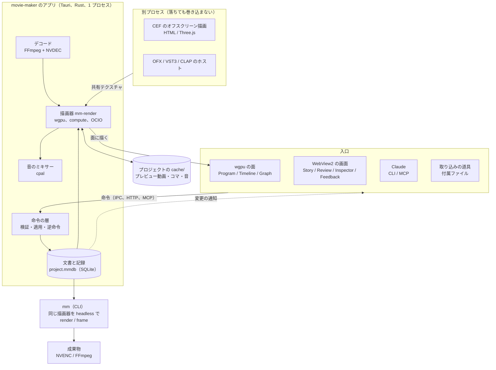

# 構成と全体像

## 構成の判断

| 軸 | A. ブラウザで描画 + ネイティブの補助プロセス | B. ネイティブの描画器 + 混成の UI（Tauri）+ 埋め込みの Chromium | C. ネイティブの描画器 + 全部ネイティブの UI（egui か Slint） |
|---|---|---|---|
| プレビューの即時性と品質 | ブラウザの中で描く。WebGL2 の制約（SDR、文脈 16 個、`VideoFrame` の往復） | wgpu の面を窓に直接置く。デコードから表示まで GPU の中で完結。RGBA16F/32F、HDR の出力も可 | B と同じ |
| プレビューと書き出しの一致 | 同じ描画器を headless Chrome で。GPU の選択が Chrome 任せ | 同じ Rust の描画器、同じ GPU、同じシェーダー。一致する | B と同じ |
| 規格への対応 | OFX、VST3、OCIO、ProRes は補助プロセスで。毎コマの往復が重いので `offline`（キャッシュ経由）に限る | 全部直接組み込める。OFX と VST3 もリアルタイムで当てられる | B と同じ |
| Web 由来の種類（HTML の文字、Three.js） | そのまま動く | CEF を埋め込み、共有テクスチャで受ける（OBS のブラウザソースの型） | B と同じ |
| 文字の多い画面（Story、Review、Inspector）の作りやすさ | HTML と CSS。Claude が直しやすい | WebView で HTML と CSS。同じ | egui/Slint で書く。表や長文の画面は手間が大きく、Claude が直す回数も増える〔推〕 |
| 直して確かめる速さ | ブラウザのリロードだけ | WebView 側はリロード、Rust 側はコンパイル（部分的な差し替えで縮める。[自動の改善](10-review-improve.md#自動の改善)） | 全部 Rust のコンパイル |
| 出先の作業 | そのまま使える（通信量が多い） | モバイル版を別に作る（Tauri は iOS と Android に出せる） | 同じ |
| 安全性 | TypeScript | Rust が核。UI の WebView は境界の外 | Rust が全部 |
| 実装の手間 | いちばん小さい | 描画器を Rust で書く。Tauri の窓に wgpu の面と WebView2 を並べる所と CEF の取り込みが難所（段階 0） | 描画器に加えて UI の部品を全部 Rust で書く |
| 先行事例 | MasterSelects（WebGPU + Rust の補助）[13] | Gyroflow（Rust の核 + wgpu + Qt/QML の UI）[9]、OBS のブラウザソース（CEF の共有テクスチャ）[6][7] | Rerun（egui + wgpu）[10]、Zed（gpui）、OpenCut の desktop（gpui、まだ空）[14] |

判断: B を採る。理由は 3 つ。

1. 品質の要（ビューアー、タイムライン、デコード、色、書き出し）を GPU の中で完結させられる。ブラウザでは `VideoFrame` の往復、WebGL2 の SDR、GPU の選択が Chrome 任せ、といった制約を抱えたままになる。
2. プロの用途の規格（OFX、VST3、OCIO、ProRes）を、キャッシュ経由の `offline` に限らず、描画器から直接リアルタイムに当てられる。
3. 文字の多い画面は WebView で作り、直す速さと Claude の直しやすさを保つ。全部ネイティブ（C）は、ビューアーとタイムラインの品質では同じだが、表や長文の画面を Rust で書く手間が上乗せになる。Rust の UI 部品が十分に育ったら、C に寄せる道は残す（Slint は wgpu のテクスチャを画像として取り込める [11]）。

「出先で作業したい」は、通信量を抑えた機能限定のモバイル版で満たす（[モバイル版](12-mobile.md)）。

## 全体像

ランタイムの分担:

| 部分 | `movie-maker`（Tauri のアプリ） | `mm`（CLI） | WebView2 の画面 | 別プロセスのホスト |
|---|---|---|---|---|
| 受け持つもの | 命令の層、文書の保存、索引、描画器、デコード、ミキサー、wgpu の面、Claude の入口（HTTP、MCP）、自動の改善の起動、ホストの管理 | 同じ描画器で書き出し（`render`）と 1 コマ（`frame`）。GUI なし | Story、Source、Media、Inspector、Review、Deliver、Feedback | CEF（HTML、Three.js の種類）、OFX、VST3、CLAP |
| 言語 | Rust | Rust（同じクレート） | TypeScript（Preact、esbuild） | Rust（CEF と OFX の C API を呼ぶ） |
| つなぎ | | アプリが動いていれば HTTP、動いていなければ `project.mmdb` | Tauri の IPC（命令とイベント） | 共有テクスチャ（D3D12 の NT ハンドル）、共有メモリ、制御はパイプ |
| 描画器 | プレビュー | 書き出しと Claude の目 | 描かない | 描いた結果を渡す |

クレートの分け方は[開発のしやすさ](14-dev-structure.md)に書く。要点は、話題ごとに口のクレート（`mm-*-api`。トレイトと型だけ）と実装のクレートを分け、実装を選んで組み立てる所を `mm-runtime` の 1 か所にすること。文書と命令のクレート（`mm-doc`、`mm-ops`）は GPU に依存せず、テストが速い。

### 名前の付け方

| もの | 名前 | 理由 |
|---|---|---|
| 製品、リポジトリのディレクトリ、アプリの実行ファイル | `movie-maker` | 人が見る所は省略しない |
| CLI の実行ファイル | `mm` | Claude と人が何度も打つ。`mm render ...` |
| クレート | `mm-` の接頭辞（`mm-doc`、`mm-render-api`） | Rust のパスと Cargo.toml に何十回も書く。`movie_maker_render_api::` は長い。wgpu の `wgpu-*`、Rerun の `re_*` [10] と同じ短い接頭辞の型 |
| 別プロセスのホストの実行ファイル | `mm-host-cef`、`mm-host-ofx`、`mm-host-audio` | クレート名と同じにして探しやすく |
| WebView の UI のパッケージ | `@mm/panels` など（`ui/` の中） | 同じ接頭辞 |

商標に当たる文字列（Windows Movie Maker のロゴ、アイコンの画像）は使わない。「ムービーメーカー」は一般名詞として使う〔推。名前を外に出すときは商標を確かめる〕。

## 技術の選び方

| 部分 | 選ぶもの |
|---|---|
| 言語 | Rust（核、ホスト、CLI、アプリ）。WebView の画面は TypeScript |
| アプリの枠 | Tauri 2（`unstable` の複数 WebView）。wgpu の面は子の HWND に自前で |
| 画面（WebView） | Preact。束ねは esbuild |
| GPU | wgpu（D3D12 を既定、Vulkan も）。シェーダーは WGSL。GLSL は naga、HLSL は DXC → SPIR-V → naga |
| デコードとエンコード | FFmpeg のライブラリ（`ffmpeg-the-third`）。NVDEC は `d3d12va` か `cuvid`、NVENC は `*_nvenc` |
| 色 | OCIO 2.5 を自前の `bindgen` で。シェーダーは GLSL → naga |
| 文字とベクター | cosmic-text、glyphon、resvg。後で vello |
| Web の種類 | CEF（`cef` クレート、tauri-apps/cef-rs [1]）。オフスクリーン描画の共有テクスチャを wgpu に取り込む |
| プラグインのホスト | `openfx-sys` の上に自前、`clack-host`、`vst3`（coupler-rs） |
| 音 | cpal、自前の DSP、`ebur128` |
| 保存 | 正本は `project.mmdb`（SQLite、`rusqlite` の `bundled`、WAL、FTS5）。版管理は `mm export` の決定的な JSON（`versions/`）。プロジェクトの配下の `cache/`（[保存の形](09-ingest-storage.md#保存の形)） |
| クレートの構成 | Cargo のワークスペース（`crates/*`、`workspace.dependencies` で版を共有 [36]）。口のクレート `mm-*-api` と実装を分け、`mm-runtime` で組み立てる |
| テスト | cargo-nextest、proptest、insta、divan、cargo-fuzz、Playwright（WebView2 を CDP で）。層は[テスト](11-testing.md) |
| 計装 | `tracing` のスパンを全クレートで。常時は `metrics.jsonl`、詳しくは Chrome の trace event（Perfetto UI）、生で見るときは Tracy。GPU は wgpu のタイムスタンプ（[計装](17-instrumentation.md)） |
| Claude の入口 | `mm`（CLI）、HTTP（axum）、MCP |

---

出典の番号（[1] など）は [references.md](references.md) を見る。
