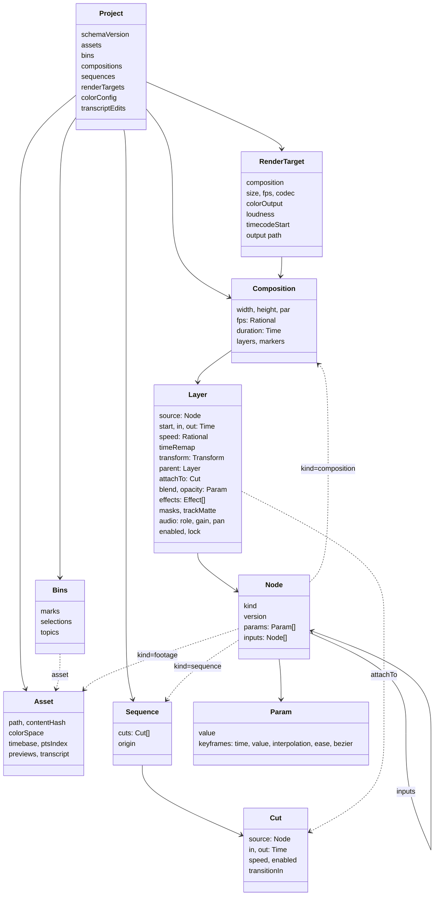

# データの形

## 時刻

- 時刻は有理数 `Time { num: i128, den: u32 }`（OTIO の `RationalTime`、FCPXML の `1001/30000s`）。fps も有理数。浮動小数の秒はプロジェクトのデータに書かない。
- 素材のフレームを選ぶ規則は 1 つ。コンポジションの時刻 t を素材の時間軸に変換した後、`floor((t - offset) * fps + 1/2^20)` でフレームの番号にする。量子化は葉で 1 回だけ。
- 可変フレームレート（VFR）の素材は、取り込みで PTS の索引を作り、プレビュー動画も PTS を保つ。
- OBS の mkv は音と映像の先頭がずれることがある。取り込みで最初の PTS の差を `timebase.offset` に記録する。
- タイムコードは SMPTE ST 12-1。ドロップフレームを含む。表示と書き出しのメタデータに使い、内部の時刻には使わない。

## 色

- 作業色空間は線形の Rec.709（primaries）、中間のテクスチャは `Rgba16Float`。精度が要る所（LUT の適用、ぼかしの蓄積）は `Rgba32Float`。アルファは中ではすべて premultiplied の線形。
- 素材ごとに入力の色空間を持つ（`Asset.colorSpace`。OCIO の名前）。取り込みで素材のタグを読み、無ければ既定（映像は `bt709`・tv レンジ、画像は sRGB）。HDR の素材（PQ、HLG）はトーンマップを明示して受ける。
- 変換は OCIO 2.5 をレンダラーのプロセスの中で直接呼ぶ。`GpuShaderDesc` に GLSL か HLSL を出させ、naga で WGSL に変換してレンダラーのシェーダーに組み込む（OCIO は GLSL、HLSL SM 5.0、MSL を出せる [16]。naga の入力は WGSL、SPIR-V、GLSL 440+ で、HLSL は入力にならない [4]）。GLSL の経路を主にし、動かなければ 3D LUT に落とす。Rust のバインディングは置き場所だけの空のクレート（`opencolorio` 0.1.0）しかないので、自前で `bindgen` を書く [15]。
- YUV→RGB は自前の compute シェーダーで行う（レンジ、行列、クロマの位置を明示）。NVDEC の NV12 を直接受ける。
- プレビュー動画と書き出しには `bt709`・tv レンジのタグを明示する。8 bit に落とす前にディザーをかける。
- 合成のガンマはコンポジションの設定で選べる。既定は線形。
- ASC CDL は WGSL で持ち、`.cube` は 3D テクスチャで適用する。CLF は OCIO 経由。
- HDR の出力は、wgpu のサーフェスを `Rgba16Float` にして、Windows の HDR の表示に乗せる〔推。段階 0 では確かめない〕。

## プロジェクト

- `assets`: 撮影素材、音、画像、文字起こし。原本のパス、コンテンツハッシュ、色空間、時間軸、取り込みで作ったものへの参照。
- `bins`: 素材の整理。下の「素材の整理と文字起こし」。
- `compositions`、`renderTargets`（形式、ラウドネスの目標、タイムコードの始まり、出力先）、`colorConfig`（OCIO の設定、作業色空間、表示の変換）。
- プロジェクトをまたぐ素材とテンプレートは、ライブラリとして参照で使う。

## 素材の整理と文字起こし

- 文字起こしの本文（単語の文字と時刻）は `project.mmdb` の `words` の表に持ち、プロジェクトのデータに入れない。本文は取り込みのツールが作り直せる結果で、数が多い（11 時間で約 10 万語）。プロジェクトのデータは素材の ID と素材の時間軸の範囲、単語の ID で本文を指す。人の判断（選別、話題、直し）だけが操作で変わり、取り消せる。
- 単語の ID は「素材のコンテンツハッシュの先頭 12 文字 + 開始の時刻」（`w_<hash>_<num>_<den>`、同じ開始の時刻の 2 つ目から `_2`）。同じ素材を取り込み直しても変わらないので、直しが付いたまま本文を入れ替えられる。
- `bins.marks`: 素材ごとのイン点とアウト点の印（Source で付ける。Premiere のソースのイン・アウトと同じく保存する）。どちらも無い印は持たない。
- `bins.selections`: 選別。素材の範囲 `[in, out)`、評価、タグ。FCP のキーワード付きの範囲と同じ形。
- `bins.topics`: 話題。素材の範囲に見出しを付けたもの。文字起こしの区間を選んで作り、Story が並べ、`insertTopics` がカットにする。評価とタグも持てる。
- 評価は FCP の Favorite / Reject と同じ 3 値（`unrated`、`favorite`、`rejected`）。タグは辞書順で重複しない文字の列。選別と話題の ID は互いに重複しない（`rate` と `tag` が ID だけで指す）。
- `transcript_edits`: 単語ごとの直し（素材、単語の ID、直した文字、消したか）。何も変えない直しは持たない。消した単語は検索と表示から外れる。`mm-store` が操作を書くたびに同じトランザクションで `words` に写す。
- 範囲と印は素材の長さの中で `in < out`。参照している素材は外せない（`Project::validate`）。
- 隙間（`lift` が残す）は透明の単色のノード（`Node::gap`）を持つカット。新しいノードの種類を足さず、今のレンダラーとミキサーのまま描けて鳴らない。Timeline は `Node::is_gap` で空きとして描く。

## コンポジションとレイヤー

- コンポジションは、大きさ、画素の縦横比、fps、長さ、背景、レイヤーの重なり、マーカーを持つ。
- レイヤーはノード（`source`）を 1 つ持ち、次を足す。時間（`start`、`in`・`out`、`speed`、`timeRemap`）、接続（`attachTo`。カットの ID。カットがリップルで動くと一緒に動く）、形（変形と `parent`）、重ね方（`blend`、`masks`、`trackMatte`）、効果の列（`effects`。ID つきのノード）、音（役割、音量、パン）、`enabled`、ロック（人が直した所を AI が上書きしないフラグ）。
- レイヤーのコンポジション上の範囲は `[start, start + (out - in) / speed)`。`speed` は正の有理数（型が 0 を拒否する。逆再生は後で足す）。`timeRemap` はレイヤーの始まりからの時刻を素材の時刻に変換する折れ線（補間はホールドと直線。有理数のまま変換する）で、あれば `in` と `speed` の代わりに使うが範囲は変えない。
- 変形（`Layer.transform`）は当面 2D で、`position`（Vec2、コンポジションの画素）、`scale`（Number か Vec2）、`rotation`（度、時計回り）、`anchor`（Vec2。無ければ画像の中心）。どれもキーフレームを持てる。レンダラーが合成で掛け、ノードの種類には渡さない。3D はカメラのフィールドを足すときに広げる。
- 合成モードは W3C Compositing and Blending Level 1 の 16 種と `add`。マスク（頂点の列を `Json` のパラメータで）とトラックマット（同じコンポジションのレイヤーのアルファか輝度）は段階 1 では型だけ。
- マーカーはコンポジションに持ち（ID、時刻、長さ、名前。時刻の厳密な昇順で、同じ時刻には 2 つ置けない）、YouTube のチャプターの書き出しに使う。
- スキーマのバージョンは 6。v1 はノードのパラメータ `transform.*` に変形を書いていた。v2 で `Layer.transform` に移し、v3 でレイヤーの時間・重ね方・効果、キーフレームのイージング、マーカー、`sequences` を足した。v4 でマーカーの時刻を厳密な昇順にした（v3 の同じ時刻のマーカーは、後ろのものを 1/1000 秒ずつ後ろへずらして上げる）。v5 で `color.lut` の LUT を素材にし、v6 で `bins` と `transcript_edits` を足した（v5 からは空で上げる）。`mm_doc::load` が上げ、`fixtures/doc/vN/` に各バージョンのフィクスチャを凍結している。

## パラメータ（時間変化）

- どのパラメータも、固定の値か、キーフレームの列（時刻の昇順）を持てる。キーフレームは時刻、値、補間（`hold`、`linear`、`bezier`）、イージング（`ease`: none、in、out、in_out。`linear` の進み具合に掛ける 2 次）、ベジェの制御点（`bezier`: CSS の `cubic-bezier(x1, y1, x2, y2)` と同じ。無ければ ease-in-out）。区間の形は始点のキーフレームで決まる。
- キーフレームがあるとき `value` は使わず、最初より前は最初の値、最後より後は最後の値。
- 型: 数、2・3 次元の数、色、真偽、文字、選択肢、素材の参照、JSON。数の型は補間でき（色は線形の premultiplied の値を成分ごとに）、それ以外はホールドだけ。
- 評価は `mm-eval`（`eval_param`、`source_time`、`place_cuts`）。プロジェクトのデータ（`mm-doc`）は形と不変条件だけ持つ。
- エクスプレッションは後で足す。「時刻 t で値を返す」形を保つ。

## 入れ子と本編とショートの関係

- コンポジションもノード（`kind: composition`、パラメータ `composition` に ID）。マグネティックシーケンスもノード（`kind: sequence`、パラメータ `sequence` に `Project.sequences` の ID）。循環と無い参照は `Project::validate` が拒否する。外の時間を中の時間に変換する。
- ショートは本編の `sequence` の一部を参照する（本編を直すとショートも変わる。カットの in/out だけショートで上書きでき、マークが付く）か、複製して分岐する（元との対応を残し、元が変わったら知らせる）。どのカットがどのショートで使われているかを本編にマークで出す。再フレーミングと字幕の置き場所は、コンポジションごとに別の値を持つ。持つ場所は `Sequence.origin`（元の sequence と、参照か複製か）と `Cut.origin`（元のカット）。段階 1 は型だけ。

## 保存の形に効く決まり

- ID は文字列で、種類ごとにプロジェクトの中で重複しない（レイヤー、カット、マーカー、効果、マスクもプロジェクト全体で）。操作の `touches` と `mm diff` が ID で指す。
- `assets`、`compositions`、`sequences`、`renderTargets` は順に意味が無い列で、`Project::normalize` が ID の順に並べる（読み込みと保存の前に通す）。レイヤー（下から上）、カット（先頭から）、マーカー（時刻の順）は順が意味なので触らない。ノードのパラメータは名前順のマップ。
- 省けるフィールド（`speed` の 1、空の `effects` など）も JSON に全部書く。

---

出典の番号（[1] など）は [references.md](references.md) を見る。
