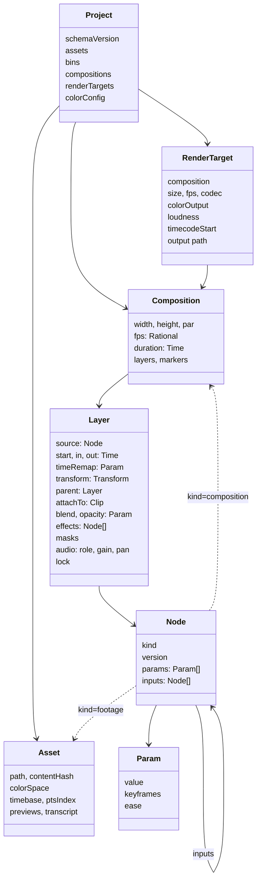

# データの形

## 時刻

- 時刻は有理数 `Time { num: i128, den: u32 }`（OTIO の `RationalTime`、FCPXML の `1001/30000s`）。fps も有理数。浮動小数の秒は文書に書かない。
- 素材のコマを選ぶ規則は 1 つ。コンポジションの時刻 t を素材の時間軸に写した後、`floor((t - offset) * fps + 1/2^20)` でコマの番号にする。量子化は葉で 1 回だけ。
- 可変フレームレート（VFR）の素材は、取り込みで PTS の索引を作り、プレビュー動画も PTS を保つ。
- OBS の mkv は音と映像の頭がずれることがある。取り込みで最初の PTS の差を `timebase.offset` に記録する。
- タイムコードは SMPTE ST 12-1。ドロップフレームを含む。表示と書き出しのメタデータに使い、内部の時刻には使わない。

## 色

- 作業色空間は線形の Rec.709（primaries）、中間のテクスチャは `Rgba16Float`。精度が要る所（LUT の適用、ぼかしの蓄積）は `Rgba32Float`。アルファは中ではすべて premultiplied の線形。
- 素材ごとに入力の色空間を持つ（`Asset.colorSpace`。OCIO の名前）。取り込みで素材のタグを読み、無ければ既定（映像は `bt709`・tv レンジ、画像は sRGB）。HDR の素材（PQ、HLG）はトーンマップを明示して受ける。
- 変換は OCIO 2.5 を描画器のプロセスの中で直接呼ぶ。`GpuShaderDesc` に GLSL か HLSL を出させ、naga で WGSL に変換して描画器のシェーダーに組み込む（OCIO は GLSL、HLSL SM 5.0、MSL を出せる [16]。naga の入力は WGSL、SPIR-V、GLSL 440+ で、HLSL は入力にならない [4]）。GLSL の経路を主にし、動かなければ 3D LUT に落とす。Rust のバインディングは置き場所だけの空のクレート（`opencolorio` 0.1.0）しかないので、自前で `bindgen` を書く [15]。
- YUV→RGB は自前の compute シェーダーで行う（レンジ、行列、クロマの位置を明示）。NVDEC の NV12 を直接受ける。
- プレビュー動画と書き出しには `bt709`・tv レンジのタグを明示する。8 bit に落とす前にディザーをかける。
- 合成のガンマはコンポジションの設定で選べる。既定は線形。
- ASC CDL は WGSL で持ち、`.cube` は 3D テクスチャで当てる。CLF は OCIO 経由。
- HDR の出力は、wgpu の面を `Rgba16Float` にして、Windows の HDR の表示に乗せる〔推。段階 0 では確かめない〕。

## プロジェクト

- `assets`: 撮影素材、音、画像、文字起こし。原本のパス、中身のハッシュ、色空間、時間軸、取り込みで作ったものへの参照。
- `bins`: 素材の整理。`selection`（素材の中の範囲）、評価、キーワード、話題。
- `compositions`、`renderTargets`（形式、ラウドネスの目標、タイムコードの始まり、出力先）、`colorConfig`（OCIO の設定、作業色空間、表示の変換）。
- プロジェクトをまたぐ素材とテンプレートは、ライブラリとして参照で使う。

## コンポジションとレイヤー

- コンポジションは、大きさ、画素の縦横比、fps、長さ、背景、レイヤーの重なり、マーカーを持つ。
- レイヤーは動画オブジェクト（`source`）を 1 つ持ち、次を足す。時間（`start`、`in`・`out`、速さ、タイムリマップ）、接続（`attachTo`。カットがリップルで動くと一緒に動く）、形（変形と親）、重ね方（合成モード、マスク、トラックマット）、効果の列、音（役割、音量、パン）、ロック（人が直した所を AI が上書きしない印）。
- 変形は当面 2D。`FrameContext` にカメラの欄を空け、3D は後で足す。
- マーカーはコンポジションに持ち、YouTube のチャプターの書き出しに使う。

## パラメータ（時間変化）

- どのパラメータも、固定の値か、キーフレームの列を持てる。キーフレームは時刻、値、補間（ホールド、直線、ベジェ）、イージング。
- 型: 数、2・3 次元の数、色、真偽、文字、選択肢、素材の参照、JSON。数の型は補間でき、それ以外はホールドだけ。
- エクスプレッションは後で足す。「時刻 t で値を返す」形を保つ。

## 入れ子と本編とショートの関係

- コンポジションも動画オブジェクト（`kind: composition`）。循環は命令の検証で断る。外の時間を中の時間に写す。
- ショートは本編の `sequence` の一部を参照する（本編を直すとショートも変わる。カットの in/out だけショートで上書きでき、印が付く）か、複製して分岐する（元との対応を残し、元が変わったら知らせる）。どのカットがどのショートで使われているかを本編に印で出す。再フレーミングと字幕の置き場所は、コンポジションごとに別の値を持つ。

---

出典の番号（[1] など）は [references.md](references.md) を見る。
