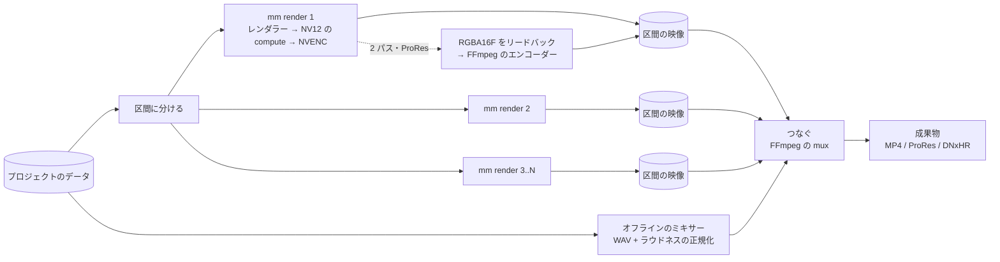

# レンダラー

- プロジェクトのデータと時刻 t から、レイヤーを評価して合成する。Rust の `mm-render`、GPU は wgpu（Windows のバックエンドは D3D12 を既定にし、Vulkan も選べる）。合成、変形、色、YUV の変換は compute シェーダー（WGSL）。中間は `Rgba16Float`、精度の要る所は `Rgba32Float`（wgpu の `TextureFormat` にある [5]）。
- 描画は UI のスレッドと分けた描画のスレッドで行い、サーフェスへの表示と書き出しは同じ経路（最後にサーフェスかリードバックかが違うだけ）。
- プロジェクトのデータの一部が変わったら、影響する時刻の範囲だけを評価し直す。`is_identity` が真の効果はスキップし、`region_of_definition` が画面の外のレイヤーは描かない。
- 合成: レイヤーの画像（効果を掛けた後）を、変形した四角形として 1 パスで重ねる。切り抜きと角丸の矩形のマスクは同じパスのフラグメントシェーダーで、レイヤーの座標での被覆率（角丸の矩形の符号つきの距離。縁の幅は出力の 1 画素か `feather` の広い方）として掛け、別のテクスチャを作らない。プレビューと書き出しは同じ合成を通る。
- GPU の選択: wgpu の `request_adapter` に `HighPerformance` を指定し、選ばれたアダプターの名前を Program に出す。
- 計測: 1 フレームの描画、レイヤーごとの評価、パスごとの GPU の時間（wgpu のタイムスタンプ）、デコードとシーク、キャッシュのヒット率、書き出しの fps を `tracing` のスパンとカウンタで取る。測る項目と予算は[計装](17-instrumentation.md)。
- デコード: FFmpeg のライブラリ（`ffmpeg-the-third`。FFmpeg 5.1〜8.1 に対応 [17]）を `mm-decode-ffmpeg` でラップし、インターフェースは `mm-decode-api`。H.264、HEVC、AV1 は NVDEC（`hwaccel`）でデコードし、ProRes、DNxHR、MXF、DPX、OpenEXR はそのまま読める。デコーダは素材ごとに 1 つを使い回すプール（同時 4〜6 本。NVDEC は 2 基で約 1,450 fps が上限）。
- NVDEC からの受け渡しは 3 段で、段階 0 で 3 つとも動いた（2026-11-06）。既定は (1)。開いた直後の数フレームで失敗する素材は (2) に切り替え、最後は (3)（ユーザーの決定。順は `mm-runtime` の設定 `auto`）。NVIDIA の d3d12va がデコードに失敗すると、プロセスの D3D12 のデバイスが全部消え、レンダラーのデバイスも使えなくなる。そのため d3d12va は、素材を開く前に別プロセスの `mm-d3d12va-probe` で先頭の 4 フレームを試し、クラッシュする素材を拒否して (2) に回す。結果は素材ごとにキャッシュする。5 フレーム目より後の失敗はこれで防げないので、レンダラーがデバイスの消失（wgpu の通知、D3D12 の消失の理由）を次のフレームの前に見つけてコンテキストごと作り直す（RFC 0009）。これを入れて `auto` を既定にした（`RuntimeConfig::real()`、2026-11-06）。4K の素材を 1080p に書き出す実測は (1) 181 fps、(2) 172 fps、(3)（YUV のまま GPU に上げる）149 fps、`auto` 166 fps で、4K のまま書き出すと x264 が上限で 52〜55 fps。プローブの実行ファイルは配布物に同梱する（無ければ (1) をスキップして (2) に回る）。4K の速度は (1) 540〜590 fps、(2) 560〜600 fps、(3) 250〜265 fps [nvdec](spikes/nvdec.md)。
  1. FFmpeg の `d3d12va` でデコードし（FFmpeg 7.0 から [18]）、D3D12 のテクスチャを `wgpu_hal::dx12::Device::texture_from_raw` → `create_texture_from_hal` で wgpu にラップする [2][3]（コピーなし）。FFmpeg には wgpu の `ID3D12Device` を渡し、同期は `Queue::add_wait_fence` で待つ。NVENC で作った 4K の HEVC はデコードできない（原因は未調査）。
  2. CUDA の `cuvid` でデコードし、D3D12 の共有バッファに `cuMemcpy2DAsync` で 1 回コピーし、共有フェンスで同期する（`cudarc` の `import_external_memory` は Win32 のハンドルを受けるが D3D12 の種類は生の `sys` で指定する [19]）。
  3. `nv12` を CPU に下ろしてアップロードする（最後の手段）。
- NVDEC のフレームは、レンダラーの `submit` が終わるまで借用にする。保持している間は FFmpeg のプールがストールするので、キャッシュに置くフレームは RGBA にする。
- エンコード: NVENC（FFmpeg の `h264_nvenc`、`hevc_nvenc`、`av1_nvenc`）。レンダラーが compute で NV12 にしたテクスチャを、上の (2) と同じ共有バッファの経路で渡す。ダメならリードバックして渡す。段階 2 の書き出しは、レンダラーが GPU で NV12 にしてリードバックを 3 枚先行させ、libx264 に NV12 のまま送る形で、1080p 154 fps（[計装の予算の表](17-instrumentation.md#予算の表)）。

## キャッシュ

- フレームのキャッシュのキー: ノードの種類、ノードの種類のバージョン、レンダラーのバージョン、評価済みのパラメータ、入力のキー、素材のコンテンツハッシュ、素材のフレームの番号（か PTS）、品質、作業色空間と OCIO の設定、画面上の大きさ。`time_varying` が偽のノードの種類は t を外す。
- フレームのキャッシュは RAM や VRAM には入らない（1080p の RGBA で 1 分 30 GB）。描いた区間を短い GOP の H.264（NVENC、ロスレスに近い cq）でエンコードして NVMe に置き、NVDEC でリードバックする。GPU の上に持つのは直近の数十フレームだけ。
- キャッシュ（プレビュー動画、フレーム、中間、音の PCM、グリフ画像、波形、サムネイル）はプロジェクトの配下の `cache/` に置く。`cache/` は丸ごと消してよく、消したら次に開いたときに作り直す（取り込みの派生物も含めて、素材の原本とプロジェクトのデータから全部作れるものだけを置く）。
- 実装の現状（段階 2、RFC 0010）: レイヤーの画像と入れ子のコンポジションの画像を GPU のテクスチャのまま覚え（既定 1 GiB）、2 回以上使われた画像が上限で追い出されたら `cache/` に退避する。操作の `touches` に頼った画像だけを捨てる。H.264 でエンコードして置く形は、プレビューの段階で作る。
- キャッシュのキーは素材のコンテンツハッシュ（`Asset.contentHash`）で引く。プロジェクトを別の場所にコピーしても、素材が同じなら当たる。
- 容量の目安: プレビュー動画は 1 時間あたり約 2.6 GB（下の「プレビュー」）、音の PCM は 48 kHz・Float32・2 ch で 1 時間あたり約 1.4 GB、フレームのキャッシュは描いた区間の長さに比例する。`Media` に `cache/` の大きさと「消す」を出す。
- 原本と `cache/` を別のドライブに分けたいときは、`cache/` をジャンクションで別の場所に向ける（この PC の Git Bash の `ln -s` はコピーになるので `cmd /c mklink /J` で）。読みと書きがぶつからなくなる見込みはレビューの 60%。

## プレビュー

- 撮影素材は、取り込みのときに NVENC で作った 960x540・GOP 3・B フレームなし・cq 28 の H.264 のプレビュー動画（`cache/preview/<contentHash>/540p.mp4`）を使う（実測: 実時間の約 11 倍で作れ、1 時間あたり約 2.6 GB）。
- 拡大するカットは 540p ではぼやける。止まっているときは原本に切り替え、拡大の大きいカットだけ 1080p のプレビュー動画を足す。
- スクラブは、ドラッグ中は縮小したフレームを先に出し、止まったら正確なフレームに差し替える。
- `realtime` でないノードの種類は、キャッシュがあれば使い、なければマークを出して先読みで描く。手を止めて数秒たったら、変わった区間を先に描いてキャッシュにためる。
- 撮影中の取り込みは、OBS の NVENC と取り合わないよう抑える。
- 再生位置の同期: 再生位置、選択、表示の倍率は Rust の 1 つの状態が持つ。wgpu のサーフェスはそれを直接読んで描き、WebView の画面にはイベントで送る（WebView から戻るのは操作とクリックだけ）。音の時計を主にして映像を合わせる。

## 音

- ミキサーは自前の DSP で、Float32・48 kHz・サンプル単位。プレビューは cpal の出力のスレッドで同じ DSP を動かし、書き出しは同じ DSP をオフラインで回す。
- 取り込みでトラックごとに区切った PCM を `cache/` に作り、カットの範囲だけ読む。
- 役割ごとのバス、バスごとの音量とメーター（ITU-R BS.1770。`ebur128` クレートは libebur128 の Rust 移植で、EBU TECH 3341・3342 のテストを通る [20]）、ダッキング。
- カットの端に数 ms のマイクロフェード。リサンプルの変換器は 1 つに固定する。
- 音量のキーフレームと音のフェード（[データ](03-data-model.md)の `fade_in`、`fade_out`）は、レンダラーが 64 サンプルごとに評価してサンプルに掛け、ミキサーには 0 dB で渡す（`mm-render` の `audio_gain.rs`）。プレビューと書き出しは同じ経路。
- 速さを変えた音は、既定ではピッチも変わる。ピッチを保つ時間伸縮は後で足す。
- 音の効果もノード（`render_audio`）。VST3 と CLAP は別プロセスのホストで動かし、共有メモリのリングバッファで音を往復させる（リアルタイム）。遅れが大きいプラグインは `offline` に切り替える。

## 書き出し

- `mm render <project> <target>` が、同じレンダラーを headless（サーフェスなし）で動かし、1 フレームずつ描く。NVENC へは GPU の中で渡す。
- 長い書き出しは区間に分け、プロセスを並行に起動して描き、つなぐ。区間ごとに再開できる。並行の数は VRAM と NVENC の数で決める。
- 細かい画質の指定（2 パス、10 bit、ProRes、DNxHR）は、リードバックして FFmpeg のエンコーダーに渡す。10 ビットの YUV へは、線形の f32 を 16 ビットの Rec.1886 の符号化値に直してから縮める（8 ビットを経由しない）。
- 実装の現状（段階 4、RFC 0015）:
  - コーデックの名前は `mm-encode-ffmpeg`（`h264`、`h264_2pass`、`prores_422hq`、`prores_4444`、`dnxhr_lb` / `sq` / `hq` / `hqx` / `444`）と `mm-encode-nvenc`（`h264_nvenc`、`hevc_nvenc`）が決める。ProRes と DNxHR は MOV に 24 ビット PCM、それ以外は MP4 に AAC。
  - NVENC は FFmpeg の `h264_nvenc` / `hevc_nvenc` を使う。GPU が作った NV12 のリードバック（3 枚先行）を CPU のメモリから渡し、GPU の中では渡さない。NVIDIA の SDK を直接使うと、セッションとバッファの管理、MP4 への多重化、コンテナと音の扱いを自前で持つことになる。NVENC の 1 セッションは 1080p で約 440〜500 fps（p4）が上限で、1 プロセスの書き出しは 449 fps（測定は [計装の予算の表](17-instrumentation.md#予算の表)）。速さを決めるのはエンコーダーのハードウェアなので、SDK を直接使っても変わらない。GPU の中で渡す経路は、レンダラーの wgpu（D3D12）のテクスチャを NVENC の入力に共有する橋が要り、上の上限の手前では利得が出ないので作っていない。
  - NVIDIA の GPU が無いと NVENC は使えないと返し、`encode: auto` の組み立てが `h264_nvenc` を libx264 の `h264` で書く。候補の作成、字幕とチャプターの受け取り、開くのどれで失敗しても次の候補へ進み、実際に書いた実装（`ffmpeg/h264` など）を書き出しの結果（`ExportSummary::encoder`）に載せる。
  - 出力先の拡張子はコーデックのコンテナに合わせる。ProRes と DNxHR は `.mov`、x264 と NVENC は `.mp4` か `.m4v` でなければ、書き出す前に拒否する。
  - MP4 の時刻はずらさない。B フレームの遅れと AAC の前置きは muxer の edit list が吸収し、映像、音、字幕、チャプターが同じ 0 から始まる（FFmpeg の既定と同じ）。
  - `--sequence` の書き出しは、sequence を置いたレイヤーの見せ方（再フレーミングと字幕の置き場所）を引き継ぐ。レンダーターゲットのコンポジションにあればそれを、無ければプロジェクトで 1 つだけのものを使う。 ミュート・音量などのレイヤーの音の設定と、そのレイヤーのコンポジションのミキサーも同じレイヤーから引き継ぐ。
  - 2 パスは同じ区間を 2 回描く（1 回目は統計だけを取り、出力を作らない）。
  - 区間の指定（`--range`、`ExportOptions::range`）の端がフレームの境界から 1/1000 フレーム以内なら境界に合わせる。秒の小数（マイクロ秒に丸める）で 1/30 秒の境界を渡しても、1 フレーム前から始まらない。
  - 並行の書き出しはプロセスではなくスレッドで行う。区間を短いチャンクに分け、`parallel` 本のワーカーがそれぞれ別の `Engine`（GPU のコンテキストは共有）で描き、呼び出した側がチャンクの番号順にエンコーダーへ送る。音は 10 秒ずつ続けて混ぜ（ミキサーの状態を持ち越すので境で切れない）、映像が止まれば音も止める。並行の効果は、エンコーダー 1 セッションの上限（NVENC の 1080p）に近いと出ない。次の手は、区間ごとに別のエンコーダーのセッションで書いて、パケットをつなぐこと（区間ごとの再開もここ）。未実装。
- 音はオフラインのミキサーで WAV に書き、レンダーターゲットのラウドネスの目標に正規化してから多重化する。
- 細かい画質の指定（2 パス、10 bit、ProRes、DNxHR）は、`Rgba16Float` をリードバックして FFmpeg のエンコーダーに渡す。
- 音はオフラインのミキサーで混ぜ、レンダーターゲットのラウドネスの目標（YouTube は -14 LUFS、放送は -23 LUFS）に正規化してから多重化する。2 パスで、1 回目に統合ラウドネスとトゥルーピークを測り（`ebur128`）、2 回目に倍率をかけ、トゥルーピークが上限（既定 -1 dBTP）を超える分を先読み 5 ms のリミッターで削る。リミッターが戻した分のラウドネスは倍率を足して合わせ直す。
- 字幕はレンダーターゲットの `delivery.subtitles` で、書き出しの隣の `.srt` と `.vtt`（`sidecar`）か、MP4 の字幕のトラック（`embedded`、mov_text）にする。コンポジションに置いた sequence のカットの文字起こしを、カットの in・out・速さとレイヤーの位置で書き出しの時間軸に写して作るので、`cutWords` で消した単語と、無効にしたレイヤーの字幕は入らない。決まりは次の表（実装は `mm-export` の `cue_text`）。文末と 0.7 秒以上の無音で区切り、読む速さに足りない表示は次の字幕の始まりまで延ばし、7 秒で読み切れない量は溜めずに区切る。話す速さが 1 秒 4 字を上回る所は延ばす余地が無く、速いまま出る。字幕を出す設定で文字起こしの DB（`project.mmdb`）が無いプロジェクトは書き出しを拒否する。要らなくなった前回の `.srt`、`.vtt`、`.chapters.txt` は消して警告に出す。

  | 項目 | この実装 | Netflix 日本語（[Japanese Timed Text Style Guide](https://partnerhelp.netflixstudios.com/hc/en-us/articles/215767517-Japanese-Timed-Text-Style-Guide)） | Netflix 共通（[Timed Text Style Guide: General Requirements](https://partnerhelp.netflixstudios.com/hc/en-us/articles/215758617-Timed-Text-Style-Guide-General-Requirements)） |
  |---|---|---|---|
  | 1 行の字数（横書き、半角は 0.5 字） | 全角 20 字 | 全角 13 字 | — |
  | 行数 | 2 行 | 2 行 | — |
  | 読む速さ | 1 秒 4 字 | 1 秒 4 字 | — |
  | 1 件の最短 | 1 秒 | 0.5 秒 | 5/6 秒 |
  | 1 件の最長 | 7 秒 | 規定なし | 7 秒 |

  1 行は、16:9 で字幕を画面幅の半分ほどに収める YouTube では 13 字より 20 字前後が読みやすいので伸ばす。最短は両方の規定より長めに取る。読む速さをレンダーターゲットで選べるようにするのは、YouTube 向けに緩めたい場面が出てから（今は定数）。焼き込み（映像に描く）は `.srt` や mov_text とは独立に選び、書き出しの字幕には含めない（下の「字幕の焼き込み」）。
- 字幕の焼き込みは `delivery.burn_in_captions` で選ぶ。上の字幕と同じ元（`composition_cues`）から、字幕 1 件につき黒い影と白い本体の `text` ノードのレイヤーを 2 つ、字幕の始まりから終わりまでのレイヤーとしてコンポジションの最上段に足したプロジェクトのデータを作り（`mm_export::burn_in_captions`）、それを描く。書き出しもアプリのプレビューも同じ関数の結果を描くので、時刻、位置、大きさが一致する。字を描くのは既存の `text` ノードで、新しい描画系は持たない。置き場所は最初の有効な sequence のレイヤーの `setCaption`（帯の下端の中央と幅）、無ければ下部中央（幅は画面の 9 割、下から高さの 8 %）。字の大きさは短い辺の 4.5 %。字幕は全長から作るので、書き出す区間によらず同じ時刻に同じ字幕が出る。焼き込む設定で文字起こしが渡されていなければ書き出しを拒否する。キーフレームを持つ `setCaption` の値は、基準の値だけを使う。
- チャプターは `delivery.chapters` で、コンポジションのマーカーを MP4 のチャプターにし、YouTube の説明欄に貼る `<出力>.chapters.txt`（`00:00 タイトル`）も置く。YouTube の決まり（最初は 00:00、3 つ以上、各 10 秒以上）を満たさないときは文字列だけを出さず、警告に理由を返す。
- 入れ子と sequence のレイヤーの音は、中を別のミキサーで 1 本に混ぜて親に渡す。sequence は有効なカットを、映像と同じくカットの位置・イン点・速さを持つレイヤーとして混ぜる。境のトランジションは音に掛けず、境で切り替える。
- 書き出し中は、自動の改善によるアプリの差し替えを待たせる。

## Claude の目

- `mm frame <project> <comp> <time> --out x.png`（1 フレーム）、`mm render --range` （区間）。アプリが動いていれば同じレンダラーを HTTP で頼み、動いていなければ CLI が自分で描く。
- 音は書き出した区間を測るツール（DTM_Vlog の `listen.py`、`seams.py` の型）を移す。数値の点検（無音、つなぎ目、ラウドネス）は対応のトランザクションに注釈として付く。

---

出典の番号（[1] など）は [references.md](references.md) を見る。
