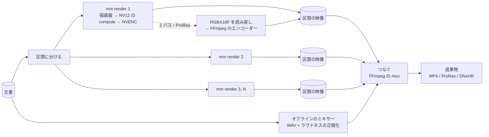

# 描画器

- 文書と時刻 t から、レイヤーを評価して合成する。Rust の `mm-render`、GPU は wgpu（Windows の裏は D3D12 を既定にし、Vulkan も選べる）。合成、変形、色、YUV の変換は compute シェーダー（WGSL）。中間は `Rgba16Float`、精度の要る所は `Rgba32Float`（wgpu の `TextureFormat` にある [5]）。
- 描画は UI のスレッドと分けた描画のスレッドで行い、面への表示と書き出しは同じ経路（最後に面か読み戻しかが違うだけ）。
- 文書の一部が変わったら、影響する時刻の範囲だけを評価し直す。`is_identity` が真の効果は飛ばし、`region_of_definition` が画面の外のレイヤーは描かない。
- GPU の選択: wgpu の `request_adapter` に `HighPerformance` を指定し、選ばれたアダプターの名前を Program に出す。
- デコード: FFmpeg のライブラリ（`ffmpeg-the-third`。FFmpeg 5.1〜8.1 に対応 [17]）を `mm-decode-ffmpeg` で囲い、口は `mm-decode-api`。H.264、HEVC、AV1 は NVDEC（`hwaccel`）で復号し、ProRes、DNxHR、MXF、DPX、OpenEXR はそのまま読める。デコーダは素材ごとに 1 つを使い回すプール（同時 4〜6 本。NVDEC は 2 基で約 1,450 fps が上限）。
- NVDEC からの受け渡しは 3 段で試す（段階 0）。(1) FFmpeg の `d3d12va` で復号し（FFmpeg 7.0 から [18]）、D3D12 のテクスチャを `wgpu_hal::dx12::Device::texture_from_raw` → `create_texture_from_hal` で wgpu に包む [2][3]（コピーなし）。(2) CUDA の `cuvid` で復号し、wgpu の D3D12 のテクスチャを共有ヒープで作って CUDA の外部メモリに取り込み、`cuMemcpy2D` で 1 回コピーする（`cudarc` の `import_external_memory` は Win32 のハンドルを受けるが D3D12 の種類は生の `sys` で指定する [19]）。(3) `nv12` を CPU に下ろしてアップロードする（最後の手段）。
- エンコード: NVENC（FFmpeg の `h264_nvenc`、`hevc_nvenc`、`av1_nvenc`）。描画器が compute で NV12 にしたテクスチャを、(1) と同じ外部メモリの経路で渡す。ダメなら読み戻して渡す。

## キャッシュ

- コマのキャッシュのキー: 種類、種類の版、描画器の版、評価済みのパラメータ、入力のキー、素材の中身のハッシュ、素材のコマの番号（か PTS）、品質、作業色空間と OCIO の設定、画面上の大きさ。`time_varying` が偽の種類は t を外す。
- コマのキャッシュは RAM や VRAM には入らない（1080p の RGBA で 1 分 30 GB）。描いた区間を短い GOP の H.264（NVENC、ロスレスに近い cq）で符号化して NVMe に置き、NVDEC で読み戻す。GPU の上に持つのは直近の数十コマだけ。
- キャッシュ（プレビュー動画、コマ、中間、音の PCM、文字の絵、波形、サムネイル）はプロジェクトの配下の `cache/` に置く。`cache/` は丸ごと消してよく、消したら次に開いたときに作り直す（取り込みの派生物も含めて、素材の原本と文書から全部作れるものだけを置く）。
- キャッシュのキーは素材の中身のハッシュ（`Asset.contentHash`）で引く。プロジェクトを別の場所に写しても、素材が同じなら当たる。
- 容量の目安: プレビュー動画は 1 時間あたり約 2.6 GB（下の「プレビュー」）、音の PCM は 48 kHz・Float32・2 ch で 1 時間あたり約 1.4 GB、コマのキャッシュは描いた区間の長さに比例する。`Media` に `cache/` の大きさと「消す」を出す。
- 原本と `cache/` を別のドライブに分けたいときは、`cache/` をジャンクションで別の場所に向ける（この PC の Git Bash の `ln -s` は写しになるので `cmd /c mklink /J` で）。読みと書きがぶつからなくなる見込みはレビューの 60%。

## プレビュー

- 撮影素材は、取り込みのときに NVENC で作った 960x540・GOP 3・B フレームなし・cq 28 の H.264 のプレビュー動画（`cache/preview/<contentHash>/540p.mp4`）を使う（実測: 実時間の約 11 倍で作れ、1 時間あたり約 2.6 GB）。
- 拡大するカットは 540p ではぼやける。止まっているときは原本に切り替え、拡大の大きいカットだけ 1080p のプレビュー動画を足す。
- スクラブは、ドラッグ中は縮小したコマを先に出し、止まったら正確なコマに差し替える。
- `realtime` でない種類は、キャッシュがあれば使い、なければ印を出して先回りで描く。手を止めて数秒たったら、変わった区間を先に描いてキャッシュにためる。
- 撮影中の取り込みは、OBS の NVENC と取り合わないよう抑える。
- 再生位置の同期: 再生位置、選択、表示の倍率は Rust の 1 つの状態が持つ。wgpu の面はそれを直接読んで描き、WebView の画面にはイベントで送る（WebView から戻るのは命令とクリックだけ）。音の時計を主にして映像を合わせる。

## 音

- ミキサーは自前の DSP で、Float32・48 kHz・サンプル単位。プレビューは cpal の出力のスレッドで同じ DSP を動かし、書き出しは同じ DSP をオフラインで回す。
- 取り込みでトラックごとに区切った PCM を `cache/` に作り、カットの範囲だけ読む。
- 役割ごとのバス、バスごとの音量とメーター（ITU-R BS.1770。`ebur128` クレートは libebur128 の Rust 移植で、EBU TECH 3341・3342 のテストを通る [20]）、ダッキング。
- カットの端に数 ms のマイクロフェード。リサンプルの変換器は 1 つに固定する。
- 速さを変えた音は、既定ではピッチも変わる。ピッチを保つ時間伸縮は後で足す。
- 音の効果も動画オブジェクト（`render_audio`）。VST3 と CLAP は別プロセスのホストで動かし、共有メモリのリングバッファで音を往復させる（リアルタイム）。遅れが大きいプラグインは `offline` に切り替える。

## 書き出し

- `mm render <project> <target>` が、同じ描画器を headless（面なし）で動かし、1 コマずつ描く。NVENC へは GPU の中で渡す。
- 長い書き出しは区間に分け、プロセスを並行に起動して描き、つなぐ。区間ごとに再開できる。並行の数は VRAM と NVENC の数で決める。
- 細かい画質の指定（2 パス、10 bit、ProRes、DNxHR）は、`Rgba16Float` を読み戻して FFmpeg のエンコーダーに渡す。
- 音はオフラインのミキサーで WAV に書き、レンダーターゲットのラウドネスの目標に正規化してから詰める。
- 書き出し中は、自動の改善によるアプリの差し替えを待たせる。

## Claude の目

- `mm frame <project> <comp> <time> --out x.png`（1 コマ）、`mm render --range` （区間）。アプリが動いていれば同じ描画器を HTTP で頼み、動いていなければ CLI が自分で描く。
- 音は書き出した区間を測る道具（DTM_Vlog の `listen.py`、`seams.py` の型）を移す。数値の点検（無音、つなぎ目、ラウドネス）は対応のまとまりに注釈として付く。

---

出典の番号（[1] など）は [references.md](references.md) を見る。
