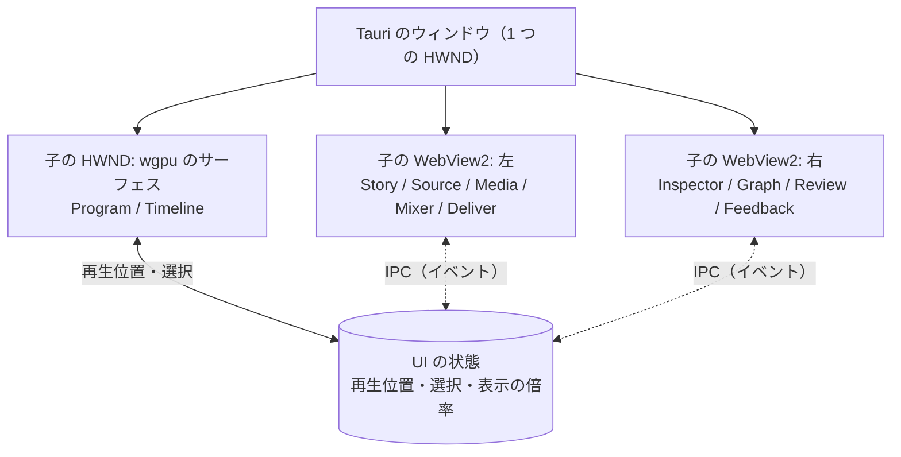

# UI

パネルの組み合わせで、どの作業も 1 つの画面で進める。どのパネルも同じプロジェクトのデータを見る。再生位置と選択は全体で 1 つ。文言は英語。

| パネル | 作る場所 | 内容 |
|---|---|---|
| `Program` | wgpu | プログラムモニター。選ばれた GPU の名前、未描画のマーク、HDR |
| `Timeline` | wgpu | `sequence` のカットと接続したレイヤー。端のつまみ、刃、スナップ、マーカー、AI が変えた所の色、ショートで使っているカットのマーク。数千のカットと波形を 60 fps で |
| `Graph` | WebView（SVG） | 選んだパラメータの値の曲線。キーとベジェのハンドルのドラッグ（[RFC 0077](../rfcs/0077-keyframe-graph.md)） |
| `Mixer` | WebView | トラック（音を持てるレイヤー）ごとの音量・パン・ミュート・ソロ・送り先のバス、役割ごとのバスの音量、ダッキング、マスターの音量。メーターはトラックとマスターのピーク、マスターの短期・統合ラウドネスとトゥルーピーク |
| `Source` | wgpu（映像）+ WebView（一覧） | 素材を見て I/O で範囲を付ける |
| `Inspector` | WebView | 選んだもののパラメータの入力フィールド。スキーマから作る |
| `Story` | WebView | 文字起こしを読み、範囲を選んで `selection` に。使っている・使っていないの色分け、採用・却下・保留を 1 キーで、話題の概観、検索、収録の中の編集者への指示のマーク |
| `Transition` | WebView | シーケンスのカットを長さに比例して並べ、境のトランジションの印と種類を出す。選んだカットの頭に、パックのトランジションの種類と長さを選ぶ・外す（1 操作が `setTransition` 1 回） |
| `Review` | WebView | 時刻・範囲・描き込みのコメント、返信、承認。AI の対応 1 回を前後 2 秒ずつ続けて再生。数値の点検の注釈 |
| `Media`、`Deliver` | WebView（別画面） | 素材の一覧と取り込みの進み具合。レンダーターゲットと書き出しの進み具合 |
| `Feedback` | WebView（右下） | 改善要望の受け付け。画面の部品を指して添付できる |

- ウィンドウの組み立て: Tauri の `unstable` の機能で 1 つのウィンドウに複数の子 WebView を置き [25]、wgpu のサーフェスは Tauri のウィンドウの HWND の下に自前の子 HWND を作って、そこに `wgpu::Surface` を張る。WebView2 の透過は Windows で当てにならないので（黒くなる報告がある [26]）、重ねずに並べる。領域の境目はドラッグで動かし、Rust が両方の矩形を更新する。
- 描き込み（Review の点と矩形）は Program の上に wgpu で描く。WebView から Program の上に何かを重ねることはしない。
- AI の変更は「対応 1 回」の提案として保留され（[操作の「提案」](05-ops.md#提案)）、Review が一覧（だれが、操作の要約、範囲）と承認・一部の承認・却下・取り消しを出す。保留中は Program を「提案を当てた絵」と「元の絵」で切り替えられる。
- Deliver の書き出し: レンダーターゲットはコンポジションを指す形のまま（本編とショートはそれぞれのコンポジションを持つ）で、書き出しの依頼の `sequence` の上書きは依頼の全体に 1 つ。縦長のプリセット（Shorts）は縦長のコンポジションを既定に選ぶ。コマンドの形は `ui/sdk/README.md`。
- キー操作は J/K/L、I/O、刃（`B`）、矢印、`[` `]` を先に。wgpu のサーフェスと WebView のどちらにフォーカスがあっても同じ操作になるよう、キーの表は Rust が 1 つ持つ。
- Timeline と Source の入力と、それが出す操作（`apps/movie-maker/src/sequence_edit.rs` が計画し、`edit::submit` が適用する。取り消しは `Ctrl+Z`、やり直しは `Ctrl+Y`）。

  | 入力 | 操作 |
  |---|---|
  | カットの入/出つまみのドラッグ | `ripple`（スナップ: 他のカットの端、レイヤーの端、再生位置） |
  | Alt を押してカットの端 | `roll`（出つまみは次との編集点、入つまみは前との編集点） |
  | カットの中のドラッグ | `slip`（中身がポインターについてくる向き） |
  | Shift + カットの中 | `slide` |
  | レイヤー（sequence 以外）の端 | `trimLayer` |
  | `,` / ボタン | `insert`（再生位置に近い編集点へ。Source の範囲） |
  | `.` / ボタン | `overwrite`（選んだカット、なければ再生位置のカット） |
  | `B` | `split`（再生位置） |
  | `Delete` / `Backspace` | `lift` / `extract`（選んだカット） |
  | `I` / `O` | `markIn` / `markOut`（Source の位置） |
  | `J` `K` `L` | 逆再生（映像のみ）/ 停止 / 再生（Source を選んでいれば Source） |

  sequence の長さが変わる編集（`insert`、`extract`、`ripple`、`insertTopics` など）は、sequence を置いたレイヤーのアウト点とコンポジションの長さも同じトランザクションで合わせる（`fitLayer`、[操作](05-ops.md)）。取り消し 1 回で戻る。
- スナップ、名前付きバージョン（`mm export --name`）と `mm diff` の意味の差分、操作ごとの自動保存とクラッシュからの復元（[保存の形](09-ingest-storage.md#バックアップと復旧)）。

## 優先度と Windows XP 風の採り方

優先度は、使いやすいこと > 高速なこと > Windows XP のムービーメーカー風であること。3 つがぶつかったら上を採る。

| XP のムービーメーカーの要素 | 採る | 採らない | 理由 |
|---|---|---|---|
| 配色（Luna の青。ウィンドウの地は `#ece9d8`、強調は `#316ac5`、Tahoma 系の字） | 既定のテーマにする。durun-dashboard の XP スキンと同じ値を使う（`:root[data-skin="xp"]` の変数 [38]） | ダークの OS でも明るい配色を強いること。テーマは切り替えられるようにし、`default`（暗い）も持つ | 結合したときに dashboard と同じ見え方になる。ユーザーが暗い画面で長く作業する日もある |
| ベベルと角丸 3 px のボタン、白から薄い青へのグラデーションの見出し | WebView の画面と wgpu のサーフェスの両方で描く | | 雰囲気の要。描くのは軽い |
| 左の作業ウィンドウ（Movie Tasks。手順を上から並べ、クリックで進む）〔推。XP のムービーメーカー 2 の記憶〕 | `Tasks` パネルとして持つ。取り込む → 切る → 文字と音を足す → 書き出す、の順に並べ、各項目が対応するパネルとマクロを開く。dashboard の `.xp-task-title`・`.xp-task-body` と同じ形 [38] | 作業ウィンドウからしかたどり着けない機能を作ること。全部の機能はキー操作とパネルからも届く | 初めての人の道しるべになる。慣れた人の邪魔にはしない |
| ストーリーボード（カットをサムネイルで横に並べる） | `Timeline` の表示の 1 つとして持つ（`sequence` のカットを等幅のカードで。トランジションはカードの間の小さな箱） | 時間に比例する表示の代わりにすること | 並び替えだけなら速く、話の流れを見るのに向く |
| 単色の背景の「コレクション」の一覧 | `Media` の見た目に合わせる | | |
| 中央のモニターと右の再生の操作 | `Program` は wgpu で描き、操作の列だけ XP 風の形に | 映像の上に飾りを重ねること | 速さと見え方を損なわない |
| ロゴ、アイコンの画像、フィルムの飾り | 自前で描く（dashboard と同じく CSS か、小さな SVG）。商標のロゴと画像はコピーしない | | |
| 効果の一覧のプレビューの小さな動画 | 後で。`shader.wgsl` のトランジションをフィクスチャの素材で描いた短い動画を出す | | |

- テーマの値（色、角丸、字、ベベルの線）は 1 つのファイル（`ui/theme/theme.json`）に置き、WebView の CSS 変数と wgpu のサーフェスの描画の両方がそこから読む。境目で色が食い違わない。
- 選択と操作の道: Timeline（wgpu）で選んだレイヤーは、Rust が共有状態に置き、Tauri のイベント `mm:layer-selected` で WebView に送る（選んだレイヤーの中身と素材の一覧。編集で中身が変わったときも送り直す）。Inspector の値の変更は `apply_op` で再生スレッドに届き、適用の後にプロジェクトのデータを置き直して、Timeline のモデルとレイヤーの一覧が追いつく。開いているコンポジションを消す操作は拒否する。
- Mixer の道: フェーダーとつまみは離したときに 1 回だけ `setLayerAudio`（レイヤーの音の設定の全体）か `setMixer`（コンポジションのミキサーの設定の全体）を `apply_ops` で送り、取り消し 1 回で戻る。メーターは、再生スレッドが音を先読みで混ぜるたびに区間ごとの値（トラックのピーク、マスターのピークとラウドネス）を記録し、再生位置を送る同期のスレッドが鳴っている位置の区間を選んで Tauri のイベント `mm:mixer-meters` で送る（60 Hz）。メーターは数十本の棒と数字なので、wgpu のサーフェスに置かず WebView で描く。
- 色の表示の式: 線形の光と画面の値の変換は Rec.1886（`v^2.4`、黒のオフセットなし）の 1 つだけ。`Program` のシェーダー、書き出しの `bt709`、Inspector の色選択（`ui/panels/inspector/src/color.ts`）が同じ式を使うので、選んだ `#101010` は `Program` にも `#101010` で出る。テーマと UI の部品の色（`theme.json`）は画面の値をそのまま指定し、変換しない。
- 使いやすさで XP 風より優先するもの: J/K/L とキー操作、ドラッグの滑らかさ（60 fps）、数千のカットの `Timeline`、パネルの大きさの変更、Inspector の入力フィールドの密度（XP の大きな余白はとらない）。
- durun-dashboard と結合したときは、dashboard のスキンが `xp` なら movie-maker も `xp`、`default` なら `default` にそろえる〔推。結合の設計で決める〕。

---

出典の番号（[1] など）は [references.md](references.md) を見る。
