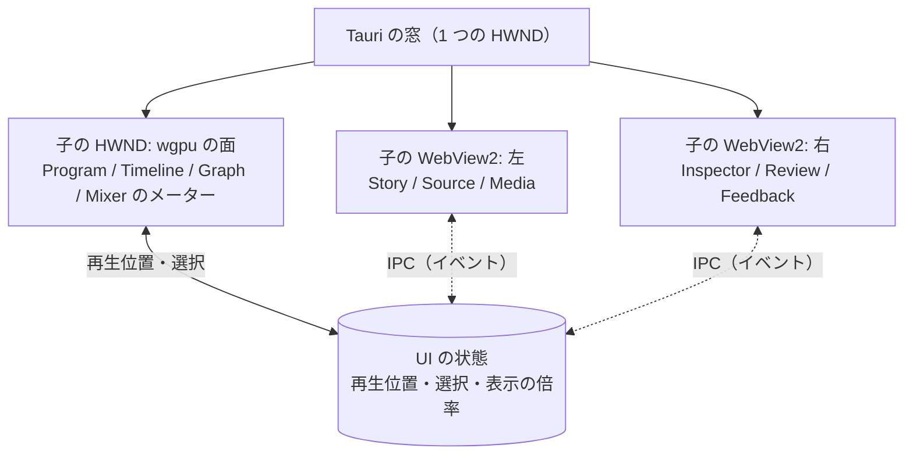

# UI

パネルの組み合わせで、どの作業も 1 つの画面で進める。どのパネルも同じ文書を見る。再生位置と選択は全体で 1 つ。文言は英語。

| パネル | 作る場所 | 中身 |
|---|---|---|
| `Program` | wgpu | プログラムモニター。選ばれた GPU の名前、未描画の印、HDR |
| `Timeline` | wgpu | `sequence` のカットと接続したレイヤー。端のつまみ、刃、スナップ、マーカー、AI が変えた所の色、ショートで使っているカットの印。数千のカットと波形を 60 fps で |
| `Graph` | wgpu | キーフレームとイージングの曲線 |
| `Mixer` | wgpu（メーター）+ WebView（フェーダー） | 役割ごとのバス、LUFS、ダッキング |
| `Source` | wgpu（映像）+ WebView（一覧） | 素材を見て I/O で範囲を付ける |
| `Inspector` | WebView | 選んだもののパラメータの編集欄。スキーマから作る |
| `Story` | WebView | 文字起こしを読み、範囲を選んで `selection` に。使っている・使っていないの色分け、採用・却下・保留を 1 キーで、話題の概観、検索、収録の中の編集者への指示の印 |
| `Review` | WebView | 時刻・範囲・描き込みのコメント、返信、承認。AI の対応 1 回を前後 2 秒ずつ続けて再生。数値の点検の注釈 |
| `Media`、`Deliver` | WebView（別画面） | 素材の一覧と取り込みの進み具合。レンダーターゲットと書き出しの進み具合 |
| `Feedback` | WebView（右下） | 改善要望の入口。画面の部品を指して添付できる |

- 窓の組み立て: Tauri の `unstable` の機能で 1 つの窓に複数の子 WebView を置き [25]、wgpu の面は Tauri の窓の HWND の下に自前の子 HWND を作って、そこに `wgpu::Surface` を張る。WebView2 の透過は Windows で当てにならないので（黒くなる報告がある [26]）、重ねずに並べる。領域の境目はドラッグで動かし、Rust が両方の矩形を更新する。
- 描き込み（Review の点と矩形）は Program の上に wgpu で描く。WebView から Program の上に何かを重ねることはしない。
- AI の変更は「対応 1 回」のまとまりで見え、まとまりごとに承認・却下・取り消しできる。
- キー操作は J/K/L、I/O、刃（`B`）、矢印、`[` `]` を先に。wgpu の面と WebView のどちらにフォーカスがあっても同じ命令になるよう、キーの表は Rust が 1 つ持つ。
- スナップ、名前つきのスナップショットと差分、自動保存とクラッシュからの復元。

## 優先度と Windows XP 風の採り方

優先度は、使いやすいこと > 高速なこと > Windows XP のムービーメーカー風であること。3 つがぶつかったら上を採る。

| XP のムービーメーカーの要素 | 採る | 採らない | 理由 |
|---|---|---|---|
| 配色（Luna の青。窓の地は `#ece9d8`、強調は `#316ac5`、Tahoma 系の字） | 既定のテーマにする。durun-dashboard の XP スキンと同じ値を使う（`:root[data-skin="xp"]` の変数 [38]） | ダークの OS でも明るい配色を強いること。テーマは切り替えられるようにし、`default`（暗い）も持つ | 結合したときに dashboard と同じ見え方になる。ユーザーが暗い画面で長く作業する日もある |
| ベベルと角丸 3 px のボタン、白から薄い青へのグラデーションの見出し | WebView の画面と wgpu の面の両方で描く | | 雰囲気の要。描くのは軽い |
| 左の作業ウィンドウ（Movie Tasks。手順を上から並べ、クリックで進む）〔推。XP のムービーメーカー 2 の記憶〕 | `Tasks` パネルとして持つ。取り込む → 切る → 文字と音を足す → 書き出す、の順に並べ、各項目が対応するパネルとマクロを開く。dashboard の `.xp-task-title`・`.xp-task-body` と同じ形 [38] | 作業ウィンドウからしかたどり着けない機能を作ること。全部の機能はキー操作とパネルからも届く | 初めての人の道しるべになる。慣れた人の邪魔にはしない |
| ストーリーボード（カットをサムネイルで横に並べる） | `Timeline` の表示の 1 つとして持つ（`sequence` のカットを等幅の札で。トランジションは札の間の小さな箱） | 時間に比例する表示の代わりにすること | 並び替えだけなら速く、話の流れを見るのに向く |
| 単色の背景の「コレクション」の一覧 | `Media` の見た目に寄せる | | |
| 中央のモニターと右の再生の操作 | `Program` は wgpu で描き、操作の列だけ XP 風の形に | 映像の上に飾りを重ねること | 速さと見え方を損なわない |
| ロゴ、アイコンの画像、フィルムの飾り | 自前で描く（dashboard と同じく CSS か、小さな SVG）。商標のロゴと画像は写さない | | |
| 効果の一覧のプレビューの小さな動画 | 後で。`shader.wgsl` のトランジションを見本の素材で描いた短い動画を出す | | |

- テーマの値（色、角丸、字、ベベルの線）は 1 つのファイル（`ui/theme/theme.json`）に置き、WebView の CSS 変数と wgpu の面の描画の両方がそこから読む。境目で色が食い違わない。
- 使いやすさで XP 風より優先するもの: J/K/L とキー操作、ドラッグの滑らかさ（60 fps）、数千のカットの `Timeline`、パネルの大きさの変更、Inspector の編集欄の密度（XP の大きな余白はとらない）。
- durun-dashboard と結合したときは、dashboard のスキンが `xp` なら movie-maker も `xp`、`default` なら `default` にそろえる〔推。結合の設計で決める〕。

---

出典の番号（[1] など）は [references.md](references.md) を見る。
