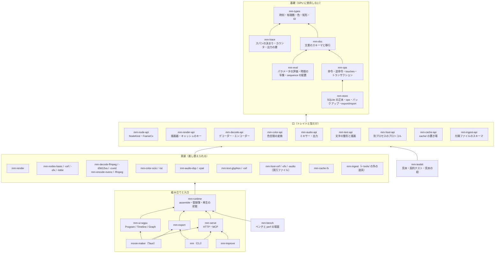

# 開発のしやすさ

独立した話題を並行に開発でき、品質のために作り直すときも他の話題を壊さない構成にする。要点は 3 つ。話題ごとにクレートを分けて依存を一方向にする。話題ごとに口（トレイトと型だけのクレート `mm-*-api`）と実装（差し替えられるクレート）を分ける。実装を選んで組み立てる所を `mm-runtime` の 1 か所にする。

## 話題と依存



図は矢印の元が先に依存する。規則は 4 つ。

1. 基礎は GPU と FFmpeg に依存しない。`cargo test` が数秒で回る。`mm-trace` も基礎で、`tracing` と出力の層だけを持つ。実装と組み立てはこれを使ってスパンを置き、口のクレートは置かない（[計装](17-instrumentation.md#スパンの決まり)）。wgpu のタイムスタンプを読む所は `mm-render` に置き、`mm-trace` には wgpu を入れない。
2. 口は基礎だけに依存する。口と口の間では、上の図に書いた型の共有（`FrameCx` が `mm-decode-api` の `FrameSource` を持つ、など）だけを認め、実装には依存しない。
3. 実装は口と基礎に依存し、ほかの実装には依存しない。`mm-nodes-basic` が素材を読むときは `mm-decode-api` のトレイトを `FrameCx` 経由で受け取る。`mm-render` が色を変えるときも `mm-color-api` 経由。
4. 実装を選ぶのは `mm-runtime` だけ。入口（アプリ、CLI、サーバー、自動の改善）は `mm-runtime` の組み立てた `Engine` を受け取る。

循環は `cargo` が断る（クレート間の循環依存はビルドできない）ので、この図のとおりに分けていれば起きない。クレートの中のモジュールの循環は、口と実装を別のクレートに置くことで防ぐ。

## ディレクトリの木

```
movie-maker/
  Cargo.toml            ワークスペース。members = ["crates/*", "apps/*"]。workspace.dependencies で外のクレートの版を 1 か所に [36]
  rust-toolchain.toml   Rust の版を固定
  crates/
    mm-types/           時刻（有理数）、色、矩形、ID、ParamSchema、エラー。依存なし
    mm-doc/             文書（Project、Composition、Layer、Node、Param）の serde、スキーマの版と移行
    mm-eval/            時刻 t でのパラメータの値、キーフレームの補間、時間の写像、sequence のカットの配置（純関数）
    mm-ops/             命令（1 命令 1 ファイル）、検証・適用・逆命令・touches、トランザクション
    mm-store/           project.mmdb（rusqlite）の読み書き。表と DDL の移行、ops と undo_stack の記録、1 つの書き手の印（.mm/lock）、WAL とチェックポイント、バックアップ（VACUUM INTO）、FTS5 の検索、決定的な JSON の export と import、mm diff、同期のフォルダーの検出
    mm-trace/           計装。スパンの決まり（名前、レベル、フィールド）、counter!/gauge!、出力の層（metrics.jsonl、Chrome の trace、Tracy、ETW）、時計の補正、負担の見張り、JSON Schema。依存は tracing と tracing-subscriber だけ
    mm-node-api/        NodeKind、FrameCx、AudioCx、Traits、FrameRef、GPU のヘルパーのトレイト
    mm-render-api/      Renderer（コンポジションと t からコマ）、Scheduler、コマのキャッシュのキー
    mm-decode-api/      Decoder（開く、シーク、コマをテクスチャか CPU で）、Encoder、FrameSource
    mm-color-api/       ColorTransform（入力の色空間 → 作業空間 → 表示・出力。WGSL か 3D LUT を返す）
    mm-audio-api/       Mixer、AudioSink、AudioBlock、ラウドネスのメーター
    mm-text-api/        TextShaper（整形と行組み）、TextRasterizer
    mm-host-api/        別プロセスのプロトコル（起動、共有テクスチャの受け渡し、時間切れ、再起動）
    mm-cache-api/       CacheStore（キーで引く、置く、大きさ、消す）
    mm-ingest-api/      付属ファイルの JSON Schema と型
    mm-render/          描画器の実装（wgpu、compute の合成、変形の折りたたみ、ベクターの倍率）
    mm-nodes-basic/     footage、audio、image、solid、shape、svg、composition、sequence、text、shader.wgsl、color.*
    mm-nodes-cef/       web.cef（mm-host-cef に頼む側）
    mm-nodes-ofx/       ofx（mm-host-ofx に頼む側）
    mm-nodes-lottie/    lottie
    mm-decode-ffmpeg/   FFmpeg のライブラリ。CPU の復号と、ProRes・DNxHR・EXR の読み
    mm-decode-d3d12va/  NVDEC を d3d12va で。コピーなしで wgpu に包む
    mm-decode-cuvid/    NVDEC を cuvid で。CUDA の外部メモリで 1 コピー
    mm-encode-nvenc/    NVENC（GPU の中で渡す）
    mm-encode-ffmpeg/   ProRes、DNxHR、2 パス（読み戻して渡す）
    mm-color-ocio/      OCIO 2.5 の bindgen と、GLSL → naga → WGSL
    mm-color-lut/       ASC CDL と .cube を WGSL で。OCIO が動かないときの 3D LUT の逃げ道
    mm-audio-dsp/       自前の DSP のミキサー、バス、ダッキング、ebur128
    mm-audio-cpal/      cpal の出力（プレビュー）
    mm-text-glyphon/    cosmic-text + glyphon
    mm-text-cef/        HTML のテンプレートを mm-host-cef で描く
    mm-host-cef/        実行ファイル。CEF のオフスクリーン描画 → 共有テクスチャ
    mm-host-ofx/        実行ファイル。OpenFX のホスト
    mm-host-audio/      実行ファイル。VST3 と CLAP のホスト
    mm-cache-fs/        <project>/cache/ の実装（contentHash で引く、大きさ、消す）
    mm-ingest/          取り込みの流れ（ハッシュ、プレビュー動画、波形、サムネイル、外の道具の起動、付属ファイルの取り込み）
    mm-runtime/         assemble()（実装を選んで Engine を作る）、種類の登録簿、再生の状態（再生位置、選択）
    mm-export/          レンダーターゲット → 区間 → 並行の描画 → mux、ラウドネスの正規化、字幕とチャプター
    mm-serve/           HTTP（axum）と MCP。命令と描画を外に出す
    mm-ui-layout/       wgpu の面の計算（端のつまみ、スナップ、範囲）。純関数
    mm-ui-wgpu/         Program、Timeline、Graph、メーターの描画と入力
    mm-improve/         自動の改善の回（worktree、claude -p、検査、取り込み）
    mm-testkit/         見本のプロジェクト、見本の素材の生成、契約テストの本体、見本の絵の比較、gpu_contract!、soak の実行ファイル
    mm-bench/           性能。divan のベンチ（基礎の層）と、mm perf run の場面（playback、scrub、export、startup）。結果の比較と履歴は mm-trace の形で
  fuzz/                 cargo-fuzz の目標（versions/ の JSON、命令の引数、壊した project.mmdb、付属ファイル、字幕、OTIO、壊れた動画）と corpus/
  xtask/                開発の道具（golden-update、perf の履歴の整理）
  apps/
    movie-maker/        Tauri のアプリ。窓の組み立て、子 HWND、IPC
    mm/                 CLI（render、frame、op、ingest、serve）
  ui/                   WebView の画面（pnpm のワークスペース、TypeScript、Preact、esbuild）
    theme/              theme.json（色、角丸、字、ベベル）と、CSS 変数に出す生成器。wgpu の面も同じ JSON を読む
    sdk/                Tauri の IPC と HTTP のクライアント。命令と型は mm-ops の JSON Schema から生成
    panels/
      story/            文字起こしのストーリー
      review/           コメント、承認
      inspector/        スキーマから作る編集欄
      media/            素材の一覧、取り込み、cache/ の大きさ
      deliver/          レンダーターゲットと書き出し
      feedback/         改善要望の入口
      tasks/            XP 風の作業ウィンドウ
    shell/              パネルを束ねて WebView に載せる入口（左と右で 1 つずつ）
  tools/                言語を問わない外の道具（文字起こしの faster-whisper など）。mm-ingest-api の付属ファイルを書く
  packs/
    vlog/               DTM_Vlog のパック（マクロ、テンプレート、ダッキングの設定）
  fixtures/             見本の素材（media/、media/broken/）、版ごとの文書（doc/vN/）、見本のプロジェクト（projects/）、見本の絵（golden/<裏>/）、音の見本（audio/）、ep03 の再現（ep03/）。作り方は Makefile（[テスト](11-testing.md#見本の素材)）
  docs/
    design/             設計書（話題ごとのファイル）
    rfcs/               口の変更の提案（NNNN-<題>.md）
    areas.toml          話題ごとに書いてよいディレクトリの表（下の「並行開発の境界」）
```

## 口と実装の分け方

- 口のクレートは、トレイト、入出力の型、エラーの型、契約（文書化した約束）だけを持つ。`impl` を持たない。依存は基礎と、必要な外の型（`wgpu` の型、`serde`）だけ。
- 実装のクレートは 1 つの口を 1 つの方式で実装する。名前は `mm-<話題>-<方式>`。同じ口の実装が複数あってよい（`mm-decode-d3d12va` と `mm-decode-cuvid`、`mm-text-glyphon` と `mm-text-cef`、`mm-color-ocio` と `mm-color-lut`）。
- 動画オブジェクトの種類は `mm-node-api` の実装で、`mm-nodes-*` にまとめて置く。種類を足すのは実装のクレートの追加で、口は変わらない。
- 別プロセスのホストは、口（`mm-host-api` のプロトコル）を挟んで 2 つに分かれる。アプリの側の `mm-nodes-cef` が頼み、実行ファイルの `mm-host-cef` が描く。OpenFX がホストとプラグインを版つきの関数の表で切り離しているのと同じ型 [32]。
- 組み立ては `mm-runtime::assemble(config) -> Engine` の 1 か所。設定で実装を選ぶ（`decode = "d3d12va" | "cuvid" | "ffmpeg"`、`text = "glyphon" | "cef"`）。Bevy が `Plugin::build` で `App` に部品を足し、`PluginGroup` の `set` で中の部品を差し替えるのと同じ型 [33]。入口は `Engine` を受け取るだけで、実装のクレートに依存しない。
- 実装の裏が安全でない所（D3D12 のハンドル、CUDA、CEF、OFX の C API）は実装のクレートの中に閉じ、口の型には `unsafe` を出さない。wgpu が `wgpu-hal`（unsafe な裏）と `wgpu-core`（検証）を分けているのと同じ [31]。
- 口を通すと遅くなる所（毎コマの呼び出し）は、口の粒度を「コマ 1 枚」でなく「区間」や「バッチ」にして、動的ディスパッチの回数を減らす。トレイトオブジェクトの呼び出しの費用は 1 コマあたり数十回なら問題にならない〔推〕。
- 先行事例から採るもの: ports and adapters（核を UI やデータベースなしで動かし、テストも人も同じ口から駆動する）[30] を全体の型に、wgpu の hal と core の分け方 [31] を裏の隔離に、OpenFX の host と plugin の切り離し [32] を別プロセスの口に、Bevy の Plugin [33] を組み立てに、Zed の小さなクレートの多いワークスペース [34] と Cargo の `workspace.dependencies` [36] を木に。rustc のクエリ（結果のメモ化と提供者の差し替え）[37] はコマのキャッシュと `mm-render-api` の `Scheduler` の参考にする（時刻とキーで引く計算と、その提供者を差し替えられる形）。

## 契約テストと再実装

- 口ごとに契約テストを `mm-testkit` に置く。`mm_testkit::decode::contract(|| MyDecoder::new())` のように、実装を作る関数を渡して呼ぶ。どの実装も同じテストを通す。
- 契約テストの中身は[テスト](11-testing.md)の表の各行（動画オブジェクトの契約、描画器の見本の絵、ミキサーの決定性、デコーダーのコマの番号の一致と VFR）。実装のクレートの `tests/contract.rs` が 1 行で呼ぶ。
- 再実装の手順: 新しい実装のクレートを足す → 契約テストと見本の絵のテストを通す → `assemble` の設定に選択肢を足す → 既定を切り替える → 古い実装は、1 つの段階が過ぎるまで残して消す。口は変えない。
- 仮の実装: 口を決めた直後に、`mm-testkit` に見本の実装（単色のコマを返すデコーダー、無音のミキサー、矩形だけの文字）を置く。ほかの話題は本物の実装を待たずに組める。段階 0 の縦の 1 本は、この見本の実装で先に通す。

## 口の版と変え方

- 口のクレートは semver で版を持つ。公開はしないが、`cargo-semver-checks` [35] で破壊的変更を検査する（公開しないクレートで動くかは段階 1 で確かめる。[決めてほしいこと](16-open-questions.md)）。
- 口を変えるときは、`docs/rfcs/NNNN-<題>.md` に、変える理由、新しいシグネチャ、影響する実装のクレート、移行の手順を書いてから変える。1 つの PR で、口の変更と、全部の実装と契約テストの更新を一緒に入れる。
- 足すだけの変更（メソッドの追加は既定の実装つき、`Traits` のフィールドの追加）は RFC なしでよい。消す・形を変える変更は RFC。
- 動画オブジェクトの種類の版（`NodeKind::version` と `migrate`）と文書のスキーマの版は、口の版とは別に持つ（文書の互換性の話）。

## 並行開発の境界

- 話題 = ディレクトリの組。`docs/areas.toml` に、話題ごとに書いてよいディレクトリを書く。worktree やエージェントに任せるときは、この表の 1 行を渡す。

| 話題 | 書いてよい所 | 触らない所 |
|---|---|---|
| 文書と命令 | `crates/mm-doc`、`mm-eval`、`mm-ops`、`mm-store` | 口のクレート |
| 描画器 | `crates/mm-render`、`mm-nodes-basic` | `mm-node-api`、`mm-render-api` |
| デコードとエンコード | `crates/mm-decode-*`、`mm-encode-*` | `mm-decode-api` |
| 色 | `crates/mm-color-*` | `mm-color-api` |
| 音 | `crates/mm-audio-*` | `mm-audio-api` |
| 文字 | `crates/mm-text-*` | `mm-text-api` |
| Web の種類と OFX のホスト | `crates/mm-host-*`、`mm-nodes-cef`、`mm-nodes-ofx` | `mm-host-api` |
| 取り込み | `crates/mm-ingest`、`tools/` | `mm-ingest-api` |
| 書き出し | `crates/mm-export` | |
| UI（wgpu の面） | `crates/mm-ui-layout`、`mm-ui-wgpu` | `ui/` |
| UI（各パネル） | `ui/panels/<パネル>/` | ほかのパネル、`ui/sdk` |
| Claude の入口 | `crates/mm-serve`、`apps/mm` | |
| 自動の改善 | `crates/mm-improve` | |
| 見本とベンチ | `crates/mm-testkit`、`mm-bench`、`fixtures/`、`fuzz/` | |
| 計装 | `crates/mm-trace`、`xtask/` | ほかのクレートのスパンの名前（名前は各話題が付け、`mm-trace` は決まりだけ持つ） |
| 口と組み立て（統合の担当） | `crates/mm-*-api`、`mm-types`、`mm-runtime`、`ui/sdk`、`ui/theme`、ルートの `Cargo.toml`、`Cargo.lock`、`docs/` | |

- 共有のファイル（ルートの `Cargo.toml`、`Cargo.lock`、`mm-runtime/src/assemble.rs`、`ui/sdk`）は統合の担当だけが書く。話題の worktree が外のクレートを足したいときは、PR に「`workspace.dependencies` に X を足す」と書き、統合の担当が足す。
- 2 つ以上のエージェントが同じリポジトリを書くときは、各々を別の worktree に置く（この表の 1 行ずつ）。同じ話題を 2 人で書かない。
- CI は、変えたクレートとそれに依存するクレートだけをテストする（`cargo nextest run -p <crate>` と、依存の逆引き）。口を変えた PR は全部を回す。夜間は全部と、実機の GPU、性能、耐久、ファズ（[テスト](11-testing.md#層の一覧)）。

## 自動の改善の領域

自動の回が書いてよい領域と、人の承認が要る領域を、この木に対応させる。

| 領域 | 自動の回 | 中身 |
|---|---|---|
| `ui/panels/*`、`ui/theme` | 書いて取り込む（検査が通れば） | 画面の直し。esbuild の束ね直しとリロードだけで反映 |
| `crates/mm-ops`、`mm-eval`、`mm-store` | 書いて取り込む | 命令の追加と直し、配置の計算。性質テストが守る |
| `crates/mm-nodes-*`、`mm-text-*`、`mm-color-lut`、`mm-audio-dsp` | 書いて取り込む | 種類の追加、文字と色と音の実装。契約テストと見本の絵が守る |
| `crates/mm-testkit`、`mm-bench`、`fixtures/`、`fuzz/`、`packs/`、`tools/` | 書いて取り込む | 見本とベンチとパックと外の道具。見本の絵（`fixtures/golden/`）の更新だけは PR までで止める（人が見る） |
| `crates/mm-trace` | PR までで止める | 計装の決まりと出力の形。変えると比較の相手が変わる |
| `crates/mm-*-api`、`mm-types`、`mm-doc`（スキーマの移行）、`mm-runtime` | PR までで止める | 口の変更、文書の形、組み立て。RFC が要る |
| `crates/mm-render`、`mm-decode-*`、`mm-encode-*`、`mm-host-*`、`mm-color-ocio`、`mm-export` | PR までで止める | GPU と unsafe な裏、別プロセス、書き出しの一致。見本の絵で機械が検査しても人が見る |
| `crates/mm-improve`、`mm-serve`、`apps/` | PR までで止める | 自分自身と入口の変更 |

- 回の worktree では、書いてよい領域の外のファイルを変えた PR は検査で落とす（`git diff --name-only` を `areas.toml` と突き合わせる）。
- 費用のかかる命令（`gen.ai`）と実際のプロジェクトは、回からは触れない（[自動の改善](10-review-improve.md#自動の改善)の囲い）。


---

出典の番号（[1] など）は [references.md](references.md) を見る。
