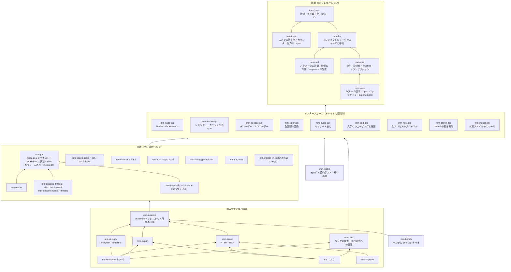

# 開発のしやすさ

独立した領域を並行に開発でき、品質のために作り直すときも他の領域を壊さない構成にする。要点は 3 つ。領域ごとにクレートを分けて依存を一方向にする。領域ごとにインターフェース（トレイトと型だけの API クレート `mm-*-api`）と実装（差し替えられるクレート）を分ける。実装を選んで組み立てる所を `mm-runtime` の 1 か所にする。

## 領域と依存



図は矢印の元が先に依存する。規則は 4 つ。

1. 基礎は GPU と FFmpeg に依存しない。`cargo test` が数秒で回る。`mm-trace` も基礎で、`tracing` と出力の `Layer` だけを持つ。実装と組み立てはこれを使ってスパンを置き、API クレートは置かない（[計装](17-instrumentation.md#スパンの決まり)）。wgpu のタイムスタンプを読む所は `mm-render` に置き、`mm-trace` には wgpu を入れない。
2. API クレートは基礎だけに依存する。API クレート同士の間では、上の図に書いた型の共有（`FrameCx` が `mm-decode-api` の `FrameSource` を持つ、など）だけを認め、実装には依存しない。
3. 実装は API クレートと基礎に依存し、ほかの実装には依存しない。`mm-nodes-basic` が素材を読むときは `mm-decode-api` のトレイトを `FrameCx` 経由で受け取る。`mm-render` が色を変えるときも `mm-color-api` 経由。例外は「共通実装」で、`mm-gpu`、`mm-decode-ffmpeg-core`、`mm-decode-hw`、`mm-encode-ffmpeg-core` の 4 つ。GPU を触る実装は `mm-gpu`（wgpu のコンテキストとアダプターの選び方、`GpuHelper` の wgpu 実装、GPU のフレームの中身の型）に依存してよい（RFC 0001）。API クレートは wgpu を出さないので、wgpu の型を合わせる場所がここになる。FFmpeg のデコーダー（`mm-decode-ffmpeg`、`-d3d12va`、`-cuvid`）は `mm-decode-ffmpeg-core`（映像の時間軸、シーク、YUV の行列。FFmpeg の CPU の部分だけ）に、GPU でデコードする 2 つはさらに `mm-decode-hw`（D3D12 のアダプター、キューの待ち、YUV の変換と描画パス）に依存してよい（RFC 0007）。FFmpeg のエンコーダー（`mm-encode-ffmpeg`、`mm-encode-nvenc`）は `mm-encode-ffmpeg-core`（コーデックの指定から MP4 と MOV に書く部分）に依存してよい（RFC 0015）。共通実装は API クレートと基礎、`mm-gpu` にだけ依存し、ほかの実装には依存しない。ソースを `#[path]` で取り込む形は使わない。
4. 実装を選ぶのは `mm-runtime` だけ。操作経路（アプリ、CLI、サーバー、自動の改善）は `mm-runtime` の組み立てた `Engine` を受け取る。

`mm-pack` は操作経路（アプリと CLI）が使う部品で、`mm-ops` と API クレートの型（`mm-text-api`、`mm-audio-api`）だけに依存し、実装を選ばない。実装のクレートは試験（dev-dependencies）でだけ使う。

循環は `cargo` が拒否する（クレート間の循環依存はビルドできない）ので、この図のとおりに分けていれば起きない。クレートの中のモジュールの循環は、API クレートと実装を別のクレートに置くことで防ぐ。

## ディレクトリの木

```
movie-maker/
  Cargo.toml            ワークスペース。members = ["crates/*", "apps/*"]。workspace.dependencies で外のクレートのバージョンを 1 か所に [36]
  rust-toolchain.toml   Rust のバージョンを固定
  crates/
    mm-types/           時刻（有理数）、色、矩形、ID、ParamSchema、エラー。依存なし
    mm-doc/             プロジェクトのデータ（Project、Composition、Layer、Node、Param）の serde、スキーマのバージョンと移行
    mm-eval/            時刻 t でのパラメータの値、キーフレームの補間、時間の写像、sequence のカットの配置（純関数）
    mm-ops/             操作（1 操作 1 ファイル）、検証・適用・逆操作・touches、トランザクション
    mm-store/           project.mmdb（rusqlite）の読み書き。表と DDL の移行、ops と undo_stack の記録、1 つの書き手のロック（.mm/lock）、WAL とチェックポイント、バックアップ（VACUUM INTO）、FTS5 の検索、決定的な JSON の export と import、mm diff、同期のフォルダーの検出
    mm-trace/           計装。スパンの決まり（名前、レベル、フィールド）、counter!/gauge!、出力の `Layer`（metrics.jsonl、Chrome の trace、Tracy、ETW）、時計の補正、負担の見張り、JSON Schema。依存は tracing と tracing-subscriber だけ
    mm-node-api/        NodeKind、FrameCx、AudioCx、Traits、FrameRef、GPU のヘルパーのトレイト
    mm-render-api/      Renderer（コンポジションと t からフレーム）、Scheduler、フレームのキャッシュのキー
    mm-decode-api/      Decoder（開く、シーク、フレームをテクスチャか CPU で）、Encoder、FrameSource
    mm-color-api/       ColorTransform（入力の色空間 → 作業色空間 → 表示・出力。WGSL か 3D LUT を返す）
    mm-audio-api/       Mixer、AudioSink、AudioBlock、ラウドネスのメーター
    mm-text-api/        TextShaper（シェーピングと行組み）、TextRasterizer
    mm-host-api/        別プロセスのプロトコル（起動、共有テクスチャの受け渡し、時間切れ、再起動）
    mm-cache-api/       CacheStore（キーで引く、置く、大きさ、消す）
    mm-ingest-api/      付属ファイルの JSON Schema と型
    mm-gpu/             共通実装。wgpu の Device と Queue（アダプターを 1 回選ぶ、LUID）、GpuHelper の wgpu 実装、デコーダーの GPU のフレームの型
    mm-render/          レンダラーの実装（wgpu、compute の合成、変形の折りたたみ、ベクターの倍率）
    mm-nodes-basic/     footage、audio、image、solid、shape、svg、composition、sequence、text、shader.wgsl、color.*
    mm-nodes-cef/       web.cef（mm-host-cef に頼む側）
    mm-nodes-ofx/       ofx（mm-host-ofx に頼む側）
    mm-nodes-lottie/    lottie
    mm-decode-ffmpeg/   FFmpeg のライブラリ。CPU のデコードと、ProRes・DNxHR・EXR の読み
    mm-decode-d3d12va/  NVDEC を d3d12va で。コピーなしで wgpu にラップする
    mm-decode-cuvid/    NVDEC を cuvid で。CUDA の外部メモリで 1 コピー
    mm-decode-ffmpeg-core/  共通実装。FFmpeg の CPU の部分（映像の時間軸、シーク、YUV の行列）
    mm-decode-hw/       共通実装。GPU でデコードする実装の部品（アダプター、キューの待ち、YUV の変換）
    mm-encode-ffmpeg-core/  共通実装。コーデックの指定（CodecSpec）から MP4 と MOV に書く（RFC 0015）
    mm-encode-nvenc/    NVENC（FFmpeg の h264_nvenc、hevc_nvenc。NV12 を CPU のメモリから渡す）
    mm-encode-ffmpeg/   libx264（1 パスと 2 パス）、ProRes、DNxHR（リードバックして渡す）
    mm-color-ocio/      OCIO 2.5 の bindgen と、GLSL → naga → WGSL
    mm-color-lut/       ASC CDL と .cube を WGSL で。OCIO が動かないときの 3D LUT のフォールバック
    mm-audio-dsp/       自前の DSP のミキサー、バス、ダッキング、ebur128
    mm-audio-cpal/      cpal の出力（プレビュー）
    mm-text-glyphon/    cosmic-text + glyphon
    mm-text-cef/        HTML のテンプレートを mm-host-cef で描く
    mm-host-cef/        実行ファイル。CEF のオフスクリーン描画 → 共有テクスチャ
    mm-host-ofx/        実行ファイル。OpenFX のホスト
    mm-host-audio/      実行ファイル。VST3 と CLAP のホスト
    mm-cache-fs/        <project>/cache/ の実装（contentHash で引く、大きさ、消す）
    mm-ingest/          取り込みの流れ（ハッシュ、プレビュー動画、波形、サムネイル、外のツールの起動、付属ファイルの取り込み）
    mm-runtime/         assemble()（実装を選んで Engine を作る）、ノードの種類のレジストリ、再生の状態（再生位置、選択）
    mm-export/          レンダーターゲット → 区間 → 並行の描画 → mux、ラウドネスの正規化、字幕とチャプター
    mm-pack/            パック（packs/）の読み込み、検査、マクロとテンプレートの操作の列への展開
    mm-serve/           HTTP（axum）と MCP。操作と描画を外に出す
    mm-ui-layout/       wgpu サーフェス上の UI の計算（端のつまみ、スナップ、範囲）。純関数
    mm-ui-wgpu/         Program、Timeline、メーターの描画と入力
    mm-improve/         自動の改善の回（worktree、claude -p、検査、取り込み）
    mm-testkit/         フィクスチャのプロジェクト、フィクスチャの素材の生成、契約テストの本体、期待画像の比較、gpu_contract!、soak の実行ファイル
    mm-bench/           性能。divan のベンチ（基礎の層）と、mm perf run のシナリオ（playback、scrub、export、startup）。結果の比較と履歴は mm-trace の形で
  fuzz/                 cargo-fuzz の目標（versions/ の JSON、操作の引数、壊した project.mmdb、付属ファイル、字幕、OTIO、壊れた動画）と corpus/
  xtask/                開発のツール（golden-update、perf の履歴の整理）
  apps/
    movie-maker/        Tauri のアプリ。ウィンドウの組み立て、子 HWND、IPC
    mm/                 CLI（render、frame、op、ingest、serve）
  ui/                   WebView の画面（pnpm のワークスペース、TypeScript、Preact、esbuild）
    theme/              theme.json（色、角丸、字、ベベル）と、CSS 変数に出す生成器。wgpu のサーフェスの UI も同じ JSON を読む
    sdk/                Tauri の IPC と HTTP のクライアント。操作と型は mm-ops の JSON Schema から生成
    panels/
      story/            文字起こしのストーリー
      review/           コメント、承認
      inspector/        スキーマから作る入力フィールド
      media/            素材の一覧、取り込み、cache/ の大きさ
      deliver/          レンダーターゲットと書き出し
      feedback/         改善要望を出す画面
      tasks/            XP 風の作業ウィンドウ
    shell/              パネルをまとめて WebView に載せるエントリーポイント（左と右で 1 つずつ）
  tools/                言語を問わない外のツール（文字起こしの faster-whisper など）。mm-ingest-api の付属ファイルを書く
  packs/
    vlog/               DTM_Vlog のパック（マクロ、テンプレート、ダッキングの設定）
  fixtures/             フィクスチャの素材（media/、media/broken/）、バージョンごとのプロジェクトのデータ（doc/vN/）、フィクスチャのプロジェクト（projects/）、期待画像（golden/<バックエンド>/）、音のフィクスチャ（audio/）、ep03 の再現（ep03/）。作り方は Makefile（[テスト](11-testing.md#フィクスチャの素材)）
  docs/
    design/             設計書（領域ごとのファイル）
    rfcs/               インターフェースの変更の提案（NNNN-<題>.md）
    areas.toml          領域ごとに書いてよいディレクトリの表（下の「並行開発の境界」）
```

## インターフェースと実装の分け方

- API クレートは、トレイト、入出力の型、エラーの型、契約（文書化した振る舞いの取り決め）だけを持つ。`impl` を持たない。依存は基礎と `serde` だけで、wgpu の型は出さない（GPU は `GpuHelper` などの型を消したトレイトで囲い、`as_any` で `mm-gpu` の型に降りる。RFC 0001）。
- 実装のクレートは 1 つのインターフェースを 1 つの方式で実装する。名前は `mm-<領域>-<方式>`。同じインターフェースの実装が複数あってよい（`mm-decode-d3d12va` と `mm-decode-cuvid`、`mm-text-glyphon` と `mm-text-cef`、`mm-color-ocio` と `mm-color-lut`）。
- ノードの種類は `mm-node-api` の実装で、`mm-nodes-*` にまとめて置く。種類を足すのは実装のクレートの追加で、インターフェースは変わらない。
- 別プロセスのホストは、インターフェース（`mm-host-api` のプロトコル）を挟んで 2 つに分かれる。アプリの側の `mm-nodes-cef` が頼み、実行ファイルの `mm-host-cef` が描く。OpenFX がホストとプラグインをバージョンつきの関数の表で切り離しているのと同じ型 [32]。
- 組み立ては `mm-runtime::assemble(config) -> Engine` の 1 か所。設定で実装を選ぶ（`decode = "d3d12va" | "cuvid" | "ffmpeg"`、`text = "glyphon" | "cef"`）。Bevy が `Plugin::build` で `App` に部品を足し、`PluginGroup` の `set` で中の部品を差し替えるのと同じ型 [33]。操作経路は `Engine` を受け取るだけで、実装のクレートに依存しない。
- unsafe になる所（D3D12 のハンドル、CUDA、CEF、OFX の C API、`mm-gpu` の LUID の読み）は実装のクレートの中に閉じ、インターフェースの型には `unsafe` を出さない。wgpu が `wgpu-hal`（unsafe なバックエンド）と `wgpu-core`（検証）を分けているのと同じ [31]。
- インターフェースを通すと遅くなる所（毎フレームの呼び出し）は、インターフェースの粒度を「フレーム 1 枚」でなく「区間」や「バッチ」にして、動的ディスパッチの回数を減らす。トレイトオブジェクトの呼び出しの費用は 1 フレームあたり数十回なら問題にならない〔推〕。
- 先行事例から採るもの: ports and adapters（コアを UI やデータベースなしで動かし、テストも人も同じインターフェースから駆動する）[30] を全体の型に、wgpu の hal と core の分け方 [31] をバックエンドの隔離に、OpenFX の host と plugin の切り離し [32] を別プロセスのインターフェースに、Bevy の Plugin [33] を組み立てに、Zed の小さなクレートの多いワークスペース [34] と Cargo の `workspace.dependencies` [36] を木に。rustc のクエリ（結果のメモ化と提供者の差し替え）[37] はフレームのキャッシュと `mm-render-api` の `Scheduler` の参考にする（時刻とキーで引く計算と、その提供者を差し替えられる形）。

## 契約テストと再実装

- インターフェースごとに契約テストを `mm-testkit` に置く。`mm_testkit::decode::contract(|| MyDecoder::new())` のように、実装を作る関数を渡して呼ぶ。どの実装も同じテストを通す。
- 契約テストの中身は[テスト](11-testing.md)の表の各行（ノードの契約、レンダラーの期待画像、ミキサーの決定性、デコーダーのフレームの番号の一致と VFR）。実装のクレートの `tests/contract.rs` が 1 行で呼ぶ。
- 再実装の手順: 新しい実装のクレートを足す → 契約テストと期待画像のテストを通す → `assemble` の設定に選択肢を足す → 既定を切り替える → 古い実装は、1 つの段階が過ぎるまで残して消す。インターフェースは変えない。
- 仮の実装: インターフェースを決めた直後に、`mm-testkit` にモックの実装（単色のフレームを返すデコーダー、無音のミキサー、矩形だけの文字）を置く。ほかの領域は実際の実装を待たずに組める。段階 0 の縦の 1 本は、このモックの実装で先に通す。

## インターフェースのバージョンと変え方

- API クレートは semver でバージョンを持つ。公開はしないが、`cargo-semver-checks` [35] で破壊的変更を検査する（公開しないクレートで動くかは段階 1 で確かめる。[決めてほしいこと](16-open-questions.md)）。
- インターフェースを変えるときは、`docs/rfcs/<PR の番号>-<題>.md`（番号の付け方は「共有のファイルの書き方」）に、変える理由、新しいシグネチャ、影響する実装のクレート、移行の手順を書いてから変える。1 つの PR で、インターフェースの変更と、全部の実装と契約テストの更新を一緒に入れる。
- 足すだけの変更（メソッドの追加は既定の実装つき、`Traits` のフィールドの追加）は RFC なしでよい。消す・形を変える変更は RFC。
- API クレートは各自の `Cargo.toml` にバージョンを持ち、ワークスペースのバージョンを使わない。壊す変更は 0.x の minor を上げる（0.1 から 0.2）。
- ノードの種類のバージョン（`NodeKind::version` と `migrate`）とプロジェクトのデータのスキーマのバージョンは、インターフェースのバージョンとは別に持つ（プロジェクトのデータの互換性の話）。

## 並行開発の境界

- 領域 = ディレクトリの組。`docs/areas.toml` に、領域ごとに書いてよいディレクトリを書く。worktree やエージェントに任せるときは、この表の 1 行を渡す。

| 領域 | 書いてよい所 | 触らない所 |
|---|---|---|
| プロジェクトのデータと操作 | `crates/mm-doc`、`mm-eval`、`mm-ops`、`mm-store` | API クレート |
| レンダラー | `crates/mm-render`、`mm-nodes-basic` | `mm-node-api`、`mm-render-api` |
| デコードとエンコード | `crates/mm-decode-*`、`mm-encode-*` | `mm-decode-api` |
| 色 | `crates/mm-color-*` | `mm-color-api` |
| 音 | `crates/mm-audio-*` | `mm-audio-api` |
| 文字 | `crates/mm-text-*` | `mm-text-api` |
| Web のノードの種類と OFX のホスト | `crates/mm-host-*`、`mm-nodes-cef`、`mm-nodes-ofx` | `mm-host-api` |
| 取り込みと cache/ | `crates/mm-ingest`、`mm-cache-*`、`tools/` | `mm-ingest-api`、`mm-cache-api` |
| 書き出し | `crates/mm-export` | |
| パック | `crates/mm-pack`、`packs/` | `mm-ops` の中（新しい操作は「プロジェクトのデータと操作」の形で足す）、`ui/panels/` |
| UI（wgpu のサーフェス） | `crates/mm-ui-layout`、`mm-ui-wgpu` | `ui/` |
| UI（1 つのパネルの縦の切り口） | `ui/panels/<panel>/`、`ui/sdk/src/<panel>.ts`、`apps/movie-maker/src/<panel>*` | ほかのパネル、`ui/sdk/src/generated/`、`ui/theme` |
| アプリの骨組み | `apps/movie-maker`（パネルとパックの切り口を除く）、`ui/shell`、`ui/tools` | パネルの切り口のファイル |
| Claude の操作経路 | `crates/mm-serve`、`apps/mm` | |
| 自動の改善 | `crates/mm-improve` | |
| テストキットとベンチ | `crates/mm-testkit`、`mm-bench`、`fixtures/`、`fuzz/` | |
| 計装 | `crates/mm-trace`、`xtask/` | ほかのクレートのスパンの名前（名前は各領域が付け、`mm-trace` は決まりだけ持つ） |
| インターフェースと組み立て（統合の担当） | `crates/mm-*-api`、`mm-types`、`mm-gpu`、`mm-runtime`、`ui/sdk`、`ui/theme`、ルートの `Cargo.toml`、`Cargo.lock`、`scripts/`、`docs/` | |

- 各領域は自分の設計書（`05-ops.md` はプロジェクトのデータと操作、`13-vlog-pack.md` はパック、など。`areas.toml` の `write`）も書く。`apps/mm/src/<領域>_cmd.rs` はその領域が書く。
- 共有のファイルは `areas.toml` の `[[shared]]` に列挙する。どの領域の PR も、そこに書いた形（`rule`。多くは名前の順の位置に 1 行）でだけ書いてよい。消す・並べ替える・形を変える変更は `reshape` の担当が書く。書き方の共通の決まりは下の「共有のファイルの書き方」。
- 2 つ以上のエージェントが同じリポジトリを書くときは、各々を別の worktree に置く（この表の 1 行ずつ）。同じ領域を 2 人で書かない。

### 共有のファイルの書き方

並行の PR が同じ連番や同じ末尾の行を取り合うと衝突する。連番を作業中に取らず、1 つの変更を 1 つのファイルにし、並びの決まった列には途中に挿す。

| 対象 | 決まり | 先行事例 |
|---|---|---|
| RFC（`docs/rfcs/`） | 作業中は `<題>.md` で書き、本文では「RFC `<題>`」と呼ぶ。PR を作ったら `<PR の番号 4 桁>-<題>.md` に改め、参照も直す。既存の 0001〜0016 は変えない。CI（`conventions`）が PR で足したファイルの番号を PR の番号と比べる | Rust の RFC（番号は PR の番号）、Go の proposal（番号は issue の番号） |
| プロジェクトのデータの形（`mm-doc`） | 整数の `SCHEMA_VERSION` は 9 で止める。形の変更は `crates/mm-doc/src/migrations/YYYYMMDD_<題>.rs` に `pub(crate) fn up(value: &mut serde_json::Value)` を 1 つ書く。表は `build.rs` がディレクトリから名前の順に作る。プロジェクトのデータは済ませた移行の名前の組（`migrations`）を持ち、読むときは組に無い移行だけを適用する。移行は書いた時点の main にある移行だけを前提にし、並行の移行と順に依らない形にする。凍結するフィクスチャは `fixtures/doc/<移行の名前>/` | Rails の `schema_migrations`（日時の名前と済ませた組）、sqlx の `migrate!`（ディレクトリから表を作る） |
| 生成物（`Cargo.lock`、`crates/mm-ops/schema/ops.json`、`crates/mm-ingest-api/schema/`、`ui/sdk/src/generated/`） | 衝突したら手で直さず、`scripts/regen.sh` で作り直して `git add` する。`Cargo.lock` は main の側を土台にして足りない分だけ cargo に足させる。CI は `check`（Rust のスキーマのテスト）と `ui`（`gen:check`）で、コミットした生成物が元と合うかを確かめる | Cargo と pnpm の lockfile の作り直し、生成物を CI で再生成して差を見る検査 |
| ルートの `Cargo.toml` | `[workspace.dependencies]` の `mm-*` は名前の順で、新しいクレートはその位置に 1 行挿す。CI（`conventions`）が並びを確かめる。外のクレートは末尾に足さず、関係するものの隣に挿す | `cargo-sort`、Chromium の BUILD.gn の並べた列 |
| 組み立て（`mm-runtime/src/assemble.rs`、`config.rs` の `Backend`） | インターフェースごとの関数の `match` に 1 腕（`#[cfg]` 込み）を足す。`Backend` のバリアントと腕は末尾（`Auto` の前）に足さず、名前の順で直前になる項目の後ろに挿す | Bevy の `PluginGroup`（組み立ての 1 か所に部品を並べる） |
| 用語集 | 段階の途中は `glossary.d/<PR の題>.md` に書き、段階ごとのクリーンアップで `glossary.md` に移す（[用語集](glossary.md)の冒頭） | towncrier の newsfragments、Changesets の `.changeset/*.md` |

- 生成物をコミットから外す案は採らない。`ops.json` は操作の契約の差分としてレビューで読み、外すと `ui` のジョブに Rust のビルドが要る。`ops.ts` は外すと typecheck、lint、test、エディターの前に毎回生成が要り、衝突は `ops.json` と同時なので `regen.sh` の 1 回で済む。
- `.gitattributes` の merge driver は採らない。各自の clone に `git config` が要り、GitHub のマージボタンは merge driver を実行せず、ファイルごとに動くので元のファイルのマージが終わる前に生成すると古い元から作る。生成物には `linguist-generated` だけを付け、PR の差分で畳む。
- 自動の登録（`inventory`、`linkme`）は採らない。実装のクレートから登録の型を見るには、型を API クレートに移す（インターフェースの変更）ことになり、どこからも参照されないクレートの登録はリンカーが除く。実装の選択は feature と `#[cfg]` で静的に決まっていて、1 か所の `match` で足りる。
- スキーマの連番に Alembic の `down_revision` や Django の `dependencies` の木を採らない。並行の 2 本が同じ親を持つと「head が 2 つ」になり、マージ用の移行を誰かが書くまで CI が失敗する。済ませた組を持つ方式は、マージの順に関わらずそのまま通る。
- CI は、変えたクレートとそれに依存するクレートだけをテストする（`cargo nextest run -p <crate>` と、依存の逆引き）。API クレートを変えた PR は全部を回す。夜間は全部と、実機の GPU、性能、耐久、ファズ（[テスト](11-testing.md#層の一覧)）。
- 実装済みの CI の PR と main の違いは [ci.md](../ci.md#pr-と-main-の違い)。PR は 1 本 30 秒を超える通しの試験（`#[ignore]`）と、性能に関わらない PR の `perf-gate` を外し、main の push と手動で全部を回す。

### 作業の分担

一度に 4〜6 の担当が別々の機能（パネル、エンコード、パック、MCP、e2e の再現）を作り、merge queue で順に入れる。2026-10-28 から 11-07 の main への PR 63 本で、複数の PR が触ったファイルを数えると、衝突は 5 つの型に分かれる。

| 型 | 例（触った PR の数） | 対処 |
|---|---|---|
| 登録の列の同じ位置への追記 | `apps/movie-maker/src/app.rs`（17）と `main.rs`（12）の mod・use・Tauri のコマンド、`apps/mm/src/main.rs`（17）、`ui/shell/src/Shell.tsx`（11）、`ui/tools/screenshot.mjs`（10）と `build.ts`（9）、`ui/sdk/src/index.ts`（10）、`mm-ops` の `op.rs`（10）と `ops/mod.rs`（9） | 登録を 2 段に分ける（下の「登録の列を分ける提案」）。それまでは名前の順の位置に 1 行 |
| 同じ行の並ぶ列で差分がずれる | `main.rs` の `#[cfg(windows)]` と `mod` の 2 行の組、最後の項目にカンマの無い `generate_handler!` | 1 項目 1 行にし、最後の項目にもカンマを付ける |
| 数や全部のフィールドを書く試験 | `mm-serve/tests/mcp.rs` の `EXTRA_TOOLS`、`Composition` の literal（35 ファイル、37 か所）、性質テストの生成器（`mm-ops/tests/spec/mod.rs`、10） | 数を名前の組の比較に、literal を作る関数に、生成器を操作の組ごとのファイルに |
| 生成物 | `Cargo.lock`（30）、`ops.json` と `ops.ts`（14）、`ui/pnpm-lock.yaml`（8） | `scripts/regen.sh`。`pnpm-lock.yaml` は main の側を土台に `pnpm install` |
| 設計書の表と節への追記 | `05-ops.md`（19）、`15-roadmap.md`（14）、`03-data-model.md`（14）、`08-ui.md`（9） | 領域の設計書は領域が書く。ほかの表には意味の位置に 1 行。`15-roadmap.md` は統合の担当が段階の締めに書く |

#### 先行事例

| 事例 | 中身 | 採るもの |
|---|---|---|
| GitHub の CODEOWNERS、Chromium と Kubernetes の OWNERS | パスの型で持ち主を決める。CODEOWNERS は 1 ファイル、OWNERS はディレクトリごとのファイル | `areas.toml` は 1 ファイルのまま（領域が 20 に満たない）。共有のファイルも同じ表に `[[shared]]` で書く |
| Bevy の `Plugin` と `PluginGroup` | 組み立ての列は Plugin を 1 行ずつ並べ、各 Plugin が `build` で自分の system と resource を足す | 登録を 2 段に分ける。中央の列は領域を 1 行、細目は領域のファイル |
| Zed の `main.rs` の `<crate>::init(cx)` の列と `Panel::activation_priority` | crate ごとの `init` がアクションと設定を登録する。ドックのパネルの並びは数の優先度で決める | パネルの記述子に並びの数を持たせ、配列の位置を取り合わない |
| cargo の `src/bin/cargo/commands/` | サブコマンド 1 つ 1 ファイル（`cli()` と `exec()`）。`mod.rs` の `builtin()` と `builtin_exec` は名前の順 | `mm` の CLI を同じ形に |
| rust-analyzer の `ide-assists`、Clippy の lint の一覧 | 一覧と文書を各ハンドラーや lint の doc コメントから生成する | 操作ごとの説明を引数の型の doc コメントに書き、`ops.json` の `description` に出す |
| VS Code の contribution points | 拡張が `package.json` に views と `order` を宣言し、本体が集める | `build.ts` と `screenshot.mjs` がパネルのディレクトリを走査する |
| Tauri の plugin（`tauri::plugin::Builder`） | plugin ごとに `invoke_handler` と `setup`（状態の `manage`）を閉じる | 形だけ借りる。plugin にすると JS の呼び名が `plugin:<名前>|<コマンド>` に変わり、ACL の権限も要るので、plugin にはしない |
| Rust API Guidelines の builder、`#[non_exhaustive]` | 構造体の literal を外のクレートに書かせず、作る関数を通す | `Composition` などを作る関数に寄せる |
| `inventory`、`linkme`、`automod` | 静的な初期化やリンカーのセクションで分散登録する。ディレクトリから `mod` を生成する | 採らない。上の「自動の登録」と同じ理由に加え、2 段の列で衝突は領域が増えるときの 1 行に減る。生成した `mod` は grep で追えない |

#### 新しい設計

1. 領域を機能の縦の切り口にする。パネル 1 つは、画面（`ui/panels/<panel>/`）、パネルの API（`ui/sdk/src/<panel>.ts`）、アプリ側の処理（`apps/movie-maker/src/<panel>*`）をまとめて 1 つの担当が書く。パック、取り込み、書き出しも `apps/mm/src/<領域>_cmd.rs` をその領域に含める。画面だけの領域だと、1 つの機能が 3 つの領域にまたがり、持ち主のいない `apps/movie-maker` に全部の PR が書いていた。
2. 共有のファイルを `areas.toml` の `[[shared]]` に列挙し、ファイルごとに書いてよい形（`rule`）と形を変える担当（`reshape`）を書く。1 つの PR が書いてよいのは、自分の領域の `write` と、`rule` に合う `[[shared]]` の変更だけ。
3. `apps/movie-maker` の再生、ウィンドウ、Timeline の編集と、`ui/shell`、`ui/tools` を「アプリの骨組み」の領域にする。同時に 2 つの担当を置かない。
4. 統合の担当が引き受けるもの: `[[shared]]` の並べ替えと形の変更、登録の列を分ける作り替え、多くの領域にまたがる機械的な書き換え（literal を作る関数に寄せる、など）、`15-roadmap.md` と `glossary.md` の更新（段階の締め）。ほかの PR が少ない時間に 1 本ずつ入れる。
5. 割り当ては、`write` が重ならない領域の組にする（例: パネル 2 つ、パック、デコードとエンコード、Claude の操作経路、テストキット）。同じ `[[shared]]` を触る PR が 3 本を超えそうなら、統合の担当が merge queue の順を決め、後の PR は前の PR が入ってから main を取り込む。

#### 登録の列を分ける提案

まだ作らない。作るときは統合の担当が下の順で入れる。

| 列 | 今 | 分け方 |
|---|---|---|
| パネルのタブ（`Shell.tsx`、`main.tsx`） | タブの配列、`ShellProps`、API を作る行をパネルごとに足す | 各パネルが `ui/panels/<panel>/src/panel.ts` に記述子（`id`、`label`、`column`、`order`、API を作る関数、描く関数）を持つ。`ui/shell/src/panels.ts` は記述子の import を名前の順に 1 行ずつ並べ、Shell は `order` で並べる。パネルの API の型と IPC の関数はパネルのパッケージに移し、`ui/sdk` は `invoke`、操作、イベントだけを持つ。**作り替え済み。** 新しいパネルは `ui/panels/<panel>/`（`package.json`、`src/panel.ts`、`src/api.ts`）を作り、`ui/shell/src/panels.ts` に `export { panel as <panel> } from "../../panels/<panel>/src/index.ts";` を名前の順の位置に 1 行足す。触る共有のファイルはこの 1 行だけ（`ui/pnpm-lock.yaml` は `pnpm install` が書く） |
| デモとスクリーンショット（`build.ts`、`screenshot.mjs`） | パネルごとに定数、エントリー、HTML、撮る関数 | `build.ts` が `panels/*/demo/*.tsx` を走査する。撮る関数は `panels/<panel>/screenshots.mjs` に移し、`screenshot.mjs` は走査して名前で選ぶ。**作り替え済み。** `demo/main.tsx` は `<panel>-demo`、`demo/<名前>.tsx` は `<名前>-demo` のページになり、撮る関数は `screenshots.mjs` の default export（`(browser, { dist })`） |
| アプリの mod とコマンド（`main.rs`、`app.rs`） | `#[cfg(windows)]` つきの mod が 30 余り、`manage` と `generate_handler!` が 1 つの列 | `main.rs` は `#[cfg(windows)] mod win;` だけにし、`win/mod.rs` に cfg の無い mod の列を置く。パネルごとの処理を `<panel>/mod.rs` にまとめ（`media.rs` と `media_ipc.rs` を 1 つの mod に）、各々が `manage` をする関数と自分の `generate_handler!` を持つ。`app.rs` はコマンドの名前の前置き（`media_` など）で領域の handler に振り分け、列は領域 1 行。`generate_handler!` の作る関数は知らない名前に `false` を返すので、振り分けに使える。前置きの合わないコマンド（`source_ipc::edit_action`）は名前を揃える。実装済み（パネルごとの mod は作らず、`<panel>_ipc.rs` が `handler` を持つ）: 新しいパネルは `win/<panel>_ipc.rs` に `handler`、`win/mod.rs` に mod を 1 行、`win/app.rs` の `Panel`、`route`、`dispatch` に 1 行ずつ。コマンド名は変えず、前置きに合わない名前（`edit_action`）は `route` に名前で書く |
| CLI のサブコマンド（`apps/mm/src/main.rs`） | `Command` の 1 つの enum と match | cargo の形。入れ子のサブコマンドは今の `Pack { command }` の形で 1 行。上の段に並べるものは、領域の `Subcommand` の enum を `#[command(flatten)]` で 1 行。実装済み: 新しいサブコマンドは領域のファイルに `Cmd`（`Subcommand`）と `run`、`apps/mm/src/main.rs` に `mod`、`Command` の flatten、`run` の腕を 1 行ずつ。`--help` の並びは `Command` の並び |
| MCP のツール（`mcp_tools.rs`、`tests/mcp.rs`） | 操作でないツールの数を `EXTRA_TOOLS = 5` で数える | ツールの定義の隣に名前の定数の列を置き、試験は `Op::NAMES` とその列の和が `tools/list` の名前の組と一致するかを見る |
| 性質テストの生成器（`mm-ops/tests/spec/mod.rs`） | `Spec` の enum、`prop_oneof!`、操作を作る腕が 1 つのファイル | 操作の組ごとのファイル（今の `bins.rs`、`shorts.rs` の形）に enum と生成器と腕を移し、`mod.rs` は組の 1 行と重みだけにする |
| `Composition` などの literal | 全部のフィールドを書く literal が 35 ファイル | `mm-doc` に作る関数（`Composition::new(id, size, fps, duration)`）を、`mm-testkit` に試験の組み立て（`comp(id).layers(..)`）を置いて literal を寄せる。そのあと `#[non_exhaustive]` で外のクレートの literal を禁じる |
| 操作（`op.rs`、`ops/mod.rs`） | 2 つの列に 1 行ずつ | 今のまま。衝突が続いたら、移行と同じく `build.rs` がディレクトリから表を作る形にする |
| 設計書（`05-ops.md`、`08-ui.md`） | 操作やパネルの細目を 1 つのファイルに足す | 操作の細目は引数の型の doc コメントに書き、`ops.json` の `description` に出す。`05-ops.md` は決まりと操作の組の説明だけを持つ。パネルの細目は `ui/panels/<panel>/README.md` |

- 実装は sonnet の 3 体を並行に走らせる（各々 worktree）。書くファイルが重ならない。新しい機能を始めない時間に、merge queue を空にしてから入れる。
  1. UI の登録: `ui/shell`、`ui/tools`、各パネルの `panel.ts` と `screenshots.mjs`、パネルの API の移動。完了条件は `pnpm build`、typecheck、vitest、全部のパネルのスクリーンショットが前と同じ。
  2. アプリと CLI の登録: `apps/movie-maker` の mod のまとめ方と振り分け、`apps/mm` のサブコマンド。完了条件は clippy、アプリの `--play-test`、IPC のコマンドの名前が変わらない（ui の呼び出しを変えない）。
  3. Rust の試験の形: `Composition` を作る関数と literal の置き換え、`mcp.rs` の名前の組、性質テストの生成器の分割。完了条件は `cargo check --workspace`、変えたクレートの nextest。
- 3 が入ったあとに、`#[non_exhaustive]` と設計書の寄せ方（`05-ops.md` を doc コメントへ）を 1 体ずつ。急がない。

#### 衝突を減らす小さな仕組み（提案）

- `scripts/check-conventions.sh` に、登録の列（`win/mod.rs` の mod、`panels.ts`、`app.rs` の振り分け）が名前の順で、最後の項目にカンマがあるかの検査を足す。rust-lang の tidy と cargo-sort の型。
- `scripts/shared-touched.sh`: `git diff --name-only origin/main...` を `[[shared]]` と突き合わせ、触った共有のファイルを出す。PR 本文の 1 行にし、統合の担当が merge queue の順を決める材料にする。

## 自動の改善の領域

自動の回が書いてよい領域と、人の承認が要る領域を、この木に対応させる。

| 領域 | 自動の回 | 中身 |
|---|---|---|
| `ui/panels/*`、`ui/theme` | 書いて取り込む（検査が通れば） | 画面の直し。esbuild のバンドルし直しとリロードだけで反映 |
| `crates/mm-ops`、`mm-eval`、`mm-store` | 書いて取り込む | 操作の追加と直し、配置の計算。性質テストが守る |
| `crates/mm-nodes-*`、`mm-text-*`、`mm-color-lut`、`mm-audio-dsp` | 書いて取り込む | ノードの種類の追加、文字と色と音の実装。契約テストと期待画像が守る |
| `crates/mm-testkit`、`mm-bench`、`mm-pack`、`fixtures/`、`fuzz/`、`packs/`、`tools/` | 書いて取り込む | フィクスチャとベンチとパックと外のツール。期待画像（`fixtures/golden/`）の更新だけは PR までで止める（人が見る） |
| `crates/mm-trace` | PR までで止める | 計装の決まりと出力の形。変えると比較の相手が変わる |
| `crates/mm-*-api`、`mm-types`、`mm-doc`（スキーマの移行）、`mm-runtime` | PR までで止める | インターフェースの変更、プロジェクトのデータの形、組み立て。RFC が要る |
| `crates/mm-render`、`mm-decode-*`、`mm-encode-*`、`mm-host-*`、`mm-color-ocio`、`mm-export` | PR までで止める | GPU と unsafe なバックエンド、別プロセス、書き出しの一致。期待画像で機械が検査しても人が見る |
| `crates/mm-improve`、`mm-serve`、`apps/` | PR までで止める | 自分自身と操作経路の変更 |

- 回の worktree では、書いてよい領域の外のファイルを変えた PR は検査で落とす（`git diff --name-only` を `areas.toml` と突き合わせる）。
- 費用のかかる操作（`gen.ai`）と実際のプロジェクトは、回からは触れない（[自動の改善](10-review-improve.md#自動の改善)の囲い）。


---

出典の番号（[1] など）は [references.md](references.md) を見る。
