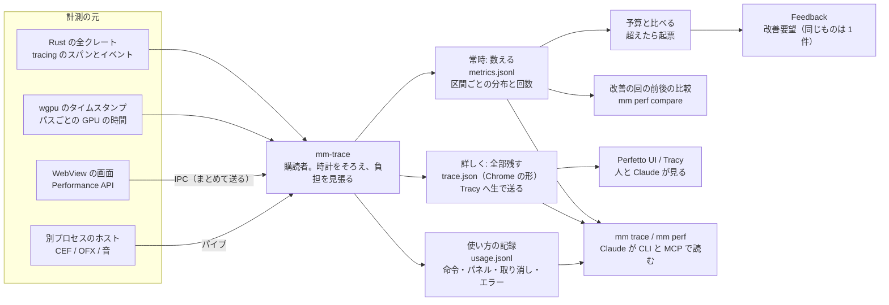

# 計装

後の最適化と継続的改善のために、アプリと CLI とホストの動きを数で残す。常時は軽く数え、詳しく見たいときだけ全部を残す。数は手元にだけ置き、外に送らない。予算を超えた処理と落ちた回数は改善要望に起票し、自動の改善の回は前後の数を比べて回帰を断る。

## 何を測るか

| 項目 | 測り方 | スパンかカウンタ |
|---|---|---|
| 描画の 1 コマ（CPU） | `mm-render` の `render_frame` のスパン。中にレイヤーごとの評価、合成、読み戻しのスパン | スパン |
| 描画の 1 コマ（GPU） | wgpu のタイムスタンプのクエリ。`Features::TIMESTAMP_QUERY` で compute と render のパスの頭と尻に `timestamp_writes` を書き、`Queue::get_timestamp_period()`（1 tick のナノ秒）で換算する [44]。パスの中の点は `TIMESTAMP_QUERY_INSIDE_PASSES`（native のみ）[44] | スパン（GPU のトラック） |
| デコード | `Decoder::next_frame` と `seek` のスパン。シークは「頼んでから正しいコマが出るまで」。実装（`d3d12va`、`cuvid`、`ffmpeg`）と素材の形（コーデック、解像度、GOP）をフィールドに | スパン |
| キャッシュ | 引いた回数と当たった回数（コマ、プレビュー動画、文字の絵、音の PCM の種類ごと）。大きさ | カウンタ |
| 命令の適用 | `mm-ops` の `apply` のスパン（検証、適用、逆命令の生成、`touches`、記録の書き込み）。トランザクションはまとまりで 1 つ | スパン |
| 操作から画面まで | 入力のイベントが届いた時刻から、その結果のコマが面に出た時刻まで。wgpu の面は Rust の中で閉じる。WebView の画面は、`performance.now()` の時刻を命令に添えて送り、Rust が受けた時刻と、変更の通知が画面に戻って描かれた時刻（`requestAnimationFrame` の後）まで | スパン（流れとしてつなぐ） |
| 再生 | 落としたコマ（音の時計に対して遅れたコマ）の数、面に出す間隔のばらつき | カウンタ |
| 書き出し | 1 コマあたりの時間（描画、NV12 への変換、NVENC）、区間ごとの fps、全体の fps、並行の数 | スパンとカウンタ |
| メモリ | RSS、ヒープ（アロケータの統計）、VRAM（wgpu の `Device` の報告と D3D12 の `QueryVideoMemoryInfo`〔推〕）、GPU の資源の数（テクスチャ、バッファ）、開いているハンドル。5 秒おき | カウンタ |
| 別プロセスのホスト | 1 コマの往復の時間、時間切れの回数、落ちた回数、再起動にかかった時間、共有テクスチャのハンドルの数 | スパンとカウンタ |
| 取り込み | 素材ごとの段階（ハッシュ、波形、文字起こし、プレビュー動画）の時間と、実時間に対する倍率 | スパン |
| 起動 | 起動からアプリが入力を受け付けるまで、プロジェクトを開いてから最初のコマが出るまで | スパン |
| 保存 | 文書の書き込み（アトミックな書き込みの 1 回）、スナップショット | スパン |
| エラー | panic、`Result` の `Err` のうち利用者に見せたもの、画面の例外、ホストの落ち | イベント |
| 自動の改善の回 | 回の長さ、ターン数、検査の結果、取り込んだか | イベント |

スパンには、どの素材か（`contentHash` の先頭 8 桁）、どのコンポジションか、どの品質か（プレビュー動画か原本か）、どの実装か、をフィールドで付ける。利用者の文字列（文字の中身、ファイル名）は付けない。

## 予算の表

目標は「この PC（RTX 5090、Ryzen 9 9950X）で、1080p60 の本編を編集するとき」の値。実測の数（[レビューの実測](reviews/2026-11-05.md)の表）を手がかりにし、ほかは〔推〕。段階 0 と 2 で測った数で置き換える。超えたら性能のテストが落ちる（[テスト](11-testing.md#性能のテストと回帰のゲート)）。

| 項目 | 目標 | 根拠 |
|---|---|---|
| 描画の 1 コマ（プレビュー、1080p、レイヤー 10 枚、文字 3 枚） | CPU 4 ms 以下、GPU 6 ms 以下。合わせて 60 fps の 16.7 ms の中に、デコードと表示を含めて収める | 〔推〕 |
| 描画の 1 コマ（書き出し、同じ場面） | 10 ms 以下（100 fps） | 〔推〕 |
| デコード（NVDEC、1 本） | 4K 700 fps 以上、1080p 1,500 fps 以上〔推〕 | 実測: 4K で 700〜800 fps、4 本の合計 1,450 fps |
| デコード（NVDEC、4 本の合計） | 1,400 fps 以上 | 実測 |
| シーク（プレビュー動画 540p、GOP 3） | 中央値 15 ms、99% 40 ms 以下 | 〔推。GOP 3 なら復号は 3 コマ以内〕 |
| シーク（原本 1080p60、GOP 2 秒、B あり） | 中央値 60 ms、99% 150 ms 以下 | 〔推。最大 120 コマの復号〕 |
| スクラブ（縮小したコマが面に出るまで） | 50 ms 以下。正確なコマ 150 ms 以下 | 〔推〕 |
| 操作から画面まで（wgpu の面） | 1 コマ（16.7 ms）以下 | 〔推〕 |
| 操作から画面まで（WebView → 命令 → 通知 → 画面） | 50 ms 以下 | 〔推。IPC 2 往復〕 |
| 命令の適用（単発） | 中央値 0.5 ms、99% 5 ms 以下 | 〔推〕 |
| 命令の適用（トランザクション、ドラッグ 1 回分） | 20 ms 以下 | 〔推〕 |
| 再生で落とすコマ | 1 分あたり 0 コマ（キャッシュあり）、1% 以下（キャッシュなし） | 〔推〕 |
| コマのキャッシュの当たり率（同じ区間の 2 回目の再生） | 95% 以上 | 〔推〕 |
| 書き出し（1080p60、NVENC、1 プロセス） | 実時間の 2 倍以上（120 fps） | 〔推。前の案のブラウザの中の VideoEncoder が 299 fps だった〕 |
| 書き出し（並行 4） | 実時間の 5 倍以上 | 〔推〕 |
| プレビュー動画の生成 | 実時間の 10 倍以上 | 実測: 約 11 倍 |
| 取り込み（波形と文字起こしが先に出るまで） | 1 時間の素材で 5 分以内〔推〕 | 文字起こしは faster-whisper の速さ次第 |
| メモリ（RSS、本編を開いて 1 時間） | 4 GB 以下。増え続けない（最初と最後の 1 時間の中央値の差 10% 以下） | 〔推〕 |
| VRAM（プレビュー） | 8 GB 以下 | 〔推。RTX 5090 は 32 GB だが OBS と DAW と同居する〕 |
| CEF の 1 コマ（1080p、共有テクスチャの写し） | 3 ms 以下 | 〔推。段階 0 で測る〕 |
| OFX の 1 コマ（別プロセス、共有テクスチャ） | 往復 5 ms 以下 | 〔推〕 |
| ホストが落ちる回数 | 1 セッションあたり 0。落ちたら再起動 2 秒以内 | 〔推〕 |
| 起動 | 入力を受け付けるまで 2 秒以内、プロジェクトを開いて最初のコマまで 1 秒以内 | 〔推〕 |
| 保存（文書の書き込み 1 回） | 20 ms 以下。スナップショット 500 ms 以下 | 〔推〕 |
| 計装の負担（常時） | CPU の 1% 以下、1 コマあたり 50 µs 以下 | 下の「負担の上限」 |

## 仕組み

### スパンの決まり

- 全クレートで `tracing` を使う [39]。`log` は使わない。スパンは `#[instrument(skip_all, fields(...))]` か `tracing::span!` で、名前は `<クレート>.<動詞>`（`render.frame`、`decode.seek`、`ops.apply`）。
- レベル: 1 コマに 1 回以下のものは `INFO`、レイヤーごとやパスごとは `DEBUG`、それより細かいもの（シェーダーのディスパッチ 1 回）は `TRACE`。常時は `INFO` まで、詳しくは `DEBUG` か `TRACE`。
- 購読者が興味を持たないスパンは構築されない [39]。`TRACE` のスパンを多く置いても、常時の負担にはならない。release のビルドの静的な上限（`release_max_level_*`）は付けず、実行時に切り替える [39]。
- カウンタは `mm-trace` の `counter!`（名前と値）と `gauge!`。中身は `tracing` の `event!` にフィールドで載せ、`mm-trace` の層が集計する（OpenTelemetry の `MetricsLayer` が特定の名前の event からメトリクスを出すのと同じ型 [46]）。
- 口のクレート（`mm-*-api`）はスパンを置かない。実装のクレートと組み立て（`mm-runtime`）が置く。口の呼び出しの境目のスパンは `mm-runtime` の包みで付ける。
- GPU の時間は `wgpu-profiler` のスコープで取る（QuerySet とバッファを中で管理し、入れ子にできる。Chrome の形と Tracy に出せる）[45]。スコープの名前は CPU のスパンと同じ名前にし、同じトラックの横に並べる。
- 別プロセスのホストも `tracing` を持ち、スパンをパイプで `mm-trace` に送る（ホストの `pid` を付ける）。ホストが落ちたら、最後に送れたスパンまでが残る。

### 出力先と切り替え

| 段 | 残すもの | 形 | 負担 |
|---|---|---|---|
| 常時（既定） | `INFO` のスパンの、名前ごとの回数と分布（中央値、95%、99%、最大。HDR のヒストグラム〔推。`hdrhistogram` クレート〕）、カウンタ、イベント。1 分ごとに 1 行 | `metrics.jsonl`（1 行 1 分。JSON Schema を `mm-trace/schema/` に） | 1% 以下 |
| 詳しく（手で入れる、予算を超えたら自動で 30 秒） | 全部のスパンとイベント、GPU の時間、WebView の計測 | Chrome の trace event の JSON（`tracing-chrome` の層 [40]。`ph: "X"` の complete event、`ts` と `dur` はマイクロ秒、B/E は入れ子に [42]）。Perfetto UI で開ける [40][43] | 数%〔推〕 |
| 生で見る（開発中） | 同上をリアルタイムに | `tracing-tracy` の層で Tracy に送る（`ondemand` で、Tracy がつながるまで集めない。`only-localhost` で外に出さない）[41]。Tracy はスレッドをまたぐスパンと順序の入れ違うスパンを扱えないので、非同期のスパンは Chrome の形で見る [41] | Tracy のゾーン 1 つは数十 ns〔推。公式の現行の数は未確認〕 |
| ETW（Windows で OS の中まで見る） | 同上を ETW に | `tracing-etw` の層 [54]。Windows Performance Analyzer で OS のスケジューラや DPC と並べて見る | 詳しくと同じ |

- 切り替えは `mm-trace` の 1 つの状態（`TraceLevel::{Light, Detailed, Tracy, Etw}`）。`Program` の右上の印、`mm trace start/stop`、環境変数 `MM_TRACE`、設定ファイルで変える。`Layer` は `Option` で積み、実行時に有効無効を変える [39]。
- 詳しくの自動の 30 秒は、予算を超えたスパンが出たときに始め、その間に 1 回しか始めない（1 時間あたり上限 6 回）。
- 形は Chrome の trace event に寄せる。Perfetto の Trace Processor が SQL で読め [43]、Claude が `mm trace query` で同じ SQL を打てる。Perfetto のプロトバッファ（`tracing-perfetto` [52]）は Chrome の形で足りなくなったら考える。

### 時計をそろえる

- Rust の時刻は `Instant`（Windows では `QueryPerformanceCounter`）[53]。トレースの `ts` は、アプリの起動の `Instant` からの経過を使い、起動の壁時計（`SystemTime`）を 1 回だけメタデータに書く。
- WebView の `performance.now()` は `timeOrigin` からの相対で、単調 [53]。Rust と同じ軸にそろえるため、起動時と 10 分ごとに「Rust が IPC で `ping` を送り、画面が `performance.now()` を返し、Rust が往復の時間を測る」を 5 回行い、往復の半分を引いた差を補正値にする。補正の揺れが 1 ms を超えたら、その画面の計測に印を付ける〔推。`timeOrigin` と QPC の原点の関係は確かめられなかったので、原点を頼らず往復で測る〕。
- 画面の計測は `performance.mark` と `performance.measure` で取り、1 秒に 1 回まとめて IPC で送る（1 件ずつ送らない）。送るのは名前と時刻と長さだけ。
- 別プロセスのホストは同じ `QueryPerformanceCounter` の軸なので、`pid` を付けてそのまま送る。
- GPU の時刻は `get_timestamp_period` で ns に換算し、そのパスを提出した CPU の時刻に頭をそろえる（GPU の時計と CPU の時計の原点は合わないので、提出の時刻を 0 とした相対で置く）〔推〕。

### 負担の上限

- 常時の段は、CPU の 1% 以下、1 コマあたり 50 µs 以下。`mm-trace` が自分の時間（層の中で過ごした時間）を測って `metrics.jsonl` に書き、超えたら `INFO` のスパンの集計を間引く（10 回に 1 回だけ集計）。
- 詳しくの段は上限を置かず、30 秒で止める。
- 計装の自己テスト（[テスト](11-testing.md)）で、計装ありとなしで同じベンチを回して差が上限に入ることを確かめる。
- 1 コマの中で確保するものは置かない（スパンのフィールドは `Copy` の値だけ。文字列は事前に interning）。

### 使い方の記録

- 使いやすさの改善の材料として、どの命令が使われたか、どのパネルがどれだけ開かれていたか、取り消しとやり直しの回数（どの命令の直後に取り消されたか）、ショートカットとメニューのどちらで呼んだか、エラーと「断られた命令」の回数を、`usage.jsonl` に残す。
- 残すのは命令の名前とパネルの名前と回数と時刻だけ。引数の中身、ファイル名、文字の中身、コメントの文は残さない。
- 外に送らない。durun-dashboard にも送らず、Claude が `mm perf usage` で読むだけ。
- 「取り消しの多い命令」と「断られた命令」の上位は、月 1 で Feedback に起票する（下）。

## 置き場所と大きさ

| もの | 置き場所 | 大きさの上限 | 消してよいか |
|---|---|---|---|
| `metrics.jsonl`、`usage.jsonl` | アプリのデータの置き場所（`%LOCALAPPDATA%/movie-maker/telemetry/<日付>/`）。プロジェクトをまたいで比べるので `cache/` には置かない | 1 日 10 MB〔推〕、90 日で古い日から消す | 消してよい。消すと推移が見られなくなるだけ |
| 詳しくの trace | 同じ所の `traces/<時刻>.json` | 1 本 200 MB まで、合計 2 GB で古いものから消す | 消してよい |
| 性能のテストの履歴（`mm perf run` の結果） | 同じ所の `perf/<時刻>.json`。git のコミットと GPU のドライバの版を添える | 1 年 | 消してよい。消すと比較の相手がなくなる |
| 自動の改善の回の前後の数 | 回の worktree の `.mm/perf/`。取り込んだら上の履歴に写す | 回ごと | 回と一緒に消す |
| プロジェクトに固有の数（キャッシュの大きさ、素材ごとのデコードの速さ） | プロジェクトの `cache/telemetry/` | `cache/` の上限の中 | `cache/` と一緒に消す |

- 文書（`project.json`、`comps/`）には計測の数を書かない。
- git に入れない。

## 継続的改善とのつなぎ

- 予算を超えたスパンと落ちた回数は、durun-dashboard の `errors.ts` の型 [70] で起票する。同じものは 1 件にまとめ（鍵は「場所 + スパンの名前 + メッセージから数字と ID を伏せたもの」）、未対応は「遅い処理」と「エラー」でそれぞれ 3 件まで、同じものの起票は 2 回まで、1 時間あたりの上限。要望の文面には、回数、最長、最長だったときの負荷（CPU の load と GPU の使用率）、詳しくの trace のパス、`mm trace query` で見るための SQL の例を添える。
- `ErrorRecord` の形を `mm-improve` に写す（`source` は `app | cli | webview | host-cef | host-ofx | host-audio`、`slowestMs`、`slowestLoad`、`count`、`firstAt`、`lastAt`、`filed`、`item`）。
- 自動の改善の回は、回の前に `mm perf run all` を取り、取り込みの前に同じ場面を取って `mm perf compare` で比べる。どれかが閾値を超えて遅くなっていたら取り込まず、回の返事に「遅くなった項目と数」を書く（[自動の改善](10-review-improve.md#自動の改善)）。
- 回の直後に起きたエラーと遅い処理は、その回の疑いとして結びつける（durun-dashboard と同じ）。
- 人が見るときは Perfetto UI か Tracy。Claude は CLI と MCP で読む（下）。

## Claude が読む

| 命令 | 中身 |
|---|---|
| `mm perf run <場面> [--repeat 5]` | 見本のプロジェクトで場面（`playback`、`scrub`、`export`、`startup`、`all`）を回し、`metrics.jsonl` と結果の JSON を書く |
| `mm perf compare <前> <後> [--threshold 5%]` | 2 つの結果を項目ごとに比べ、閾値を超えたものを出す。終了コードで落とす |
| `mm perf history [--item render.frame] [--days 30]` | 履歴の推移（中央値と 99%）。コミットとドライバの版つき |
| `mm perf budget` | 予算の表と今の数を並べ、超えている項目を出す |
| `mm perf usage [--days 30]` | 使い方の記録の集計（命令、パネル、取り消し、断られた命令） |
| `mm perf soak --hours N` | 耐久（[テスト](11-testing.md)） |
| `mm trace start/stop [--level detailed]` | 動いているアプリの詳しくの段を切り替える（HTTP で頼む） |
| `mm trace query <trace.json> "<SQL>"` | Perfetto の Trace Processor（Python の `perfetto` パッケージ）で SQL を打つ [43]。`slice`、`thread`、`counter` の表 |
| `mm trace summary <trace.json>` | 名前ごとの回数と分布、いちばん長いスパン上位 20、落ちたコマ、を文章で |
| `mm trace open <trace.json>` | Perfetto UI をブラウザで開く |

MCP も同じ名前のツールを持つ（`perf_budget`、`trace_summary`、`trace_query`）。`mm-serve` の HTTP には `/telemetry/metrics`（直近 1 分）と `/telemetry/trace/start` を置く。

## 先行事例から採るもの

| 事例 | 採るもの |
|---|---|
| `tracing` の層 [39] | スパンを全クレートの決まりにし、出力先を層で差し替える。興味のないスパンは作られない |
| Chrome の trace event と Perfetto [40][42][43] | 詳しくの形。SQL で読める。`tracing-chrome` で書く |
| Tracy [41] と Zed [49] | 生で見る段。Zed は `#[instrument(skip_all)]` と環境変数で Tracy に送る。同じ型 |
| wgpu-profiler [45] と wgpu のタイムスタンプ [44] | GPU の時間を CPU のスパンと同じ名前で並べる |
| Unreal Insights [47] | チャンネル（`cpu,gpu,frame,…`）で軽い常時と詳しい段を切り替える。`.utrace` の自己記述 |
| Firefox の Perfherder [48] | 閾値を超えた点を後の点でも確かめてから警告にする。項目ごとの閾値 |
| Blender Open Data [51] | 共通の場面で測り、時系列に貯める |
| Rerun [50] | `profile_function!` の型のマクロ。数コマ分をメモリに取る `ProfileCapture`（詳しくの自動の 30 秒に相当） |
| OpenTelemetry [46] | event からメトリクスを出す層の型、単位と名前の決まり（秒、階層の名前）。外に送らないので exporter は使わない |
| durun-dashboard の `errors.ts` [70] | 同じものを 1 件にまとめ、未対応の上限、起票の上限 |

新しく設計する所: WebView と Rust の時計の往復での補正、予算を超えたら 30 秒だけ詳しくの段に入る自動の切り替え、自動の改善の回の前後の比較を取り込みのゲートにすること、使い方の記録を手元だけに残すこと。

---

出典の番号（[1] など）は [references.md](references.md) を見る。
