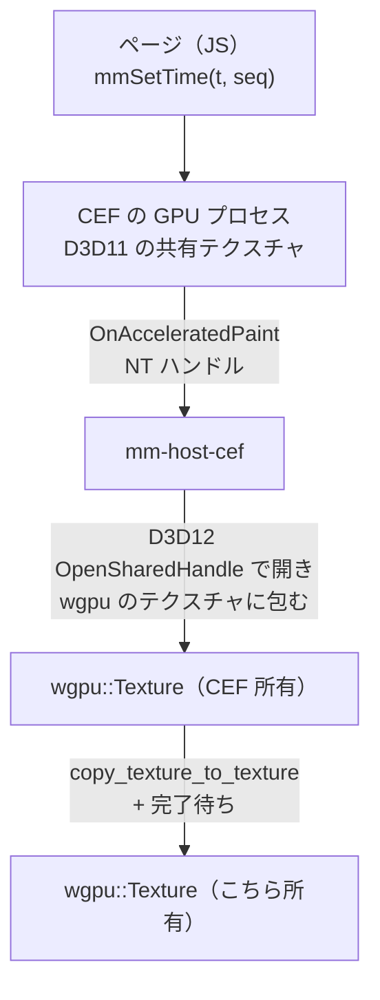

# 試作: CEF の共有テクスチャを wgpu へ

[段階 0 の難所](../15-roadmap.md#段階-0-で最初に確かめる難所)の 2 行目。
実装は `crates/mm-host-cef`（手順は[README](../../../crates/mm-host-cef/README.md)）。

## 結論

- 可。`OnAcceleratedPaint` の D3D11 共有ハンドルを、コールバックの中で wgpu のテクスチャへ写せた。1080p の写しは p50 0.6 ms、p95 0.8 ms（予算 3 ms 以下）。
- 描く時刻をこちらで決められる。1 フレーム受け取るまで p50 4.8 ms、p95 6.1 ms（1080p。ページの描画を含む）。約 190 fps で書き出せる。
- 逃げ道（`OnPaint` の CPU の BGRA）も動く。1 フレーム p50 9.2 ms で、共有テクスチャの約 2 倍。4K では 22.6 ms と 4.8 倍に開く。
- 使うには 3 つの設定が要る（下の[つまずいた所](#つまずいた所)）。外すと動かない（GPU の不一致）か、1 フレーム 35 ms に落ちる（フレームレート）。
- 未確かめ: 別プロセスのアプリへ渡す所（下の[口に要る変更](#口に要る変更)）。この試作の取り込みは CEF と同じプロセスで動く。

## 環境

| 項目 | 値 |
|---|---|
| OS | Windows 11 Home 10.0.26200 |
| GPU | NVIDIA GeForce RTX 5090（ドライバ 616.92）。ほかに AMD Radeon（内蔵）がある |
| CEF | `cef` 156.3.0（Chromium 156.0.8078.80）、`cef-dll-sys` 同版 |
| wgpu | 30.0.1、バックエンド dx12 |
| Rust | 1.95.0、release ビルド |

## 経路

- 取り込みは `cef` クレートの `osr_texture_import`（`SharedTextureHandle::import_texture`）をそのまま使った。`d3d11.rs` の中身は設計書の想定どおり（`OpenSharedHandle` → `texture_from_raw` → `create_texture_from_hal`（状態は `PRESENT`）→ コピー → 完了待ち）。出典は [references.md](../references.md) の [2][3][7]。
- ハンドルを開く所、コピーする所はコールバックの中。写した後のテクスチャはコールバックの外へ持ち出せる。
- unsafe は `import_texture` の呼び出しと `OnPaint` のバッファの読みの 2 か所で、`mm-host-cef` の中に閉じた。
- 描く時刻を決める手順（1 フレームごと）:
  1. `execute_java_script("mmSetTime(t, seq)")`。ページは `t` の関数としてだけ画面を作り、`document.title = "ready:" + seq` で反映を知らせる。
  2. `OnTitleChange` で `ready:seq` を待つ（p50 0.17 ms）。JS の実行と BeginFrame の順序は IPC で保証されないので、この往復で順序を作る。
  3. `send_external_begin_frame()`。絵が来なければ 3 ms ごとに送り直す（下記）。
  4. `OnAcceleratedPaint` の中で写す。

## 実測

1080p、300 フレーム（助走 30 フレーム）、ミリ秒。`mm-trace` の `MetricsLayer` で取った分布。生の 1 行は [metrics-accel.jsonl](cef/metrics-accel.jsonl)、[metrics-cpu.jsonl](cef/metrics-cpu.jsonl)。
ページは 1920x1080 の固定で、グラデーション、ぼかし、影、回転、文字を使う。

| スパン | 共有テクスチャ p50 | p95 | p99 | max | CPU の逃げ道 p50 | p95 |
|---|---|---|---|---|---|---|
| `host_cef.frame`（1 フレームの全体） | 4.84 | 6.11 | 17.8 | 26.4 | 9.18 | 10.6 |
| `host_cef.set_time`（JS の反映待ち） | 0.17 | 0.27 | 0.31 | 0.50 | 0.29 | 0.38 |
| `host_cef.begin_frame`（BeginFrame から絵が来るまで） | 4.60 | 5.89 | 17.6 | 26.3 | 8.89 | 10.3 |
| `host_cef.import`（コールバックの中の写し） | 0.60 | 0.79 | 3.04 | 14.0 | | |
| `host_cef.upload`（CPU の BGRA を上げて完了待ち） | | | | | 2.44 | 2.77 |

- 予算「CEF の 1 フレーム（1080p、共有テクスチャの写し）3 ms 以下」は写し（`import`）で見る。p50 0.6 ms で満たす。tail の 14 ms は 300 フレーム中の数回で、GPU プロセスと取り合った時と見られる（原因は未調査）。
- `frame` はページの描画を含む。この数字はページの重さで動く。`web.cef` の予算は、実際のページで取り直す。
- 4K（3840x2160、同じページ）は共有テクスチャが p50 4.74 ms、CPU の逃げ道が 22.6 ms（`upload` 8.76 ms）。共有テクスチャは大きさにほぼよらず、CPU の経路は画素数に比例して開く。
- 約 190 fps（5.1〜5.5 ms/フレーム）で連続して取れた。

### 決定的か

`--verify` で全フレームをリードバックて調べた（1080p、150 フレーム）。

| 確かめた事 | 結果 |
|---|---|
| ページの左上の四角に `seq` を色で入れ、リードバックて一致するか（古い時刻の絵が来ていないか） | 150 フレーム中 0 フレームが古い絵 |
| 同じ入力で 2 回走らせ、全フレームの画素のハッシュが一致するか | 100 フレームで完全に一致 |
| 同じ時刻を後から描き直して一致するか | 一致 |
| 共有テクスチャの経路と CPU の経路で画素が一致するか | 一致（同じ `seq` の PNG がバイト単位で同じ） |

目で確かめた絵: [frame-accel-0030.png](cef/frame-accel-0030.png)（`t=1.000`）、[frame-accel-0105.png](cef/frame-accel-0105.png)（`t=3.500`）。

## つまずいた所

設計の前提として残す 3 件。

1. **GPU を揃える。** この PC は内蔵 AMD と RTX 5090 があり、CEF の GPU プロセスは既定で AMD を選ぶ。wgpu を RTX にすると `OpenSharedHandle` が `0x80070057`（E_INVALIDARG）で落ちる。`--force-high-performance-gpu`（`App::on_before_command_line_processing`）で CEF を外付けに寄せ、wgpu も同じ GPU にすると通る。複数 GPU の PC では、ホストが選んだ GPU をアプリ側の wgpu にも伝える必要がある。
2. **`windowless_frame_rate` を上げる。** 外部 BeginFrame でも、この値が描画の間隔の下限になる。60（既定の値）では `begin_frame` が p50 35 ms、30 では 79 ms。240 で 4.8 ms、1000 でも 4.6 ms と頭打ちで、240 を採った。
3. **BeginFrame は捨てられることがある。** 送って絵が来ない時は、送り直さないと止まる。実測は 1 フレームにつき平均 1 回の送り直し（300 フレームで 310 回）。このため `send_external_begin_frame` は「1 回で必ず 1 フレーム」にはならない。「絵が来るまで送る」で作り、`seq` の印で古い絵を検出するのがよい。

そのほか:

- 最初の数フレームは GPU プロセスの起動で遅く、BeginFrame の送り直しも要る。助走で捨てる。
- CEF の C++ ラッパーのビルドは、`cargo` の target のパスが長いと CMake が `Cannot open compiler generated file` で落ちる。Ninja が要る。README に書いた。
- `cef` クレートの機能名は `accelerated_osr`。wgpu の版は `cef` クレートの要る版（30）に合わせる。
- 1280x720 で同じページを描くと p95 が 26 ms に跳ねた（原因は未調査。ページが 1920 幅の固定のため）。

## 採った経路と逃げ道

| 段 | 状態 |
|---|---|
| 共有テクスチャ（`OnAcceleratedPaint` → D3D12 `OpenSharedHandle` → wgpu） | 動く。採る |
| `OnPaint` の CPU の BGRA をアップロード | 動く。1 フレーム全体は 1080p で共有テクスチャの約 2 倍、4K で 4.8 倍。アップロード単体は 1080p で 2.4 ms と予算に収まるが、CEF が GPU から CPU へ読み戻す分が `begin_frame` に乗る。共有テクスチャが使えない構成の保険に残す |
| パラメーターごとに 1 回描くキャッシュ | 下がる必要が無かった。使わない |

## 口に要る変更

`mm-host-api` は変えていない。次を確かめる必要がある。

- **共有ハンドルの受け渡し。** CEF がコールバックで渡す NT ハンドルは、CEF のブラウザのプロセスの中だけで有効。`SharedFrame::SharedTexture { handle: u64 }` で別プロセスのアプリへ渡すには、`DuplicateHandle` でアプリのプロセスへ複製するか、ホストが自前の D3D12 共有テクスチャ（`CreateSharedHandle`）へ写して渡す必要がある。前者はホストがアプリの pid を知る必要があり（`HostSpec` か `Prepare` に足す）、後者は wgpu 経由では共有フラグ付きのテクスチャを作れないので生の D3D12 で作る。どちらも未実装・未測定。
- **GPU の指定。** 複数 GPU で揃える必要があるので、`HostSpec` か `Prepare` に「使う GPU（LUID）」を足す案。
- **完了の同期。** 現状はホストが写して完了を待ってから返す。アプリ側が開く形にするなら、`SharedTexture` に待つ印（フェンス）の有無も要る。

## 未確かめ

- アプリの別プロセスへの受け渡し（上記）。`mm-host-api` の `HostProcess` 越しの `RenderFrame` は、この試作では作っていない。
- 実際の `web.cef` のページ（動画、`<canvas>`、Web フォント）での 1 フレームの時間。
- 透過（`premultiplied`、背景色）の扱い。試作のページは不透明。
- CEF を落とした時の再起動（`restart`）、複数ブラウザの同時描画。
