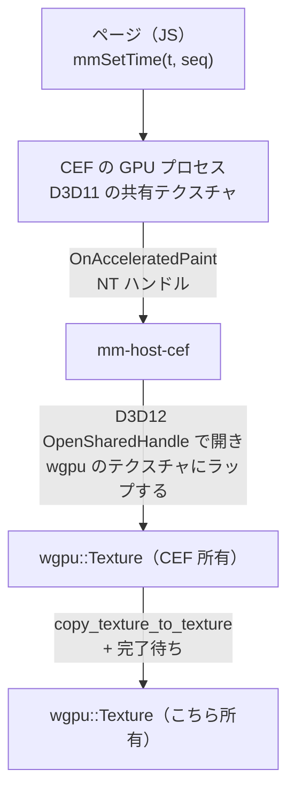

# 試作: CEF の共有テクスチャを wgpu へ

[段階 0 の難所](../15-roadmap.md#段階-0-で最初に確かめる難所)の 2 行目。
実装は `crates/mm-host-cef`（手順は[README](../../../crates/mm-host-cef/README.md)）。

## 結論

- 可。`OnAcceleratedPaint` の D3D11 共有ハンドルを、コールバックの中で wgpu のテクスチャへコピーできた。1080p のコピーは p50 0.6 ms、p95 0.8 ms（予算 3 ms 以下）。
- 描く時刻をこちらで決められる。1 フレーム受け取るまで p50 4.8 ms、p95 6.1 ms（1080p。ページの描画を含む）。約 190 fps で書き出せる。
- フォールバック（`OnPaint` の CPU の BGRA）も動く。1 フレーム p50 9.2 ms で、共有テクスチャの約 2 倍。4K では 22.6 ms と 4.8 倍に開く。
- 使うには 3 つの設定が要る（下の[つまずいた所](#つまずいた所)）。外すと動かない（GPU の不一致）か、1 フレーム 35 ms に下がる（フレームレート）。段階 4 でタイマーの粒度を足して 4 つ（[段階 4 の追加](#段階-4-の追加mm-host-cef)）。
- 別プロセスのアプリへの受け渡しは段階 4 で作った。ホストが自前の D3D12 共有テクスチャへコピーし、NT ハンドルをアプリのプロセスへ複製する。往復は 1080p で p50 8.6 ms（[段階 4 の追加](#段階-4-の追加mm-host-cef)）。

## 環境

| 項目 | 値 |
|---|---|
| OS | Windows 11 Home 10.0.26200 |
| GPU | NVIDIA GeForce RTX 5090（ドライバ 616.92）。ほかに AMD Radeon（内蔵）がある |
| CEF | `cef` 156.3.0（Chromium 156.0.8078.80）、`cef-dll-sys` 同版 |
| wgpu | 30.0.1、バックエンド dx12 |
| Rust | 1.95.0、release ビルド |

## 経路

- 取り込みは `cef` クレートの `osr_texture_import`（`SharedTextureHandle::import_texture`）をそのまま使った。`d3d11.rs` の中身は設計書の想定どおり（`OpenSharedHandle` → `texture_from_raw` → `create_texture_from_hal`（状態は `PRESENT`）→ コピー → 完了待ち）。出典は [references.md](../references.md) の [2][3][7]。
- ハンドルを開く所、コピーする所はコールバックの中。コピーした後のテクスチャはコールバックの外へ持ち出せる。
- unsafe は `import_texture` の呼び出しと `OnPaint` のバッファの読みの 2 か所で、`mm-host-cef` の中に閉じた。
- 描く時刻を決める手順（1 フレームごと）:
  1. `execute_java_script("mmSetTime(t, seq)")`。ページは `t` の関数としてだけ画面を作り、`document.title = "ready:" + seq` で反映を知らせる。
  2. `OnTitleChange` で `ready:seq` を待つ（p50 0.17 ms）。JS の実行と BeginFrame の順序は IPC で保証されないので、この往復で順序を作る。
  3. `send_external_begin_frame()`。フレームが来なければ 3 ms ごとに送り直す（下記）。
  4. `OnAcceleratedPaint` の中でコピーする。

## 実測

1080p、300 フレーム（助走 30 フレーム）、ミリ秒。`mm-trace` の `MetricsLayer` で取った分布。生の 1 行は [metrics-accel.jsonl](cef/metrics-accel.jsonl)、[metrics-cpu.jsonl](cef/metrics-cpu.jsonl)。
ページは 1920x1080 の固定で、グラデーション、ぼかし、影、回転、文字を使う。

| スパン | 共有テクスチャ p50 | p95 | p99 | max | CPU のフォールバック p50 | p95 |
|---|---|---|---|---|---|---|
| `host_cef.frame`（1 フレームの全体） | 4.84 | 6.11 | 17.8 | 26.4 | 9.18 | 10.6 |
| `host_cef.set_time`（JS の反映待ち） | 0.17 | 0.27 | 0.31 | 0.50 | 0.29 | 0.38 |
| `host_cef.begin_frame`（BeginFrame からフレームが来るまで） | 4.60 | 5.89 | 17.6 | 26.3 | 8.89 | 10.3 |
| `host_cef.import`（コールバックの中のコピー） | 0.60 | 0.79 | 3.04 | 14.0 | | |
| `host_cef.upload`（CPU の BGRA を上げて完了待ち） | | | | | 2.44 | 2.77 |

- 予算「CEF の 1 フレーム（1080p、共有テクスチャのコピー）3 ms 以下」はコピー（`import`）で見る。p50 0.6 ms で満たす。tail の 14 ms は 300 フレーム中の数回で、GPU プロセスと取り合った時と見られる（原因は未調査）。
- `frame` はページの描画を含む。この数字はページの重さで動く。`web.cef` の予算は、実際のページで取り直す。
- 4K（3840x2160、同じページ）は共有テクスチャが p50 4.74 ms、CPU のフォールバックが 22.6 ms（`upload` 8.76 ms）。共有テクスチャは大きさにほぼよらず、CPU の経路は画素数に比例して開く。
- 約 190 fps（5.1〜5.5 ms/フレーム）で連続して取れた。

### 決定的か

`--verify` で全フレームをリードバックして調べた（1080p、150 フレーム）。

| 確かめた事 | 結果 |
|---|---|
| ページの左上の四角に `seq` を色で入れ、リードバックして一致するか（古い時刻のフレームが来ていないか） | 150 フレーム中 0 フレームが古いフレーム |
| 同じ入力で 2 回走らせ、全フレームの画素のハッシュが一致するか | 100 フレームで完全に一致 |
| 同じ時刻を後から描き直して一致するか | 一致 |
| 共有テクスチャの経路と CPU の経路で画素が一致するか | 一致（同じ `seq` の PNG がバイト単位で同じ） |

目で確かめた画像: [frame-accel-0030.png](cef/frame-accel-0030.png)（`t=1.000`）、[frame-accel-0105.png](cef/frame-accel-0105.png)（`t=3.500`）。

## つまずいた所

設計の前提として残す 3 件。

1. **GPU を揃える。** この PC は内蔵 AMD と RTX 5090 があり、CEF の GPU プロセスは既定で AMD を選ぶ。wgpu を RTX にすると `OpenSharedHandle` が `0x80070057`（E_INVALIDARG）で失敗する。`--force-high-performance-gpu`（`App::on_before_command_line_processing`）で CEF を外付けの GPU にし、wgpu も同じ GPU にすると通る。複数 GPU の PC では、ホストが選んだ GPU をアプリ側の wgpu にも伝える必要がある。
2. **`windowless_frame_rate` を上げる。** 外部 BeginFrame でも、この値が描画の間隔の下限になる。60（既定の値）では `begin_frame` が p50 35 ms、30 では 79 ms。240 で 4.8 ms、1000 でも 4.6 ms と頭打ちで、240 を採った。
3. **BeginFrame は破棄されることがある。** 送ってフレームが来ない時は、送り直さないと止まる。実測は 1 フレームにつき平均 1 回の送り直し（300 フレームで 310 回）。このため `send_external_begin_frame` は「1 回で必ず 1 フレーム」にはならない。「フレームが来るまで送る」で作り、`seq` で古いフレームを検出するのがよい。

そのほか:

- 最初の数フレームは GPU プロセスの起動で遅く、BeginFrame の送り直しも要る。助走で破棄する。
- CEF の C++ ラッパーのビルドは、`cargo` の target のパスが長いと CMake が `Cannot open compiler generated file` で失敗する。Ninja が要る。README に書いた。
- `cef` クレートの機能名は `accelerated_osr`。wgpu のバージョンは `cef` クレートの要るバージョン（30）に合わせる。
- 1280x720 で同じページを描くと p95 が 26 ms に跳ねた。原因は `windowless_frame_rate` の 240（下の[段階 4 の追加](#段階-4-の追加mm-host-cef)）。ページの大きさではなかった。

## 採った経路とフォールバック

| 段 | 状態 |
|---|---|
| 共有テクスチャ（`OnAcceleratedPaint` → D3D12 `OpenSharedHandle` → wgpu） | 動く。採る |
| `OnPaint` の CPU の BGRA をアップロード | 動く。1 フレーム全体は 1080p で共有テクスチャの約 2 倍、4K で 4.8 倍。アップロード単体は 1080p で 2.4 ms と予算に収まるが、CEF が GPU から CPU へリードバックする分が `begin_frame` に乗る。共有テクスチャが使えない構成の保険に残す |
| パラメーターごとに 1 回描くキャッシュ | フォールバックする必要が無かった。使わない |

## 段階 4 の追加（mm-host-cef）

試作を `mm-host-api` の実装にした（`CefLauncher` が `mm-host-cef serve` を子プロセスで起こす）。手順は[README](../../../crates/mm-host-cef/README.md)。

### 別プロセスへの受け渡し

ホストがフレームごとに D3D12 の共有ヒープ（`D3D12_HEAP_FLAG_SHARED`）のテクスチャを作り、`OnAcceleratedPaint` の中でそこへコピーして完了を待つ。そのテクスチャの NT ハンドル（`CreateSharedHandle`）を、`HostSpec::client_pid` のプロセスへ `DuplicateHandle`（`DUPLICATE_CLOSE_SOURCE`）して返す。

| 先行事例 | やり方 | 採ったもの |
|---|---|---|
| Chromium の OSR | GPU プロセスがテクスチャを持ち、NT ハンドルを Mojo でブラウザのプロセスへ複製する。テクスチャはプールで使い回すので、CEF ではハンドルがコールバックの間だけ有効 | プロセスをまたぐのは NT ハンドルの `DuplicateHandle`。テクスチャを持つ側（ホスト）が複製する |
| OBS の browser source | 同じプロセスの中で `OnAcceleratedPaint` のハンドルを開き、コールバックの中で自前のテクスチャへコピーする | コールバックの中でコピーを終えること |

CEF のハンドルをそのまま複製する案は採らなかった。CEF はコールバックから戻るとテクスチャを次のフレームに使い回すので、アプリがコピーし終えるまでコールバックの中でプロセス間の往復を待つことになる。自前の共有テクスチャへのコピーは、フレームごとに資源を作っても 1080p で約 0.3 ms 増えるだけ（`host_cef.import` が p50 1.0 → 1.3 ms）で、ハンドルの作成と複製（`host_cef.share`）は 0.02 ms。渡したテクスチャは二度と書かないので、アプリが閉じるまで中身が変わらない。

### GPU を揃える

ホストは `HostSpec::gpu`（無ければ高性能のアダプター）で wgpu を作り、その LUID を Chromium のスイッチ `use-adapter-luid=<HighPart>,<LowPart>`（Chromium がブラウザから GPU プロセスへ渡すのと同じ形）で CEF に渡す。wgpu を RTX 5090 にしても内蔵の AMD にしても `OpenSharedHandle` が通った（試作では CEF が AMD を選び、RTX との組で失敗していた）。

### 速さ

前提の 2 つを新しく見つけた。

1. **タイマーの粒度。** CEF のプロセスが Windows の既定の 15.6 ms のタイマーで動くと、BeginFrame からフレームが来るまでが 15 ms 前後に揃う（1080p で `frame` p50 15.5 ms、68 fps）。Windows 10 2004 以降は粒度がプロセスごとなので、実行ファイルの先頭で `timeBeginPeriod(1)` を呼ぶ（GPU とレンダラのプロセスも同じ実行ファイル）。試作の数字は、ほかのアプリが粒度を上げていた時に取れたものと見られる。
2. **`windowless_frame_rate` を 1000 に。** 1280x720 で p95 が 26 ms に跳ねたのはこれが原因。CEF が付けるフレームの時刻（`AcceleratedPaintInfo` の `timestamp`）を見ると、遅いフレームも BeginFrame の約 1 ms 後に描けていて、`OnAcceleratedPaint` に届くのが約 20 ms 遅れていた。遅れるのは、前のフレームから 4.2 ms（1/240 秒）より短い間隔で描けたフレームの次で、720p はページが軽く間隔が短いので当たる。CEF がフレームを受け取る経路（Chromium の映像の取り込み）が最短の間隔を `windowless_frame_rate` から決め、それより早いフレームを後回しにしていると見られる〔推。Chromium のコードは読んでいない〕。1000 にすると 720p の p95 は 6〜9 ms に収まる（同じ条件の 3 回で、240 は 18〜26 ms）。1080p は変わらない。ページの大きさ（1920 幅の固定）、ぼかし、影を外しても 240 のままでは直らなかった。

BeginFrame の送り直しの間隔は 3 ms のまま。BeginFrame からフレームが来るまでは最短でも約 3.5 ms あり、1.5 ms や 0.5 ms にすると送った分が捨てられて遅くなる（0.5 ms で 1080p の `frame` p50 18.9 ms）。

数字（`bench`、300 フレーム、助走 30、`windowless_frame_rate` 1000、ms）。ほかの作業のビルドが同時に走っていたので、3 回の中央値と、負荷が軽かった回を並べる。

| 大きさ | 経路 | `frame` p50 | p95 | `import` p50 | p95 | 負荷が軽い回の `frame` p50 / p95 |
|---|---|---|---|---|---|---|
| 1920x1080 | 自前のテクスチャへコピー | 9.10 | 11.21 | 1.54 | 2.68 | 4.83 / 6.21 |
| 1920x1080 | 共有テクスチャ（`serve` と同じ） | 11.39 | 13.94 | 2.94 | 4.73 | 6.22 / 7.62（240） |
| 1280x720 | 自前のテクスチャへコピー | 4.87 | 7.28 | 0.82 | 1.10 | 2.49 / 5.25 |
| 1280x720 | 共有テクスチャ（`serve` と同じ） | 3.46 | 6.22 | 1.10 | 1.43 | 3.33 / 6.08 |

別プロセス越しの往復（`tests/serve.rs` の `別プロセス越しの往復を測る`。要求を送ってから、アプリ側が共有テクスチャを開いて自分のテクスチャへコピーし終えるまで）は、1080p で p50 8.64 ms、p95 10.86 ms、720p で p50 5.53 ms、p95 8.45 ms（`windowless_frame_rate` 240 の時の 1 回）。ホストの中の `frame` との差（約 1 ms）が、パイプの往復とアプリ側の取り込み。

### 古いフレームの検出

- `serve` は、ページの JS が時刻を反映した合図（タイトル）を待ってから BeginFrame を送り、その後に来た最初のフレームを使う。時刻を変える前の画面にはダメージが無く CEF がフレームを出さないので、この順で古いフレームは来ない。テスト（`古い時刻のフレームを返さない`）で、`params.seq` をページの左上に色で入れて 120 フレームを共有テクスチャ越しに読み、全部一致した。`bench --verify` も 150 フレーム中 0。
- 大きさを変えた直後に来る古い大きさのフレームは捨てて次を待つ。
- 時刻を変えても画面が変わらないページはフレームが来ないので、60 ms 待って前のフレームを返す。

## インターフェースに要る変更

`mm-host-api` は変えていない（RFC 0001 で足した `HostSpec::gpu`、`client_pid`、`SharedFence` で足りた）。次は足すと良い。

- **共有テクスチャの形式。** `SharedFrame::SharedTexture` に形式が無い。今は README の約束（`B8G8R8A8_UNORM`、premultiplied、sRGB の符号化、COMMON）で、アプリが決め打ちで開く。`format` を足す案。
- **要求の番号。** 期限を過ぎた応答は、ランチャーが数えて次の要求の前に読み捨てている（ホストが順に 1 行ずつ答える前提）。要求と応答に番号があれば前提が要らない。

## 未確かめ

- 実際の `web.cef` のページ（動画、`<canvas>`、Web フォント）での 1 フレームの時間。
- 透過（`premultiplied`、背景色）の扱い。テストのページは不透明。
- CEF がクラッシュした時の再起動（契約の `kill` と `restart` は通る。クラッシュの検出と 2 秒以内の再起動は段階 6）、複数ブラウザの同時描画。
- `Engine` が持つホストの持ち替え（RFC 0009 の未了）。ホストはまだ再生の経路に入っていない。
