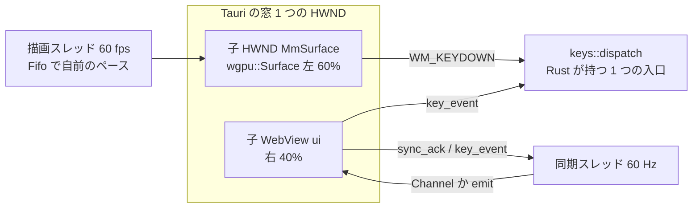
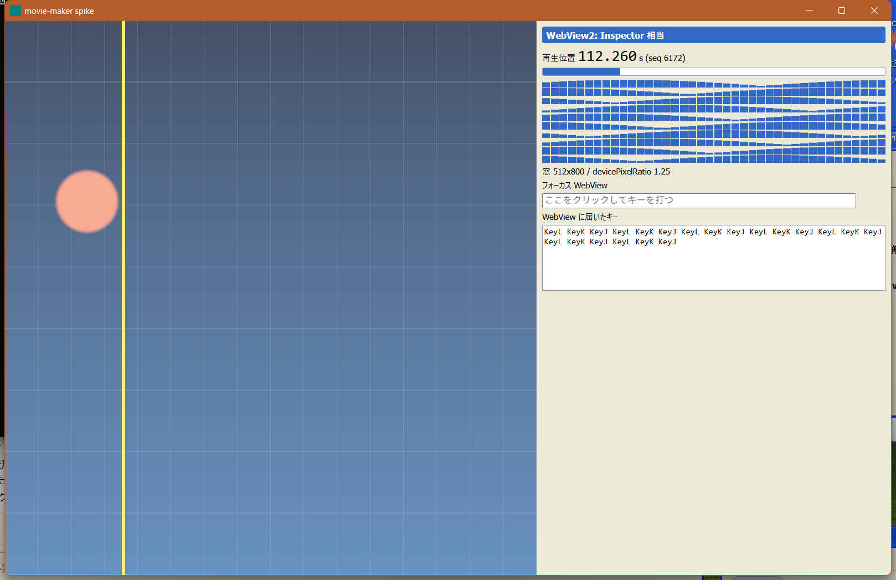
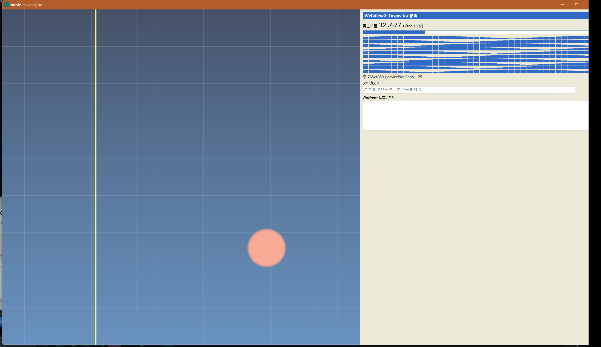
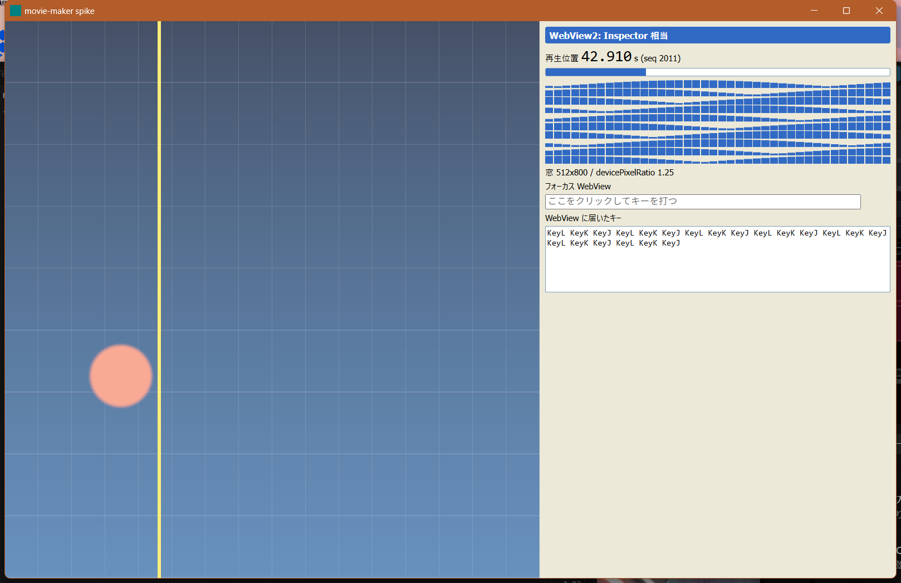

# 難所の試作: Tauri の窓に wgpu の面と WebView2 を並べる

[段階 0 の難所](../15-roadmap.md#段階-0-で最初に確かめる難所)の 1 行目の結果。コードは `apps/movie-maker/`、生の数字は `window/result.json`。

## 結論

- **並べられた。逃げ道（別の窓、全部ネイティブ）には下がっていない。**
- Tauri 2 の `Window::add_child`（`unstable`）で子 WebView を、自前の子 HWND に `wgpu::Surface` を張って並べる。
- 面は 60 秒の連続で 59.97 fps、面を取れなかった回数は 0。WebView を 60 Hz で更新しても落ちない。
- Rust の再生位置が WebView の画面に出るまで、中央値 9〜14 ms、99% で 17 ms 以下（予算 50 ms の内）。
- 大きさを変え続けている間は WebView の更新が最大 0.25 秒遅れる。面は 1〜2 コマ落ちるだけ。
- 未確認は 150% の DPI、倍率の違うモニター間の移動、複数の子 WebView。「人が確かめる所」を見る。

## 手元の環境

| 項目 | 値 |
|---|---|
| OS | Windows 11 Home 10.0.26200 |
| GPU | NVIDIA GeForce RTX 5090（wgpu の DX12 バックエンド）。ほかに AMD Radeon（内蔵） |
| モニター | 主 2560x1600、副 3840x2160。**どちらも 125%**（150% は無い） |
| WebView2 ランタイム | 156.0.4314.58 |
| 版 | tauri 2.12.5（`unstable`）、wgpu 30.0.1、windows 0.62、Rust 1.95（release ビルド） |

## 組み立て



- 窓は `WindowBuilder` で作る（`WebviewWindow` は WebView が窓全体を覆う）。`add_child` の位置と大きさは物理ピクセルで渡す。
- 面の HWND は `WS_CHILD | WS_CLIPSIBLINGS` で親の下に作り、`SurfaceTargetUnsafe::RawHandle`（Win32）で `wgpu::Surface` にする。UI スレッドの外の描画スレッドで描く。
- `WindowEvent::Resized` で `SetWindowPos`（面）と `Webview::set_bounds`（WebView）を同じ値から決めて置き直す。面は次のコマで `configure` し直す。
- Tauri のコマンドは `async` にする。同期のコマンドは UI スレッドで動くので、60 Hz の通知がメッセージループを塞ぐ。
- wry の `wgpu.rs` の例 [28] は使わなかった。Tauri 側の `add_child` が wry の `build_as_child` を包んでおり、そのまま足りた。

## 確かめたことと数字

計測は `window.frame` `window.sync` `window.resize` `window.key` の `mm-trace` のスパンと、壁時計を突き合わせた系列。`window.sync` は送ってから ack が戻るまで、`window.resize` は配置を変えてから新しい大きさの最初の present まで。

### 面を 60 fps で描き続ける

| 場面 | 時間 | fps | コマの間隔 p99 / 最大 (ms) | 面を取れなかった数 |
|---|---|---|---|---|
| WebView を更新しない | 5 s | 60.0 | 16.67 / 16.71 | 0 |
| `Channel` で 60 Hz 更新（400 個の要素を毎回変える） | 10 s | 60.0 | 16.67 / 16.76 | 0 |
| `emit` で 60 Hz 更新 | 10 s | 60.0 | 16.67 / 16.82 | 0 |
| `Channel` で 60 Hz 更新、連続 | 60 s | 59.97 | 18.06 / 25.70 | 0 |

- 1 コマの CPU は、コマンドの記録と submit が中央値 0.4〜0.7 ms、present が 0.4〜0.6 ms。残りは `get_current_texture` での待ち（Fifo のペース）。
- 通知の経路は `Channel` と `emit` で差が出なかった。型が付き順序が保たれる `Channel` を採る。

### 再生位置の同期の遅れ（Rust の状態 → IPC → WebView の画面）

`window.sync` の往復と、壁時計の片道。rAF の時刻までを「画面に出る」の近似にした（実際の描画はその後 1 回の合成）。

| 区間 | `Channel` 中央値 / 99% (ms) | `emit` 中央値 / 99% (ms) | 60 s の連続 中央値 / 99% (ms) |
|---|---|---|---|
| 送信 → WebView が受ける | 0.3 / 1.0 | 0.0 / 1.8（時計の粒度 0.1 ms 未満） | 0.0 / 1.9 |
| 送信 → rAF | 9.5 / 11.6 | 13.7 / 15.9 | 9.6 / 16.8 |
| rAF → Rust が ack を受ける | 2.2 / 3.2 | 1.9 / 2.9 | 3.1 / 5.7 |
| 送信 → ack（`window.sync` の往復） | 11.7 / 14.3 | 15.5 / 18.0 | 12.5 / 20.5（最大 26.4） |

- IPC の片道は 1 ms 前後で、遅れの大半は WebView の次の rAF を待つ時間（最大 1 コマ）。
- 予算「WebView → 命令 → 通知 → 画面 50 ms」に対し、ここは「通知 → 画面」の区間だけで 99% 17 ms 以下。
- WebView から Rust へキーが届くまでは中央値 5.0 ms（最大 10.0 ms）。命令の適用を足しても 50 ms に収まる見込み。

### 大きさの変更

| 場面 | 結果 |
|---|---|
| 4 段階（1600x1000、900x600、1920x1080、1280x800。論理） | 4 回とも、面の HWND と `wgpu` の大きさと WebView の報告（CSS px）が一致。面を取れなかった数 0 |
| 変更から新しい大きさの最初の present まで | 中央値 30 ms、最大 44 ms（4 回）。このとき 1 コマの間隔が最大 58 ms |
| 10 ms ごとに 200 回、続けて変える | 変更 → present は中央値 5.7 ms、99% 15.8 ms。コマの間隔は 99% 23.7 ms、最大 27.9 ms（1 コマ落ちる程度）。面を取れなかった数 0 |
| 同じ連続の間の WebView の同期（`window.sync`） | 中央値 36.9 ms、99% 221.8 ms、最大 247 ms |

- 連続で変えている間、WebView の通知は最大 0.25 秒遅れる（WebView の再レイアウトが先に来るためと見ている。原因の切り分けはしていない）。900 ms の静止を挟む 4 段階の測定では、往復の中央値が 2.5 ms（99% 18.8 ms）だった。
- 面は WebView に引きずられない。ドラッグ中に面が止まる、黒くなる、は見られなかった。

### キーの振り分け

面と WebView を `SendInput` でクリックし、J/K/L を 21 回ずつ送った。

| クリックした先 | キーボードフォーカスの HWND | 面に届いた | WebView に届いた | `SendInput` → Rust の受信 中央値 / 最大 (ms) |
|---|---|---|---|---|
| 面 | `MmSurface`（自前の子 HWND） | 21 | 0 | 3.1 / 7.6 |
| WebView | `Chrome_WidgetWin_1`（WebView2） | 0 | 21 | 5.0 / 10.0 |

- キーは**フォーカスのある片方にだけ**届く。両方に届くことも、どちらにも届かないこともない。
- 子 HWND は自動でフォーカスを取らないので、`WM_LBUTTONDOWN` で `SetFocus` する。
- 「どちらにフォーカスがあっても同じ命令になる」は、面の `WM_KEYDOWN` と WebView の `keydown`（IPC）を `keys::dispatch` の 1 つの入口に入れることで成り立つ。キーの表（J/K/L など）はこの入口の先に置く。

### DPI とモニター

- 主モニターの 125%（物理 2000x1250 の窓）で、面の HWND、`wgpu` の面、WebView の `innerWidth × devicePixelRatio` が全て一致。WebView の `devicePixelRatio` は 1.25。
- 副モニター（3840x2160、125%、主の左上にあたる負の座標）へ窓を動かして戻した。配置は崩れず、面を取れなかった数 0、コマの間隔は最大 20.6 ms。
- **150% と、倍率の違うモニター間の移動は測っていない**（このマシンに 150% が無い）。

## 逃げ道

使っていない。面を別の窓にする案も、全部ネイティブにする案も、この試作の範囲では要らない。

## 実装のとき気をつける所

- 面の大きさと WebView の矩形は、窓の物理ピクセルから 1 か所（`split_rects`）で決める。論理ピクセルで持つと DPI で 1 px ずれる。
- 面を取れなかったとき（`Outdated`、`Lost`）は `configure` し直して次のコマに回す。今回は 0 回で、この経路は試していない。
- wgpu 30 は `Instance::new_without_display_handle`、`get_current_texture` が `CurrentSurfaceTexture` を返し、`queue.present` で出す。`SurfaceConfiguration` に `color_space` がある（HDR の出力は段階 2 で見る）。
- Tauri 3 の alpha（3.0.0-alpha.5）が crates.io にある。この試作は 2.12.5。
- 自己診断（`--selftest`）は窓を最前面にして `SendInput` を打つ。実行中の約 2 分は PC を触らない。

## 人が目で確かめる所

- 150% の DPI（設定 → ディスプレイ → 拡大/縮小）で `cargo run --release -p movie-maker` を起動し、面と WebView の境目に隙間や重なりが無いか。`--selftest <out.json>` の `stage_resize_steps.checks[].ok` がすべて `true` なら一致している。
- 倍率の違うモニター間のドラッグ中に、面が一瞬ぼやけたり、位置がずれたりしないか。
- IME の変換候補（日本語入力）が WebView の入力欄で面の上に出るか。面に隠れるか。
- 面と WebView の境目をドラッグで動かす操作（この試作は固定の 60:40）。
- 複数の子 WebView を並べたときの前後（Tauri の issue #9798）。この試作は子 WebView 1 つ。
- 長時間（30 分以上）の連続再生で、面を取れなかった数が 0 のままか。

## 再現

```sh
cd movie-maker
cargo run --release -p movie-maker                          # 窓を開く
cargo run --release -p movie-maker -- --selftest out.json   # 自己診断（約 2 分）
```

スクリーンショット（主モニター、125%）:






