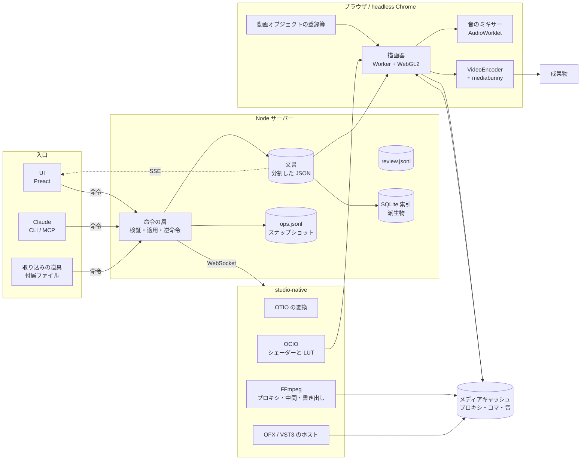
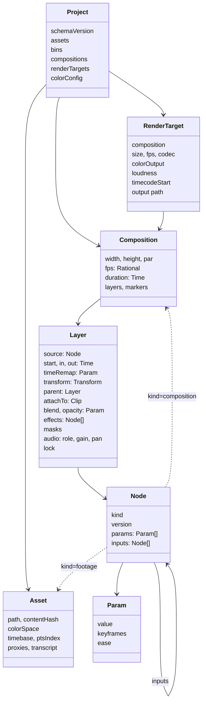
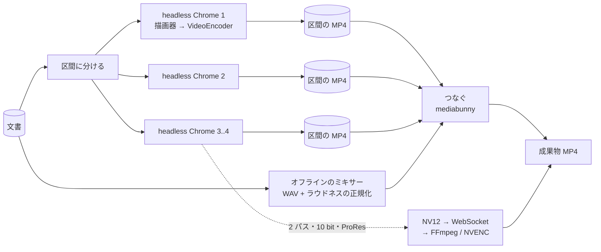

# studio 設計書

汎用の動画編集・合成ソフト。2026-11-05 時点の案。名前（studio）は仮。
2026-11-05 の 6 人のレビュー（`reviews/2026-11-05.md`）と規格の調査（`reviews/2026-11-05-standards.md`）を反映した版。実測の数はレビューのものを使い、〔推〕を付けた数と判断は推測。

## 目的

1. **AI と手作業の混成**: Claude が編集でき、人も UI でまったく同じ作業ができる。
2. **素早いフィードバック**: 操作した結果を、書き出しを待たずにその場で再生できる。
3. **継続的な改善**: 要望を出すと自動で直るサイクルを持つ（durun-dashboard と同じ型）。
4. **汎用性**: vlog の形に依存しない。vlog は、その上で作るものの 1 つとして扱う。
5. **生成方法の拡張**: 映像の作り方（撮影素材、Three.js、シェーダー、Web の UI、生成 AI など）を、同じ口から足せる。
6. **規格への対応**: 業界標準の規格がある所はそれに対応し、プロの用途にも耐える（下の「規格への対応」）。

決まったこと（2026-11-05、ユーザー）:

- 再生はブラウザで合成する。
- 改善要望は、起票をきっかけに自動で実装する（ON/OFF を切り替えられる）。
- 既存の基盤（DTM_Vlog の `build_ep.py`、レビュー UI）にはこだわらず、ゼロから組む。
- UI の文言は英語にする（翻訳調を避けるため）。
- 開発は `claude-marketplace` リポジトリの worktree で、`studio/` に置く。durun-dashboard とつなぐのは後にする。
- 拡大のキーフレームがかかったベクターは、プレビューではその範囲でいちばん大きい倍率で 1 回描いて縮め、書き出しでは毎コマ実寸で描き直す。
- レビューの指摘は全部反映する。
- 業界標準の規格がある所はそれに対応し、プロの用途にも耐えるようにする（OpenFX などを例に）。

## 中心の考え方

1. **プロジェクトとコンポジション**: 1 つのプロジェクトに複数のコンポジションを持つ。書き出しの対象（レンダーターゲット）は複数選べるので、プロジェクトと成果物は 1 対 N になる（本編とショートを 1 つのプロジェクトで作る）。コンポジションはほかのコンポジションに入れられる（入れ子）。
2. **動画オブジェクト**: 「入力パラメータを受け取り、時刻ごとに映像（と音）を返す箱」と定義する。撮影素材も、文字も、シェーダーも、Three.js の場面も、生成 AI の出力も、OpenFX のプラグインも、コンポジションそのものも、この口で扱う。
3. **時間変化は基盤が持つ**: どのパラメータもキーフレームとイージングで動かせる。動画オブジェクトの側は「時刻 t でのパラメータの値」を受け取るだけで、時間変化の仕組みを自分で持たない。
4. **操作は命令にする**: 文書を変えるのは命令だけ。UI のボタンも Claude の CLI・MCP も同じ命令を呼ぶ。
5. **同じ描画器で見て、同じ描画器で書き出す**: プレビューも本番も、同じ TypeScript の描画器をブラウザで動かす。差として認めるのは、素材のデコードの品質（プロキシか原本か）と、ベクターを描く倍率（決まったことの 6 つ目）だけ。
6. **内部のモデルは規格に合わせて作る**: 時刻は有理数（OTIO の `RationalTime`、SMPTE のタイムコード）、色は線形の浮動小数と OCIO の変換、タイムラインは OTIO の `Track`・`Clip`・`Gap`・`Transition` に写せる形にする。後から規格に合わせ直すのは、最初から合わせるより高くつく。
7. **ブラウザでできないことはネイティブの補助プロセスが受け持つ**: OFX、VST3、OCIO の本体、ProRes などのデコード、FFmpeg の書き出しは、ブラウザの中では動かない。これらは描画器の外のプロセスに置き、ブラウザとは決まった口（ファイルと WebSocket）でつなぐ（下の「構成の判断」）。

## 構成の判断

規格の調査の 3 つの構成を、ユーザーの要望の軸で比べた。

| 軸 | A. ブラウザで描画 + ネイティブの補助プロセス | B. Rust の共通の核 + wgpu（ネイティブと WASM） | C. ネイティブの描画器 |
|---|---|---|---|
| プレビューの即時性 | ブラウザの中で描くので、操作からコマまでが短い | WASM 版で同じ。GPU の口は WebGPU に限られる | 描いたコマをブラウザへ送るか、UI もネイティブにする。送ると遅れる |
| プレビューと書き出しの一致 | 同じ描画器を headless Chrome で動かす。差はデコードの品質とベクターの倍率だけ | 同じ核をネイティブと WASM で動かすが、GPU の裏（wgpu のバックエンド）と浮動小数の丸めが違いうる〔推〕 | 一致する（同じ物） |
| 人と Claude が同じ命令で編集 | 命令の層は Node のサーバー。どの構成でも同じ | 同じ | 同じ |
| 種類（生成方法）の足しやすさ | HTML の文字、Three.js、GLSL、Lottie はブラウザの物なので、そのまま足せる。OFX と VST3 は補助プロセスの側に足す | Web 由来の種類（HTML の文字、Three.js）は WASM の核からは描けず、結局ブラウザが要る | 同じく、Web 由来の種類にはブラウザが要る |
| 実装の手間 | いちばん小さい。TypeScript だけで最初の縦の 1 本が通る | Rust と wgpu の描画器を書き、WASM の口も作る。先行事例（OpenCut）は移行の途中 | OFX のホストと描画器を全部ネイティブで書く。参考の Natron は GPLv2 |
| durun-dashboard（Node と Preact）とつなぐ | サーバーも画面も同じ道具。つなぐのは API を足すだけ | 画面は同じ。核は別の言語 | 画面を別に作るか、ネイティブの画面を埋め込む |
| 規格への対応 | ブラウザで扱える規格はブラウザで、残り（OFX、VST3、OCIO の本体、ProRes、MXF、AAF）は補助プロセスで | ネイティブ版は全部直接組み込める。WASM 版は A と同じ制約 | 全部直接組み込める |

判断: **A を採る**。理由は 3 つ。

1. 「HTML の UI、Three.js、シェーダーで映像を作る」はユーザーの要望で、これらはブラウザのエンジンでしか動かない。B と C を選んでも、これらの種類のためにブラウザが描画の経路に入る。構成 A はブラウザを「仕方なく使う」のではなく、「ブラウザでしか動かないものはブラウザで、ネイティブでしか動かないものはネイティブで」と、動く場所で分けた形になる。
2. 一致と即時性の両方を、同じ描画器の 1 つの実装で満たせる。プロの用途で要る規格は、補助プロセスに正面から実装する（OFX のホスト、VST3 のホスト、OCIO、FFmpeg）。これらは描画器の中ではなく、動画オブジェクトの `offline` の種類として扱い、結果をキャッシュに描き出してからブラウザで合成する（下の「規格への対応」の OFX と VST3）。
3. 内部のモデル（有理数の時刻、線形の浮動小数の色、OTIO に写せるタイムライン）を規格に合わせて作っておけば、後で描画器を B の形（Rust の核）に置き換えても、文書・命令・補助プロセスはそのまま残る。A は B への道をふさがない。

補助プロセス（仮に `studio-native`）は、Node のサーバーが起動して管理する 1 つの実行ファイルにする。言語は C++ か Rust。OFX と OCIO は C/C++ の API なので C++ の方が手間が少ない〔推〕。実装の前に、OFX のホストを Rust で書いた先行事例の有無を調べる。

## 全体像



ランタイムの分担:

| 部分 | ブラウザ（Chrome、headless Chrome） | Node サーバー | studio-native |
|---|---|---|---|
| 受け持つもの | 描画器、音のミキサー、UI、ブラウザの中の符号化 | 命令の層、文書の保存、索引、Claude の入口（CLI、MCP）、自動の改善、補助プロセスの管理 | FFmpeg（プロキシ、中間、ProRes などの書き出し）、OFX と VST3 のホスト、OCIO、OTIO の変換、ラウドネスの測定 |
| 言語 | TypeScript | TypeScript（`.ts` を直接動かす） | C++ か Rust |
| つなぎ | HTTP と SSE、WebSocket | | Node と WebSocket（命令と進み具合）、キャッシュのファイル（コマと音） |
| 同じ描画器 | プレビューと書き出しの両方 | | 描かない。描画器に渡す物（シェーダー、LUT、中間の映像）を作る |

## 先行事例から採るもの

| 型 | 先行事例 | この設計での形 |
|---|---|---|
| コンポジション、レイヤー、入れ子、親子づけ、キーフレームとグラフエディター | After Effects | データの骨組み（下の「データの形」） |
| 書き出しの対象を並べて一度に書き出す | After Effects のレンダーキュー、Resolve の Deliver ページ | レンダーターゲット |
| 素材の選別（ソースを見て I/O で範囲を付け、刻んで並べる） | Resolve の Cut ページとソーステープ、Premiere のソースモニター、FCP のキーワードコレクションと評価 | Media と Source のパネル |
| 端の語彙（リップル、ロール、スリップ、スライド）、3 点編集、J/K/L | Avid のトリムモード、どの NLE でも共通 | 命令とキー操作の語彙 |
| 隙間のできない並びと、カットに接続したクリップ | Final Cut Pro の磁気タイムラインと接続クリップ、Premiere のリンク | `sequence` と `attach`（下） |
| 言葉で切る | Premiere の文字ベースの編集、Descript、Avid の ScriptSync・PhraseFind | Story パネル |
| 見た目を固定し、中身だけを差し替えるテンプレート | Premiere の MOGRT、Remotion の Zod スキーマ | 動画オブジェクトのパラメータの型から編集欄を作る |
| パラメータの型を宣言した描画の部品。時刻で引ける入力、描く領域、恒等の宣言 | OpenFX のプラグイン API、Blender と Nuke のノード | 動画オブジェクトの口 |
| 有理数の時刻と、版つきの型をもつ交換形式 | OpenTimelineIO の `RationalTime` と `Timeline.1` のような版、FCPXML の `1001/30000s` | 時刻の型と文書のスキーマの版 |
| 作業色空間を線形の浮動小数にし、入出力で変換する | OpenColorIO、ACES、AE の「1.0 ガンマでブレンド」 | 色の管理 |
| 変形を 1 つの行列にまとめ、1 回だけ再標本化する | AE の「連続ラスタライズ」と「トランスフォームを折りたたむ」、Nuke の concat | 変形の折りたたみ |
| プレビューと書き出しを同じコードで描く | Remotion（Player と renderer）、Revideo | 描画器を 1 つにする |
| 先回りの描画、プロキシ、素材の中身で引くキャッシュ | Resolve の Smart Cache と Cache Files、FCP のバックグラウンドレンダリング、Premiere の Ingest と Media Cache | コマのキャッシュと、置き場所を決めたメディアキャッシュ |
| 文書を分けて保存し、変わった所だけ書く | FCP の `.fcpbundle`、Unity の `.meta` | プロジェクトのディレクトリ |
| スナップショットと操作の記録からの復旧 | Redis の RDB と AOF、SQLite の WAL | `ops.jsonl` の再生 |
| 人の UI と AI のスクリプトが同じデータを書く | Resolve の Python/Lua API、Premiere の UXP、Descript の API と Underlord | 命令の層 |
| 時刻・範囲・描き込みつきのコメント、版の比較 | Frame.io | Review パネル |
| 要望の保存をきっかけに AI が直す。別の作業場で直して検査が通ったら取り込む | durun-dashboard の `server/improve.ts`、Dependabot と Renovate の PR | 自動の改善 |
| 役割ごとのバス、ラウドネスのメーター | FCP のロール、Premiere のエッセンシャルサウンド、EBU R128 | 音のミキサー |

Remotion もプレビューと書き出しの見た目を完全には一致させていない（`OffthreadVideo` は、書き出しでは FFmpeg が抜いたコマ、プレビューでは `<video>` で描く）。この設計では、デコードの品質とベクターの倍率だけを差として認め、それ以外は同じコードで描く。

## 新しく設計するもの

先行事例にそのまま当たるものがなく、この設計で決めたもの。

- 動画オブジェクトの 1 つの口に、撮影素材・文字・シェーダー・Three.js・生成 AI・OFX・入れ子のコンポジションをそろえること。OFX は効果の口としては先行事例だが、「素材も生成も同じ口」はこの設計のもの。
- ベクターの倍率の扱い（プレビューは範囲の最大の倍率で 1 回、書き出しは毎コマ実寸）。
- ブラウザでできない規格を `offline` の種類として補助プロセスに任せ、キャッシュを介して同じ描画器で合成すること。
- 命令の `touches` による同時書き込みの判定と、AI の対応 1 回をまとまりとして承認・却下すること。
- 自動の改善を worktree で囲い、本番のプロジェクトのハッシュで守ること。

## データの形



### 時刻

- 時刻は有理数 `Time = {num: bigint, den: number}`（OTIO の `RationalTime`、FCPXML の `1001/30000s`）。コンポジションの fps も有理数（`30000/1001`）。浮動小数の秒は文書に書かない。
- 素材のコマを選ぶ規則は 1 つ。コンポジションの時刻 t を素材の時間軸に写した後、`floor((t - offset) * fps + 1/2^20)` でコマの番号にする。量子化はここ（葉）で 1 回だけ。途中の入れ子やタイムリマップでは丸めない。
- 可変フレームレート（VFR）の素材は、取り込みで PTS の索引（`ptsIndex`）を作り、プロキシも PTS を保つ。コマの番号ではなく PTS で引く。
- OBS の mkv は音と映像の頭がずれることがある。取り込みで最初の PTS の差を `timebase.offset` に記録し、素材を置くときに引く。
- タイムコードは SMPTE ST 12-1。29.97 と 59.94 のドロップフレームを含む。表示と書き出しのメタデータに使い、内部の時刻には使わない。レンダーターゲットが `timecodeStart` を持つ。

### 色

- 作業色空間は線形の Rec.709（primaries）で、中間のテクスチャは RGBA16F。アルファは中ではすべて premultiplied の線形。
- 素材ごとに入力の色空間を持つ（`Asset.colorSpace`。OCIO の色空間の名前）。取り込みで素材のタグを読み、無ければ既定（映像は `bt709`・tv レンジ、画像は sRGB）。HDR の素材（PQ、HLG）は当面は断るか、トーンマップを明示して受ける。
- 変換は OCIO の設定（ACES 2.0 の内蔵の設定を既定）に従う。studio-native が OCIO から GLSL のシェーダーと 3D LUT を作り、描画器がそれを使う。ブラウザの中に OCIO の本体は置かない。
- YUV→RGB はブラウザに任せない。WebCodecs の `VideoFrame` から `copyTo` で Y と UV の面を受け、自前のシェーダーで変換する（レンジ、行列、クロマの位置を明示）。`copyTo` の手間は未計測なので、段階 0 で測る。
- プロキシと書き出しには `bt709`・tv レンジのタグを明示する（FFmpeg の既定は BT.601 になる）。8 bit に落とす前にディザーをかける。
- 合成のガンマはコンポジションの設定で選べる（線形か、表示のガンマか。AE の「1.0 ガンマでブレンド」）。既定は線形。
- 色補正は ASC CDL の式を GLSL で持ち、`.cube` の LUT は WebGL2 の 3D テクスチャで当てる。CLF は OCIO 経由で読む。
- HDR の出力は WebGPU の `rgba16float` と `toneMapping: extended` が要る（Chrome 138 以降）。WebGL2 の間は SDR だけ。描画器の裏を WebGPU に替えるときに足す。

### プロジェクト

- `assets`: 撮影素材、音、画像、文字起こし。原本のパス、中身のハッシュ、色空間、時間軸、取り込みで作ったもの（プロキシ、波形、文字起こし、サムネイル）への参照を持つ。
- `bins`: 素材の整理。`selection`（素材の中の範囲。Resolve のサブクリップ）、評価（お気に入り・却下・保留）、キーワード、話題を持つ。
- `compositions`: コンポジションの一覧。
- `renderTargets`: 書き出しの対象。コンポジション、形式（解像度、fps、コーデック、ビット深度、色の出力、ラウドネスの目標、タイムコードの始まり）、出力先を持つ。本編は 1920x1080 の 1 本、ショートは 1080x1920 の N 本のように並べる。
- `colorConfig`: OCIO の設定のパスと、作業色空間、表示の変換。
- プロジェクトをまたぐ素材とテンプレートは、ライブラリ（決まった置き場所のプロジェクト）として持ち、参照で使う。

### コンポジションとレイヤー

- コンポジションは、大きさ、画素の縦横比、fps、長さ、背景、レイヤーの重なり、マーカーを持つ。
- レイヤーは、動画オブジェクト（`source`）を 1 つ持ち、次を足す。
  - 時間: 置く時刻（`start`）、使う範囲（`in`・`out`）、速さ、タイムリマップ（パラメータなのでキーフレームで動かせる）
  - 接続（`attachTo`）: `sequence` の中のカットに接続する。カットがリップルで動くと一緒に動き、カットを外すと一緒に外れる（FCP の接続クリップ）。字幕、札、図はこれでカットに付ける。
  - 形: 変形（アンカー、位置、拡大、回転、不透明度）と、親のレイヤー（親子づけ）
  - 重ね方: 合成モード、マスク、トラックマット
  - 効果: 効果の列（効果も動画オブジェクトで、前の結果を入力に受ける）
  - 音: 役割（喋り、音楽、効果音など。FCP のロール）、音量とパン（パラメータ）
  - ロック: 人が直した所を AI の命令が上書きできないようにする印
- 変形は当面 2D。`FrameContext` にカメラの欄を空け、3D のレイヤーとカメラは後で足せるよう、変形の型を版で分ける。
- マーカーはコンポジションに持ち、YouTube のチャプターの書き出しに使う。

### パラメータ（時間変化）

- どのパラメータも、固定の値か、キーフレームの列を持てる。キーフレームは時刻（`Time`）、値、補間（ホールド、直線、ベジェ）、イージング（既定の曲線か、ベジェのハンドル）を持つ。
- 型: 数、2 次元・3 次元の数、色、真偽、文字、選択肢、素材の参照、JSON。数の型は補間でき、それ以外はホールドだけ。
- 時刻 t でのパラメータの値を出すのは基盤の役目。動画オブジェクトは評価済みの値を受け取る。
- エクスプレッション（式で値を決める）は後で足す。足すときも「時刻 t で値を返す」形を保つ。

### 入れ子と再帰

- コンポジションも動画オブジェクトの 1 つ（`kind: composition`）なので、レイヤーに置ける。入れ子の深さに上限はない。
- 自分自身を含む入れ子（循環）は、命令の検証で断る。
- 入れ子のコンポジションは、外の時間を中の時間に写す（タイムリマップで速さや逆再生もできる）。

### 本編とショートの関係

- 参照: ショートのコンポジションが本編の `sequence` の一部を入れ子にする。本編を直すとショートも変わる。カットの in/out だけはショートの側で上書きでき、上書きした所に印が付く。
- 複製して分岐: `sequence` を写して独立させる。元との対応（どのカットから来たか）を残し、元が変わったら知らせる。
- どのカットがどのショートで使われているかを、本編のタイムラインに印で出す。
- 縦への再フレーミング（見せたい所）と字幕の置き場所は、コンポジションごとに別の値を持つ（`attachTo` した字幕のレイヤーの変形を、ショートのコンポジションで上書きする）。

## 動画オブジェクトの口

すべての映像と音の作り方を、この 1 つの口で扱う。OpenFX のプラグイン API に寄せる（非同期の描画、時刻で引ける入力、描く領域、恒等の宣言、画素の形の宣言）。

```ts
interface NodeKind<P> {
  kind: string;                 // "footage", "text.html", "shader.glsl", "three.scene", "ofx" ...
  version: number;
  params: ParamSchema<P>;       // パラメータの型。UI の編集欄と MCP の引数はここから作る
  inputs?: InputSchema;         // 効果やトランジションが受ける映像
  traits: {
    realtime: boolean;          // プレビューで毎コマ描けるか
    deterministic: boolean;     // 同じ機械・同じ実装の上で、同じ入力なら同じコマを返すか（キャッシュできるか）
    offline?: boolean;          // 先に作って保存してから使うか（生成 AI、OFX、VST3）
    timeVarying: boolean;       // 時刻で変わるか。false ならキャッシュのキーから t を外す
    audio?: boolean;
    vector?: boolean;           // 描く解像度を選べるか（文字、図形、SVG、Lottie、シェーダー）
    pixel: { alpha: boolean; depth: "u8" | "f16" | "f32"; par?: number };  // 返す画素の形
    cost?: "light" | "heavy";   // heavy は別の文脈や Worker に移す候補（Three.js、生成 AI）
  };
  duration?(p: P): Time | null;                        // 素材の長さ（無限なら null）
  migrate?(old: unknown, fromVersion: number): P;      // 古い版のパラメータを今の形に
  prepare?(p: P, ctx: PrepareContext): Promise<void>;  // 素材の読み込み、生成 AI や OFX の呼び出し
  getFramesNeeded?(ctx: FrameContext<P>): TimeRange[]; // 入力のどの時刻が要るか（モーションブラー、残像）
  getRegionOfDefinition?(ctx: FrameContext<P>): Rect;  // 描く範囲（画面の外に出るか）
  isIdentity?(ctx: FrameContext<P>): boolean;          // 入力をそのまま通すなら描かない
  render(ctx: FrameContext<P>): Promise<Frame>;        // 時刻 t のコマ
  renderAudio?(ctx: AudioContext<P>): Promise<AudioBlock>;
}
```

- `FrameContext` は、時刻 t（`Time`）、その時刻での評価済みのパラメータ、描く大きさ（出力の画素）、要る領域（RoI）、入力の映像（時刻で引ける）、カメラ（当面は空）、描画先とヘルパー（テクスチャの確保、シェーダーの作成、Canvas から写す）を渡す。GL の文脈そのものは渡さない（種類に GL の状態を汚させない）。
- 返すコマは、描画器のテクスチャ（RGBA16F、premultiplied の線形）。Canvas や DOM で描く種類は、ヘルパーがテクスチャに写す。
- 種類の隔離: `render` と `prepare` の例外は描画器が受け、そのレイヤーだけ透明にしてエラーの印を出す。どちらにも時間切れを付ける。連続して失敗した種類は一時的に無効にする。`cost: heavy` の種類は、後で別の WebGL の文脈や Worker に移せる口にしておく。
- `deterministic` の自己申告は、契約テストで 2 回描いて同じかを確かめる。
- 種類は `nodes/` に 1 つずつのモジュールで置き、登録簿に足すだけで使える。

最初に作る種類と、後で足す種類:

| 種類 | 中身 | 時期 |
|---|---|---|
| `footage` | 撮影素材。プレビューはプロキシ、書き出しは原本（か中間）をデコードする | 最初 |
| `audio` | 音だけの素材 | 最初 |
| `image`、`solid` | 静止画、単色 | 最初 |
| `shape`、`svg` | 図形（パス、塗り、線）と SVG。ベクターのまま持つ | 最初 |
| `composition` | 入れ子のコンポジション | 最初 |
| `sequence` | 磁気の並び（下） | 最初 |
| `text` | 字幕と短い文字。Canvas2D か MSDF で GPU に描く。多くの字幕はこれで足りる | 最初 |
| `text.html` | HTML と CSS のテンプレートで描く文字と図。パラメータはテンプレートが宣言する。パラメータの組ごとに 1 回描いてテクスチャにする | 最初 |
| `shader.glsl` | GLSL のフラグメントシェーダー。uniform がパラメータになる。効果とトランジションもこれで書ける | 最初 |
| `color.cdl`、`color.lut` | ASC CDL と `.cube` の色補正 | 最初 |
| `three.scene` | Three.js の場面。場面のモジュールがパラメータを宣言する。`cost: heavy` | 次 |
| `ofx` | OpenFX のプラグイン。studio-native のホストが描き、`offline` でキャッシュに書く（下の「規格への対応」） | 次 |
| `shader.hlsl`、`shader.wgsl` | HLSL は変換器（DXC から SPIR-V、そこから GLSL か WGSL）を通す | 後 |
| `lottie` | Lottie のアニメーション | 後 |
| `gen.ai` | 生成 AI（画像、映像、音）。`offline` で、`prepare` が生成して素材として保存する。費用のかかる API は、命令の側で見積もりを強制し、自動の改善の回からは呼べない | 後 |

### ベクターの解像度

文字や図形のようにベクターで表せるものは、拡大や入れ子で劣化させない。先行事例は After Effects の「連続ラスタライズ」と「トランスフォームを折りたたむ」、SVG。

- `vector` の種類は、ラスタにする時期を最後まで遅らせる。描画器は、入れ子のコンポジションとレイヤーの変形を出力の画面まで掛け合わせた変形（画面上の大きさ）を `FrameContext` に渡す。種類はその大きさで描き、描いたコマを後から拡大することはしない。
- 入れ子のコンポジションの中のベクターも、外の変形を中へ折りたたんで、出力の解像度で 1 回だけラスタにする。コンポジションを途中で一度ラスタにするのは、ぼかしのようにラスタを入力に取る効果がかかるときだけで、その場合も出力の解像度で中間のテクスチャを取る。
- プレビューではモニターの実際の画素（拡大表示ならその倍率、devicePixelRatio も含む）で描く。書き出しでは出力の解像度で描く。ベクターにはプロキシを使わない。
- 拡大のキーフレームで大きさが変わる区間: プレビューでは、その区間でいちばん大きい倍率で 1 回描いてテクスチャにし、合成で縮める。書き出しでは毎コマ実寸で描き直す（決まったこと）。
- 文字の画素への吸着（ヒンティング）は、ゆっくり動かすと跳ねる。大きさは画面上の倍率で描き、平行移動は合成の側でサブピクセルにかける。
- キャッシュのキーには画面上の大きさを入れ、段階（1、1.5、2、3、4 倍…）に丸める。

### 文字の描き方

- DOM の文字を毎コマ WebGL に入れる標準の手段はない。`text.html` は、パラメータの組ごとに 1 回ラスタにし、時間で変わらない絵としてキャッシュする。動かすのは合成の側（変形と不透明度）。
- ラスタの裏は差し替えられるようにする。最初は SVG の `foreignObject`（実測 1080p で 6〜7 ms/枚、システムのフォント。ウェブフォントの埋め込みは未計測）。HTML-in-Canvas（`drawElementImage`）は origin trial なので試すだけにし、書き出しの Chrome は版を固定できるので、必要なら origin trial のフラグを強制する。
- 字幕のようにパラメータが文字と色と位置だけのものは `text`（Canvas2D か MSDF）で描く。`text.html` はテンプレートの見た目が要る所に使う。
- フォントは OpenType。プロジェクトが使うフォントはライブラリに置き、headless Chrome にも同じフォントを読ませる。

### 変形と合成

- 変形は 4x4 の行列で掛け合わせ、素材を 1 回だけ再標本化する（ラスタの素材にも「トランスフォームを折りたたむ」）。
- 縮めるときは面積の平均か Lanczos、広げるときは bicubic。どちらも線形の光で。
- マスクは被覆率のアンチエイリアス。合成モードの式は W3C Compositing and Blending Level 1。
- モーションブラーの口（シャッター角、コマの間の時刻）を `FrameContext` と `getFramesNeeded` で持つ。最初は実装しない。
- 中間の絵はすべて RGBA16F。8 bit に落とすのは表示と書き出しの最後だけ。

### 磁気の並び（`sequence`）

- 撮影素材を切って並べる編集（NLE の編集）を、コンポジションの中の 1 つの動画オブジェクトとして持つ。OTIO の `Track` に写せる形（`Clip`、`Gap`、`Transition` の列）。
- 中身はカット（素材の範囲）の列で、時刻は前のカットの尻から自動で決まる（FCP の磁気タイムライン）。カットの間にトランジションを置ける。トランジションは効果音を持てる。
- 端の命令（リップル、ロール、スリップ、スライド）は、この中で働く。`attachTo` したレイヤーも一緒に動く。
- 喋りの継ぎ目は自動で処理できる（短いクロスフェード、無音の詰め。マクロで）。
- 外したカットは消さずに残す（無効の印）。
- vlog の本編は「`sequence` の上に、カットに接続した字幕、札、図のレイヤーを重ねたコンポジション」になる。ショートは、同じ `sequence` の一部を参照した縦のコンポジションになる。

## 命令の層

- 文書を変えるのは命令だけ。命令は `ops/` に 1 つずつ置き、引数の型、検証、文書への適用、逆命令の生成、`touches`（触る所の道筋の一覧）を持つ。
- 汎用の命令: `addLayer`、`removeLayer`、`moveLayer`、`setParam`（パラメータの道筋と値）、`setKeyframe`、`removeKeyframe`、`setEase`、`parentLayer`、`attachLayer`、`lockLayer`、`precompose`（選んだレイヤーを新しいコンポジションにまとめる）、`addComposition`、`forkSequence`、`addRenderTarget`、`addMarker`
- 編集の命令: `insert`、`overwrite`、`lift`、`extract`、`split`（刃で分ける）、`ripple`、`roll`、`slip`、`slide`、`disable`
- 選別の命令: `markIn`・`markOut`、`addSelection`、`rate`、`tag`、`addTopic`
- 文字起こしの命令: `deleteWords`、`fixTranscript`
- 入口は 3 つで、どれも同じ命令を呼ぶ。
  - UI: サーバーの HTTP（`POST /api/ops`）
  - Claude の CLI: `studio op <project> ripple --clip c12 --edge out --by -0.4`
  - Claude の MCP: 命令ごとのツール。引数の型はスキーマから作る
- トランザクション: 複数の命令を 1 つのまとまりとして当てる。ドラッグの連続（UI が 1 つにまとめる）、マクロ、AI の対応 1 回がこれになる。取り消しもまとまりの単位。
- 逆命令: 命令を当てるときに逆命令を作って記録に残す。取り消しは逆命令を当てる。やり直しは元の命令を当て直す。
- 同時書き込み: 人と Claude が同時に書くとき、サーバーが 1 本の列で順に当て、文書の版番号を進め、変わった所を開いているすべての UI に送る（SSE）。古い版を元にした命令は、`touches` が、その版より後に当たった命令の `touches` と重ならなければ当て、重なれば断って理由を返す。CRDT は使わない。
- ロック: `lock` の付いたレイヤーやカットに触る命令は、Claude の入口からは断る。人の UI からは通る。
- 記録: 命令はすべて `ops.jsonl` に残す（誰が、いつ、何を、どのコメントへの対応として、逆命令）。UI は Claude がした変更を時系列で見て、1 つずつ取り消せる。
- マクロ: 命令を組み合わせて命令の列を作る手順（例: 喋りの下の音楽を下げる、無音を詰める、つなぎ言葉を外す、喋りの継ぎ目にクロスフェード）。マクロが出すのも普通の命令なので、人も Claude も同じように使え、取り消せる。vlog の編集の好みは、マクロとテンプレートの組（パック）として持つ。

## 描画器

- 文書と時刻 t から、レイヤーを評価して合成する。TypeScript で書き、ブラウザの Worker（OffscreenCanvas）で動かして UI と分ける。
- 合成は WebGL2 で行う。変形、合成モード、マスク、不透明度はシェーダーで描く。裏を WebGPU に差し替えられるよう、描画の口（テクスチャ、シェーダー、描画先）は抽象にする。WebGL の文脈は 1 ページ 16 個までなので、描画器は 1 つの文脈に集める。コンテキストロストからは、キャッシュを捨てずに作り直して復帰する。
- 文書の一部が変わったら、影響する時刻の範囲だけを評価し直す（コンポジションごと、レイヤーごとのキャッシュ）。`isIdentity` が真の効果は飛ばす。`getRegionOfDefinition` が画面の外のレイヤーは描かない。
- デコーダは素材ごとに 1 つを使い回すプール（同時 4〜6 本）。`VideoFrame` は描いた直後に必ず `close()` する。
- GPU の選択: Chrome は、フラグなしでは CPU 内蔵の GPU を選ぶことがある（実測: Radeon を選び 4K の復号 278 fps。`--force_high_performance_gpu` で RTX 5090、784 fps）。プレビューの UI に `WEBGL_debug_renderer_info` で選ばれた GPU の名前を出す。

### キャッシュ

- コマのキャッシュのキー: 種類、種類の版、描画器の版、評価済みのパラメータ、入力のキー、素材の中身のハッシュ、素材のコマの番号（か PTS）、品質（プロキシか原本か）、作業色空間と OCIO の設定、画面上の大きさ（段階に丸める）。`timeVarying` が偽の種類は t を外す。`deterministic` な種類は、プレビューでも書き出しでも、このキーでコマを使い回す。
- コマのキャッシュは RAM や VRAM には入らない（1080p の RGBA で 1 分 30 GB）。描いた区間を短い GOP の H.264（NVENC、ロスレスに近い cq）で符号化して NVMe に置き、WebCodecs で読み戻す。GPU の上に持つのは直近の数十コマだけ。
- メディアキャッシュ（プロキシ、コマ、音、文字の絵）はプロジェクトの外の決まった置き場所に置き、素材の中身のハッシュで引く（Premiere の Media Cache、Resolve の Cache Files）。同じ素材を複数のプロジェクトで使っても 1 つで済み、プロジェクトのディレクトリを git に入れられる。
- 原本の置き場所（T500）とキャッシュの置き場所（T705）を分けると、読みと書きがぶつからない（レビューの見込み 60%）。

### プレビュー

- 撮影素材は、取り込みのときに NVENC で作った 960x540・GOP 3・B フレームなし・cq 28 の H.264 のプロキシを使う（実測: 実時間の約 11 倍で作れ、1 時間あたり約 2.6 GB）。デコードは WebCodecs で、コンテナの読み出しは mediabunny で行う。
- 拡大するカットは 540p のプロキシではぼやける。止まっているときは原本に切り替え、拡大の大きいカットだけ 1080p のプロキシを足す。
- スクラブは、ドラッグしている間は縮小したコマを先に出し、止まったら正確なコマに差し替える。
- `realtime` でない種類は、キャッシュがあれば使い、なければ印を出して先回りで描く。手を止めて数秒たったら、変わった区間を先に描いてキャッシュにためる（FCP のバックグラウンドレンダリングの型）。
- 撮影中の取り込みは、OBS の NVENC と取り合わないよう抑える。

### 音

- ミキサーは自前の DSP で、Float32・48 kHz・サンプル単位。プレビューは同じ DSP を AudioWorklet で動かし、音の時計を主にして映像を合わせる。書き出しは同じ DSP をオフラインで回す。
- 取り込みでトラックごとに区切った PCM（か Opus）をメディアキャッシュに作り、カットの範囲だけ読む（11 時間を `decodeAudioData` で読むと 15 GB になるので、しない）。
- 役割（喋り、音楽、効果音…）ごとのバス、バスごとの音量とメーター（ITU-R BS.1770 の LUFS。`ebur128-wasm`）、ダッキング（喋りのバスで音楽のバスを下げる。パラメータなのでキーフレームにも落とせる）。
- カットの端に数 ms のマイクロフェード。リサンプルの変換器は 1 つに固定する（プレビューと書き出しで同じ）。
- 速さを変えた音は、既定ではピッチも変わる（テープの型）。ピッチを保つ時間伸縮は後で足す（口を空けておく）。
- 音の効果も動画オブジェクト（`renderAudio`）。VST3 と CLAP は studio-native のホストが `offline` で処理する（下の「規格への対応」）。

### 書き出し



- headless Chrome で同じ描画器を動かし、1 コマずつ描く。符号化はブラウザの中の `VideoEncoder`（実測: 1080p で H.264 299 fps、HEVC 272 fps。AV1 は不可）、MP4 に詰めるのは mediabunny。コマを Chrome の外に出さない（CDP のスクリーンショットは 50 ms/コマ、base64 で Node へは 107 ms/コマ）。
- 書き出しの Chrome は `--force_high_performance_gpu` で起動し、`WEBGL_debug_renderer_info` で NVIDIA を選んだか確かめ、違えば止める。版を固定する。
- 長い書き出しは区間に分け、Chrome を 3〜4 個並行に起動して描き、つなぐ。見込みは 21 分 60 fps で 4〜8 分〔推〕。区間ごとに再開できる（落ちた区間だけやり直す）。
- 細かい画質の指定（2 パス、10 bit、CQ、ProRes、DNxHR）が要るレンダーターゲットは、GPU で NV12 に変換し、PBO と fence で非同期に読み、バイナリの WebSocket で Node へ、FFmpeg の stdin へ、の経路を使う。
- 音はオフラインのミキサーで WAV に書き、レンダーターゲットのラウドネスの目標（EBU R128 の -23 LUFS、配信向けの -14 LUFS など）に正規化してから MP4 に詰める。
- 素材は原本をデコードする。WebCodecs が読めない原本（ProRes など）は、取り込みで studio-native が作った中間（intra、ロスレスか高ビットレートの HEVC 10 bit）を読む〔推〕。
- 書き出し中は、自動の改善によるサーバーの読み直しを待たせる。

## 規格への対応

規格ごとに、どう対応するか、どの段階で、どの部品が受け持つか。優先度は「必須」「あると良い」「当面は不要」。

| 規格 | 対応 | 段階 | 部品 | 優先度 |
|---|---|---|---|---|
| SMPTE ST 12-1（タイムコード） | 内部の時刻は有理数。表示と書き出しのメタデータでドロップフレームを含めて変換 | 1 | 文書（`Time`）、UI | 必須 |
| OpenTimelineIO | `sequence` とコンポジションを OTIO の `Timeline`・`Track`・`Clip`・`Gap`・`Transition` に写せる形にする。`.otio` の読み書きと、EDL・FCPXML・AAF への変換は studio-native の Python（公式の実装とアダプター）に任せる | モデルは 1、変換は 5 | 文書、studio-native | あると良い |
| OpenColorIO 2.5、ACES 2.0 | 作業色空間は線形。素材ごとに入力の色空間。studio-native が OCIO から GLSL と 3D LUT を作り、描画器が当てる。ACES 2.0 の内蔵の設定を既定。AMF は後 | 色のモデルは 1、OCIO のつなぎは 2 | 文書、描画器、studio-native | 必須 |
| ASC CDL、`.cube` | GLSL で自前に実装 | 2 | 描画器（`color.cdl`、`color.lut`） | 必須 |
| CLF（ST 2136-1） | OCIO 経由で読む | 5 | studio-native | あると良い |
| OpenFX 1.5 | studio-native に OFX のホストを書く（GPU Rendering Suite の CUDA に対応）。`ofx` の種類は `offline` で、プラグインの結果をコマのキャッシュに書き、描画器はキャッシュを合成する。プレビューはキャッシュができるまで印を出す。パラメータは OFX の記述子から `ParamSchema` に写す | 7 | studio-native、`nodes/ofx` | あると良い |
| VST3、CLAP | studio-native に音のプラグインのホストを書く。`offline` で、効果をかけた音をキャッシュに書く。プラグインは別のプロセスで動かし、落ちてもホストは残す。WCLAP（WASM）は様子を見る | 7 | studio-native、`nodes/audio.vst3` | あると良い |
| H.264、HEVC、AV1 | WebCodecs でデコード。書き出しは `VideoEncoder`（H.264、HEVC）と FFmpeg の NVENC（AV1 も） | 2 | 描画器、studio-native | 必須 |
| ProRes | 読み込みは取り込みで studio-native が中間を作る。書き出しは FFmpeg | 4 | studio-native | 読み込みは必須、書き出しはあると良い |
| DNxHR、MXF、DPX | FFmpeg で中間を作る。書き出しは FFmpeg | 7 | studio-native | あると良い |
| OpenEXR | WASM のデコーダー（tinyexr か exrjs）で `image` が読む。浮動小数のまま作業色空間へ | 7 | `nodes/image` | あると良い |
| PQ（ST 2084）、HLG、Rec.2020 | 作業空間は最初から線形の浮動小数。入力はトーンマップを明示して受ける。出力は描画器の裏を WebGPU にしてから | 後 | 描画器 | あると良い |
| BWF、iXML | WAV のチャンクを取り込みで読み、タイムコードとトラック名を `Asset` に持つ | 3 | 取り込み | 読み込みは必須 |
| ITU-R BS.1770、EBU R128 | ミキサーのメーター（`ebur128-wasm`）と、書き出しの正規化（FFmpeg の `loudnorm` か自前） | 2 | ミキサー、studio-native | 必須 |
| SRT、WebVTT | 字幕のトラック（`text` のレイヤーの列）から書き出す | 4 | 文書、書き出し | 必須 |
| TTML、IMSC 1.2 | 同じ字幕のトラックから XML で書き出す | 7 | 書き出し | あると良い |
| CEA-608、708 | 対応しない | | | 当面は不要 |
| OpenType、SVG | ブラウザが扱う。フォントはライブラリに置く | 2 | 描画器 | 必須 |
| Lottie 1.0 | `lottie` の種類（lottie-web で描いてテクスチャに） | 7 | `nodes/lottie` | あると良い |
| glTF | `three.scene` が Three.js で読む | 7 | `nodes/three.scene` | あると良い |
| USD、MaterialX | 対応しない | | | 当面は不要 |
| AAF | OTIO のアダプター経由（マーカーと効果は未対応） | 5 | studio-native | あると良い |

OFX と VST3 を `offline` にする理由: プラグインは別のプロセスで動くので、毎コマをブラウザと往復させると 1080p の RGBA で 8 MB/コマの転送が要る。キャッシュに書いて合成する形なら、転送はファイルの読みだけで、プレビューの速さが落ちない。プラグインのパラメータを変えたら、そのキーのキャッシュを作り直す。

## UI

パネルの組み合わせで、どの作業も 1 つの画面で進める（Resolve のページのように画面を切り替えない）。どのパネルも同じ文書を見る。再生位置と選択は全体で 1 つ。文言は英語。

| パネル（UI の名前） | 先行事例 | 中身 | 置き場所 |
|---|---|---|---|
| `Program` | どの NLE でも共通 | プログラムモニター。選ばれた GPU の名前、未描画の印 | 常に表示（中央の上） |
| `Timeline` | FCP の磁気タイムライン、AE のタイムライン | `sequence` のカットと、接続したレイヤー。端のつまみ、刃、スナップ、マーカー。AI が変えた所を色で出す。ショートで使っているカットの印 | 常に表示（中央の下） |
| `Inspector` | Premiere の Essential Graphics、AE のエフェクトコントロール | 選んだものの、パラメータの編集欄。動画オブジェクトのスキーマから作る | 常に表示（右） |
| `Story` | Descript、Premiere の文字ベースの編集、Avid の ScriptSync | 文字起こしを読み、範囲を選んで `selection` にする。使っている・使っていないの色分け、採用・却下・保留を 1 キーで、話題の概観と使用率、検索の結果をそのまま `selection` に、収録の中の編集者への指示は別の印 | 左のタブ |
| `Source` | Resolve のソーステープ、Premiere のソースモニター | 素材を見て I/O で範囲を付ける | 左のタブ |
| `Graph` | AE のグラフエディター | キーフレームとイージングの曲線 | 下のタブ |
| `Mixer` | Premiere のオーディオトラックミキサー | 役割ごとのバス、LUFS のメーター、ダッキング | 下のタブ |
| `Review` | Frame.io | 時刻・範囲・描き込みのコメント、返信、承認。AI の対応 1 回を、変わった所の前後 2 秒ずつ続けて再生。数値の点検（無音、つなぎ目）を注釈で付ける。直す前と後を並べて再生 | 右のタブ |
| `Media` | Resolve の Media ページ、FCP のブラウザ | 素材の一覧、評価、キーワード、話題。取り込みの段階（波形と文字起こしを先に）とプロキシの進み具合 | 別画面 |
| `Deliver` | Resolve の Deliver ページ、AE のレンダーキュー | レンダーターゲットの一覧、書き出しの進み具合、字幕とチャプターの書き出し | 別画面 |

- AI の変更は「対応 1 回」のまとまりで見え、まとまりごとに承認・却下・取り消しできる。人が直した所はロックして AI が上書きしない。
- キー操作は J/K/L、I/O、刃（`B`）、矢印、`[` `]`（端の詰め）を先に。Avid の `M` `,` `.` `/` は日本語のキーボードで扱いにくいので後。
- スナップ（カットの端、マーカー、再生位置）。名前つきのスナップショットと、スナップショットの間の差分。自動保存とクラッシュからの復元。
- 右下に改善要望の入口（`Feedback`）を置く（画面の部品を指して添付できる）。

## 取り込み

- 取り込みも命令で文書に素材を足す。素材ごとに中身のハッシュ、プロキシ、波形、サムネイル、文字起こし（単語の時刻つき）、PTS の索引、色空間のタグを作る。段階を分けて進め、波形と文字起こしが先にでき、プロキシは後から足される。
- 取り込みの処理は、決まった形の付属ファイル（素材の横に置く JSON。版と JSON Schema を持つ）を書く外の道具として作り、言語を問わない。文字起こし（faster-whisper）のような Python の処理は、この形で書けば使える。DTM_Vlog の `ingest.py` と `transcribe.py` は、この形に合わせれば流用できる。
- WebCodecs が読めない素材（ProRes、DNxHR、MXF）は、studio-native が中間を作る。
- 文字起こしの単語の ID は「素材の中身のハッシュ + 開始の時刻」の決定的な値にする。`selection` やカットは時刻に加えて単語の ID を持つので、文字起こしをやり直しても範囲を追える。
- VR の別撮りと画面収録のように、同じ時間に撮った複数の素材は、取り込みで組にして頭をそろえる（音の相互相関か、ファイルの時刻）。

## 保存の形

```
<project>/
  project.json        索引と設定（スキーマの版、素材とコンポジションの一覧、レンダーターゲット、colorConfig）
  comps/<id>.json     コンポジションごと
  assets/<id>.json    素材ごと
  transcripts/<assetId>.json
  review.jsonl        コメント
  ops.jsonl           命令の記録（逆命令つき）。スナップショットごとにローテーション
  snapshots/<n>/      文書のスナップショット（名前つきのものも）
  .index/             SQLite（node:sqlite、FTS5）。文字起こしの検索と ops の照会。派生物なので消してよい
<media cache>/<contentHash>/   プロキシ、中間、音の PCM、コマ、文字の絵（プロジェクトの外）
```

- 正は文書（`project.json` と `comps/`、`assets/`、`transcripts/`）。`ops.jsonl` は記録で、取り消し・履歴・復旧に使う。
- 変わったファイルだけ書く。書き込みはアトミック（一時ファイル → fsync → rename）。
- 復旧は「最後のスナップショット + その後の `ops.jsonl` の再生」。起動時に文書と記録の版が合わなければ再生して直す。
- git には文書と `review.jsonl` を入れ、`ops.jsonl`、`snapshots/`、`.index/`、メディアキャッシュは外す。
- スキーマの移行は 1 版ずつの純関数（`migrate/v1_to_v2.ts` …）。動画オブジェクトの種類も `migrate(old, fromVersion)` を持つ。

## レビューと Claude の対応

- コメントは文書とは別に持つ（`review.jsonl`）。コンポジションの時刻か範囲、描き込み（点と矩形）、返信、状態（`open` → `fresh` → `done`、`wontfix`）を持つ。
- Claude はコメントを読んで命令で対応し、対応 1 回を 1 つのトランザクションにして、そのコメントに結びつける。返事は UI に出る。
- Claude の目と耳: 描画器で 1 コマを描いて見る（`studio frame`）。音は書き出した区間を測る道具（DTM_Vlog の `listen.py`、`seams.py` の型）を移す。数値の点検（無音、つなぎ目、ラウドネス）は、対応のまとまりに注釈として付く。

## 自動の改善

durun-dashboard の `server/improve.ts` の型を移す（要望をまとめて 1 つの回で対応し、Stop フックで区切り、使用制限が明けたら同じセッションで続ける）。dashboard とつなぐまでは、studio が自分で持つ。

- 入口: UI の右下の `Feedback`。サーバーの例外、画面の例外、遅い処理も自動で起票する（同じエラーは 1 件にまとめ、1 時間あたりの上限を設ける。回の直後の例外はその回の疑いとして紐づける）。
- 起動: 要望を保存したとき、設定を変えたとき、サーバーを起動したときに、動いている回がなく、ON で、未対応の要望があれば `claude -p` を起動して、たまった要望を 1 回でまとめて実装する。
- 区切り: Stop フックで回を終え、最後の発言の「対応した要望:」の行から済んだ要望を決める。残りがあれば次の回を始める。使用制限で止まったら、明けたときに続きから再開する（イベントで受け、時間のタイマーは使わない）。
- 囲い:
  - 回は別の worktree で動かし、型の検査とテストが通ったら本線へ取り込む。動いているサーバーは本線を読むので、壊れた回は本線に届かない。
  - 回の中では、プロジェクトの置き場所を見本のプロジェクトに向け、実際のプロジェクトは権限の外に置く。回の前にスナップショットを取り、前後で実際のプロジェクトのハッシュを比べ、違えば失敗にして戻す。
  - 回の予算（ターン、時間、費用）と、すぐ止める手段（プロセスグループごと kill）。連続して失敗したら自動で止める。
  - 回ごとに 1 コミットにし、戻すのは revert 1 回。描画器、命令の層、スキーマの移行は人の承認が要る領域にして、PR までで止める。
  - 費用のかかる命令（`gen.ai` の生成）は回から呼べない。
- 反映: サーバーと画面の自動の読み直し。入力中と書き出し中は読み直さず、更新の印を出す。
- 返事: 要望ごとに、何をしたかを UI で読めるようにする。

## テスト

| 対象 | 方法 |
|---|---|
| 命令 | 性質テスト（fast-check）。apply → undo で元に戻る。apply → undo → redo が apply と同じ。同じ文書と命令なら同じ結果。断った命令は文書を変えない。`touches` の宣言が実際に触った所と一致する |
| キーフレーム | 補間の性質テスト。端で元の値、単調な区間で単調、ホールドは跳ぶ |
| 時刻 | 有理数の演算、コマの選択の規則、ドロップフレームのタイムコードの往復 |
| 描画器 | 小さい固定の解像度で決まった時刻のコマを描き、見本の絵と許容差つきで比べる。GPU は SwiftShader で固定する。プレビューと書き出し（headless Chrome）で同じコマを描いて比べる |
| 動画オブジェクト | 全種類に共通の契約テスト。既定値で描ける、端（t=0、最後、範囲の外）で例外なし、`vector` なら 2 倍で描けて縁が崩れない、キーが安定、`deterministic` なら 2 回描いて同じ、`migrate` が古い見本を通す |
| 音 | 数値で比べる（ラウドネス、無音、ピーク、位相）。ミキサーの決定性 |
| 保存 | 版ごとの見本の文書（`fixtures/v1.json` …）からの移行。スナップショット + ops の再生で同じ文書に戻る。途中で落ちた書き込みからの復旧 |
| 取り込み | 付属ファイルの JSON Schema。VFR と頭のずれの見本 |
| UI | 計算の部分（端のつまみ、範囲、スナップ）は純関数にして `node --test`。画面は headless Chrome で主な流れを通す |
| 実データ | 終わった回（ep03）を再現して、長さ・音量・つなぎ目を前の書き出しと比べる |

## vlog をこの上で作る

DTM_Vlog の作り方は、studio の上の「パック」として持つ。基盤は vlog を知らない。

| DTM_Vlog の今 | studio での形 |
|---|---|
| `pool.yaml` の候補 | `bins` の `selection` |
| `edit.yaml` の並び | 本編のコンポジションの `sequence` |
| 字幕、札、図解（`overlay.mjs` と 7_mix の見た目） | `text` と `text.html` のテンプレート。カットに `attachTo` |
| トランジション（`tools/transitions/fx/*.js`） | `shader.glsl` の効果 |
| ショート（`shorts/sNN.yaml`） | 本編の `sequence` を参照した縦のコンポジションと、そのレンダーターゲット |
| 編集の好み（BGM を切らない、喋りの下で音楽を下げる、早送りを 1.5 秒に収める） | パックのマクロと、ミキサーのダッキング |
| ディレクション UI の書き込み | `Review` のコメント |
| `seams.py`、`listen.py` | 対応のまとまりに付く数値の点検 |

ep04 から、この形で作れるかを試す。

## 技術の選び方

durun-dashboard と同じ道具にそろえ、後でつなぐときの手間を減らす。

| 部分 | 選ぶもの |
|---|---|
| 言語と実行 | TypeScript。サーバーは Node で `.ts` を直接動かす |
| 画面 | Preact。束ねは esbuild |
| テスト | `node --test`、fast-check |
| 合成 | WebGL2（描画の口を抽象にし、WebGPU に差し替えられるようにする） |
| デコード | WebCodecs と mediabunny。読めない形式は studio-native の FFmpeg で中間に |
| 書き出し | headless Chrome（puppeteer-core、版を固定）の `VideoEncoder` と mediabunny。細かい画質は FFmpeg の NVENC |
| 音 | 自前の DSP（AudioWorklet とオフライン）、`ebur128-wasm` |
| 色 | OCIO（studio-native）が作る GLSL と LUT |
| 補助プロセス | studio-native（C++ か Rust）。FFmpeg、OCIO、OFX と VST3 のホスト、OTIO（Python） |
| 取り込み | 付属ファイルの形を決めた外の道具（Python も可） |
| 保存 | 分割した JSON、`ops.jsonl`、`review.jsonl`、SQLite の索引、プロジェクトの外のメディアキャッシュ |

## 進め方

| 段階 | 中身 | 終わりの条件 |
|---|---|---|
| 0 | 縦の 1 本: 素材 1 本を切って文字を載せ、音を付けて書き出す。headless の GPU とハードウェアデコードの確認。数日の試作で、書き出しの速さ、プロキシのコマの正確さ、音と映像のずれ、`text.html` の画素の差、`VideoFrame.copyTo` の手間を測る | 数字がこの設計書に戻っている。書き出した MP4 が再生できる |
| 1 | 文書のスキーマ（有理数の時刻、色空間）、パラメータとキーフレーム、命令（逆命令、`touches`、トランザクション）、保存と復旧、CLI | 命令の性質テストと移行テストが通る。落とした後に復旧できる |
| 2 | 描画器（`footage`、`solid`、`image`、`composition`、`sequence`、`text`、`text.html`、`shader.glsl`、`color.cdl`）、色の管理（OCIO のつなぎ）、ミキサー、プレビュー、コマのキャッシュ | 入れ子のコンポジションを、ブラウザで通して再生できる。見本の絵のテストが通る |
| 3 | `Media`、`Story`、`Source`、`Timeline` のパネルと取り込み（付属ファイル、メディアキャッシュ） | 長い素材から話題を切り出して並べ、そのまま再生できる |
| 4 | `Inspector`、`Graph`、`Mixer`、`Deliver`、書き出し（並行、音、ラウドネス、字幕、チャプター）、レンダーターゲット、本編とショートの参照 | 1 つのプロジェクトから本編とショートを書き出せ、プレビューと一致する |
| 5 | `Review`、Claude の MCP と対応のまとまり、OTIO の読み書き、終わった回（ep03）の再現 | Claude が MCP で同じ編集をでき、対応のまとまりを承認・却下できる。ep03 の再現が前の書き出しと一致する |
| 6 | vlog のパック、ep04 | ep04 を studio で作れる |
| 7 | 自動の改善（worktree の囲い、Feedback） | 要望を起票すると、自動で直って返事が付く |
| 8 | `three.scene`、`ofx`、VST3、`lottie`、`gen.ai`、HLSL の変換、ProRes 以外の中間 | 種類を足すだけで使える |

自動の改善は基盤が安定した後（段階 7）にする。描画器と命令の層を自動の回が触ると、壊れた回が本線に混ざる危険が大きいため。

## 決めてほしいこと

1. **構成**（上の「構成の判断」）
   - 案 A（75%）: ブラウザで描画 + ネイティブの補助プロセス（studio-native）。Web 由来の種類にはブラウザが要るので、どの構成でもブラウザは経路に入る。実装の手間がいちばん小さく、durun-dashboard と同じ道具。規格は補助プロセスで正面から実装する
   - 案 B（25%）: Rust の共通の核 + wgpu。ネイティブ版は規格を直接組み込めるが、Web 由来の種類は結局ブラウザで描く。先行事例が移行の途中で、手間が大きい。A のモデルを規格に合わせておけば後から移れる
   - 案 C（10%）: ネイティブの描画器。プレビューの即時性と Web 由来の種類で不利。OFX のホストの参考（Natron）は GPLv2
2. **studio-native の言語**: C++（60%。OFX と OCIO が C/C++ の API）か Rust（40%。安全性。OFX のホストの先行事例は実装の前に調べる）
3. **プロキシとキャッシュの置き場所**: プロジェクトの外の決まった置き場所（`D:` か `E:`。推奨。素材の中身のハッシュで引く）。数時間の素材で 1 時間あたり 2.6 GB のプロキシに加えて、中間とコマのキャッシュが要る
4. **名前**: 仮の名前は studio。ほかの名前にするなら、ディレクトリを作る前に決めたい
