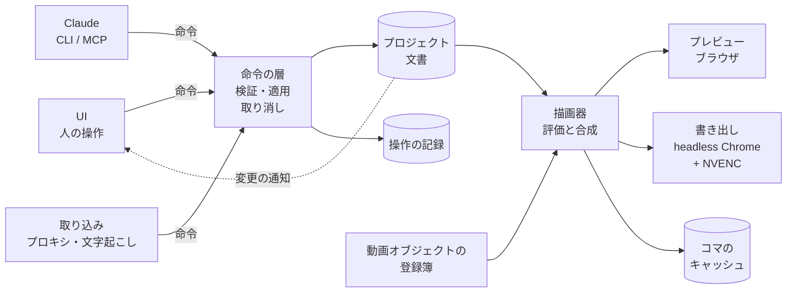
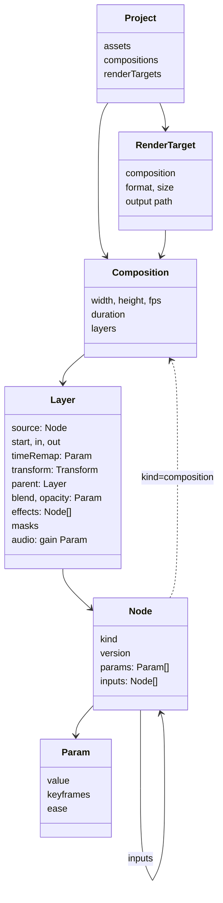

# studio 設計書

汎用の動画編集・合成ソフト。2026-11-05 時点の案。名前（studio）は仮。

## 目的

1. **AI と手作業の混成**: Claude が編集でき、人も UI でまったく同じ作業ができる。
2. **素早いフィードバック**: 操作した結果を、書き出しを待たずにその場で再生できる。
3. **継続的な改善**: 要望を出すと自動で直るサイクルを持つ（durun-dashboard と同じ型）。
4. **汎用性**: vlog の形に依存しない。vlog は、その上で作るものの 1 つとして扱う。
5. **生成方法の拡張**: 映像の作り方（撮影素材、Three.js、シェーダー、Web の UI、生成 AI など）を、同じ口から足せる。

決まったこと（2026-11-05、ユーザー）:

- 再生はブラウザで合成する。
- 改善要望は、起票をきっかけに自動で実装する（ON/OFF を切り替えられる）。
- 既存の基盤（DTM_Vlog の `build_ep.py`、レビュー UI）にはこだわらず、ゼロから組む。
- UI の文言は英語にする（翻訳調を避けるため）。
- 開発は `claude-marketplace` リポジトリの worktree で、`studio/` に置く。durun-dashboard とつなぐのは後にする。

## 中心の考え方

1. **プロジェクトとコンポジション**: 1 つのプロジェクトに複数のコンポジションを持つ。書き出しの対象（レンダーターゲット）は複数選べるので、プロジェクトと成果物は 1 対 N になる（本編とショートを 1 つのプロジェクトで作る）。コンポジションはほかのコンポジションに入れられる（入れ子）。
2. **動画オブジェクト**: 「入力パラメータを受け取り、時刻ごとに映像（と音）を返す箱」と定義する。撮影素材も、文字も、シェーダーも、Three.js の場面も、生成 AI の出力も、コンポジションそのものも、この口で扱う。
3. **時間変化は基盤が持つ**: どのパラメータもキーフレームとイージングで動かせる。動画オブジェクトの側は「時刻 t でのパラメータの値」を受け取るだけで、時間変化の仕組みを自分で持たない。
4. **操作は命令にする**: 文書を変えるのは命令だけ。UI のボタンも Claude の CLI・MCP も同じ命令を呼ぶ。
5. **同じ描画器で見て、同じ描画器で書き出す**: プレビューも本番も、同じ TypeScript の描画器で描く（決めてほしいこと 1）。

## 全体像



## 先行事例から採るもの

| 型 | 先行事例 | この設計での形 |
|---|---|---|
| コンポジション、レイヤー、入れ子、親子づけ、キーフレームとグラフエディター | After Effects | データの骨組みとして採る（下の「データの形」） |
| 書き出しの対象を並べて一度に書き出す | After Effects のレンダーキュー、Resolve の Deliver ページ | レンダーターゲットをプロジェクトに持つ |
| 素材の選別（ソースを見て I/O で範囲を付け、刻んで並べる） | Resolve の Cut ページとソーステープ、Premiere のソースモニター、FCP のキーワードコレクションと評価 | Media 画面と Source 画面（下の「UI」） |
| 端の語彙（リップル、ロール、スリップ、スライド）、3 点編集、J/K/L | Avid のトリムモード、どの NLE でも共通 | 命令とキー操作の語彙にする |
| 隙間のできない並び | Final Cut Pro の磁気タイムライン | `sequence` という動画オブジェクトにする（下） |
| 言葉で切る | Premiere の文字ベースの編集、Descript、Avid の ScriptSync・PhraseFind | Story 画面（下） |
| 見た目を固定し、中身だけを差し替えるテンプレート | Premiere の MOGRT、Remotion の Zod スキーマ | 動画オブジェクトのパラメータの型から、編集欄を自動で作る |
| パラメータの型を宣言した描画の部品 | OpenFX（OFX）のプラグイン、Blender のノード、Nuke のノード | 動画オブジェクトの口（下の「動画オブジェクトの口」） |
| 版つきの型をもつ交換形式 | OpenTimelineIO（`Timeline.1` のような版） | 文書のスキーマに版番号を持たせる |
| プレビューと書き出しを同じコードで描く | Remotion（Player と renderer）、Revideo | 描画器を 1 つにする |
| 先回りの描画、プロキシ | Resolve の Smart Cache、FCP のバックグラウンドレンダリング、Premiere の Ingest | コマのキャッシュと、取り込み時のプロキシ |
| 人の UI と AI のスクリプトが同じデータを書く | Resolve の Python/Lua API、Premiere の UXP、Descript の API と Underlord | 命令の層 |
| 時刻・範囲・描き込みつきのコメント、版の比較 | Frame.io | Review 画面 |
| 要望の保存をきっかけに AI が直す | durun-dashboard の `server/improve.ts` | 自動の改善 |

Remotion もプレビューと書き出しの見た目を完全には一致させていない（`OffthreadVideo` は、書き出しでは FFmpeg が抜いたコマ、プレビューでは `<video>` で描く）。この設計では、撮影素材のデコードの違い（プロキシか原本か）だけを差として認め、それ以外は同じコードで描く。

## データの形



### プロジェクト

- `assets`: 撮影素材、音、画像、文字起こし。原本のパスと、取り込みで作ったもの（プロキシ、波形、文字起こし、サムネイル）を持つ。
- `bins`: 素材の整理。`selection`（素材の中の範囲。Resolve のサブクリップに当たる）、評価（お気に入り・却下）、キーワード、話題を持つ。
- `compositions`: コンポジションの一覧。
- `renderTargets`: 書き出しの対象。コンポジション、形式（解像度、fps、コーデック、音量の基準）、出力先を持つ。本編は 1920x1080 の 1 本、ショートは 1080x1920 の N 本のように並べる。

### コンポジションとレイヤー

- コンポジションは、大きさ、fps、長さ、背景、レイヤーの重なりを持つ。
- レイヤーは、動画オブジェクト（`source`）を 1 つ持ち、次を足す。
  - 時間: 置く時刻（`start`）、使う範囲（`in`・`out`）、速さ、タイムリマップ（パラメータなのでキーフレームで動かせる）
  - 形: 変形（アンカー、位置、拡大、回転、不透明度）と、親のレイヤー（親子づけ。親の変形を受け継ぐ）
  - 重ね方: 合成モード、マスク、トラックマット
  - 効果: 効果の列（効果も動画オブジェクトで、前の結果を入力に受ける）
  - 音: 音量（パラメータ）、パン、役割（喋り、音楽、効果音など。FCP のロール）
- 変形は当面 2D。3D のレイヤーとカメラは後で足せるよう、変形の型を版で分けておく。

### パラメータ（時間変化）

- どのパラメータも、固定の値か、キーフレームの列を持てる。キーフレームは時刻、値、補間（ホールド、直線、ベジェ）、イージング（既定の曲線か、ベジェのハンドル）を持つ。
- 型: 数、2 次元・3 次元の数、色、真偽、文字、選択肢、素材の参照、JSON。数の型は補間でき、それ以外はホールドだけ。
- 時刻 t でのパラメータの値を出すのは基盤の役目。動画オブジェクトは評価済みの値を受け取る。
- エクスプレッション（式で値を決める）は後で足す。足すときも「時刻 t で値を返す」形を保つ。

### 入れ子と再帰

- コンポジションも動画オブジェクトの 1 つ（`kind: composition`）なので、レイヤーに置ける。入れ子の深さに上限はない。
- 自分自身を含む入れ子（循環）は、命令の検証で断る。
- 入れ子のコンポジションは、外の時間を中の時間に写す（タイムリマップで速さや逆再生もできる）。

## 動画オブジェクトの口

すべての映像と音の作り方を、この 1 つの口で扱う。

```ts
interface NodeKind<P> {
  kind: string;                 // "footage", "text.html", "shader.glsl", "three.scene" ...
  version: number;
  params: ParamSchema<P>;       // パラメータの型。UI の編集欄と MCP の引数はここから作る
  inputs?: InputSchema;         // 効果やトランジションが受ける映像
  traits: {
    realtime: boolean;          // プレビューで毎コマ描けるか
    deterministic: boolean;     // 同じ入力なら同じコマを返すか（キャッシュできるか）
    offline?: boolean;          // 先に作って保存してから使うか（生成 AI など）
    audio?: boolean;
  };
  duration?(p: P): number | null;       // 素材の長さ（無限なら null）
  prepare?(p: P, ctx: PrepareContext): Promise<void>;   // 素材の読み込み、生成 AI の呼び出し
  render(ctx: FrameContext<P>): Frame;  // 時刻 t のコマを GPU のテクスチャで返す
  renderAudio?(ctx: AudioContext<P>): AudioBlock;
}
```

- `FrameContext` は、時刻 t、その時刻での評価済みのパラメータ、描く大きさ、入力の映像、GPU の文脈を渡す。
- 返すコマは、描画器の GPU の文脈のテクスチャにする（WebGL2）。Canvas や DOM で描く種類は、描画器がテクスチャに写す。
- キャッシュのキーは「種類、版、評価済みのパラメータ、入力のキー」のハッシュにする。`deterministic` な種類は、プレビューでも書き出しでも、このキーでコマを使い回す。

最初に作る種類と、後で足す種類:

| 種類 | 中身 | 時期 |
|---|---|---|
| `footage` | 撮影素材。プレビューはプロキシ、書き出しは原本をデコードする | 最初 |
| `audio` | 音だけの素材 | 最初 |
| `image`、`solid` | 静止画、単色 | 最初 |
| `composition` | 入れ子のコンポジション | 最初 |
| `sequence` | 磁気の並び（下） | 最初 |
| `text.html` | HTML と CSS のテンプレートで描く文字と図。パラメータはテンプレートが宣言する | 最初 |
| `shader.glsl` | GLSL のフラグメントシェーダー。uniform がパラメータになる。効果とトランジションもこれで書ける | 最初 |
| `three.scene` | Three.js の場面。場面のモジュールがパラメータを宣言する | 次 |
| `shader.hlsl`、`shader.wgsl` | HLSL は変換器（DXC から SPIR-V、そこから GLSL か WGSL）を通して `shader.glsl` か WebGPU に渡す | 後 |
| `lottie` | Lottie のアニメーション | 後 |
| `gen.ai` | 生成 AI（画像、映像、音）。`offline` で、`prepare` が生成して素材として保存する。パラメータのハッシュで生成し直すかを決める。費用のかかる API は、呼ぶ前に見積もりを出す | 後 |

種類は `nodes/` に 1 つずつのモジュールで置き、登録簿に足すだけで使えるようにする。

### 磁気の並び（`sequence`）

- 撮影素材を切って並べる編集（NLE の編集）を、コンポジションの中の 1 つの動画オブジェクトとして持つ。
- 中身はカット（素材の範囲）の列で、時刻は前のカットの尻から自動で決まる（FCP の磁気タイムライン）。カットの間にトランジションを置ける。
- 端の命令（リップル、ロール、スリップ、スライド）は、この中で働く。
- 外したカットは消さずに残す（無効の印）。
- vlog の本編は「`sequence` の上に字幕、札、図のレイヤーを重ねたコンポジション」になる。ショートは、同じ `sequence` の一部を入れ子にした縦のコンポジションになる。

## 命令の層

- 文書を変えるのは命令だけ。命令は `ops/` に 1 つずつ置き、引数の型、検証、文書への適用、取り消しを持つ。
- 汎用の命令: `addLayer`、`removeLayer`、`moveLayer`、`setParam`（パラメータの道筋と値）、`setKeyframe`、`removeKeyframe`、`setEase`、`parentLayer`、`precompose`（選んだレイヤーを新しいコンポジションにまとめる）、`addComposition`、`addRenderTarget`
- 編集の命令: `insert`、`overwrite`、`lift`、`extract`、`split`（刃で分ける）、`ripple`、`roll`、`slip`、`slide`、`disable`
- 選別の命令: `markIn`・`markOut`、`addSelection`、`rate`、`tag`、`addTopic`
- 文字起こしの命令: `deleteWords`、`fixTranscript`
- 入口は 3 つで、どれも同じ命令を呼ぶ。
  - UI: サーバーの HTTP（`POST /api/ops`）
  - Claude の CLI: `studio op <project> ripple --clip c12 --edge out --by -0.4`
  - Claude の MCP: 命令ごとのツール。引数の型はスキーマから作る
- 命令はすべて記録に残す（誰が、いつ、何を、どのコメントへの対応として）。取り消しとやり直しは、この記録から行う。UI は Claude がした変更を時系列で見て、1 つずつ取り消せる。
- 人と Claude が同時に書くときは、サーバーが 1 本の列で順に当て、文書の版番号を進め、変わった所を開いているすべての UI に送る（SSE）。古い版を元にした命令は、当たる所が変わっていなければ当て、変わっていれば断って理由を返す。
- **マクロ**: 命令を組み合わせて命令の列を作る手順（例: 喋りの下の音楽を下げる、無音を詰める、つなぎ言葉を外す）。マクロが出すのも普通の命令なので、人も Claude も同じように使え、取り消せる。vlog の編集の好みは、マクロとテンプレートの組（パック）として持つ。

## 描画器

- 文書と時刻 t から、レイヤーを評価して合成する。TypeScript で書き、ブラウザで動かす。
- 合成は WebGL2 で行う。変形、合成モード、マスク、不透明度はシェーダーで描く。
- 音は Web Audio で鳴らし、音の時計を主にして映像を合わせる。音量の曲線は、評価したパラメータから予約する。
- 文書の一部が変わったら、影響する時刻の範囲だけを評価し直す（コンポジションごと、レイヤーごとのキャッシュ）。

### プレビュー

- 撮影素材は、取り込みのときに NVENC で作った 540p・短い GOP（キーフレームを 2〜4 コマごと、B フレームなし）の H.264 のプロキシを使う。デコードは WebCodecs で、コンテナの読み出しは mediabunny で行う。
- スクラブは、ドラッグしている間は縮小したコマを先に出し、止まったら正確なコマに差し替える。
- `realtime` でない種類は、キャッシュがあれば使い、なければ印を出して先回りで描く。

### 書き出し

- headless Chrome で同じ描画器を動かし、1 コマずつ描いて、FFmpeg の NVENC で書き出す（Remotion と Revideo の型）。素材は原本をデコードする。
- 長い書き出しは区間に分けて並行に描き、つなぐ。
- 手を止めて数秒たったら、変わった区間を先に描いてキャッシュにためる（FCP のバックグラウンドレンダリングの型）。

## UI

画面は Resolve のページのように、作業ごとに分ける。どの画面も同じ文書を見る。文言は英語。

| 画面（UI の名前） | 先行事例 | 中身 |
|---|---|---|
| `Media` | Resolve の Media ページ、FCP のブラウザ | 素材の一覧、評価、キーワード、話題。素材の取り込みとプロキシの進み具合 |
| `Story` | Descript、Premiere の文字ベースの編集、Avid の ScriptSync | 長い素材の文字起こしを読み、範囲を選んで `selection` にする。話題の区切りを付け、言葉で検索する。選んだ範囲をそのまま並びに入れる |
| `Cut` | Resolve の Cut ページとソーステープ | 素材を見て I/O で範囲を付け、刻み、並べる。カットの前後をつまみでずらし、刃で分ける |
| `Compose` | After Effects のタイムラインとグラフエディター | レイヤーの重なり、キーフレーム、イージングの曲線、親子づけ、入れ子 |
| `Inspector`（どの画面にも出す側の欄） | Premiere の Essential Graphics、AE のエフェクトコントロール | 選んだものの、パラメータの編集欄。動画オブジェクトのスキーマから作る |
| `Review` | Frame.io | 時刻・範囲・描き込みのコメント、返信、承認。直す前と後を並べて同時に再生する |
| `Deliver` | Resolve の Deliver ページ、AE のレンダーキュー | レンダーターゲットの一覧、書き出しの進み具合 |

- どの画面にもプログラムモニターを置く。
- キー操作は J/K/L、I/O、刃（`B`）、トリムのキー（Avid の `M` `,` `.` `/`）にそろえる。
- 右下に改善要望の入口を置く（画面の部品を指して添付できる）。

## 取り込み

- 取り込みも命令で文書に素材を足す。素材ごとにプロキシ、波形、サムネイル、文字起こし（単語の時刻つき）を作る。
- 取り込みの処理は、決まった形の付属ファイル（素材の横に置く JSON）を書く外の道具として作り、言語を問わない。文字起こし（faster-whisper）のような Python の処理は、この形で書けば使える。DTM_Vlog の `ingest.py` と `transcribe.py` は、この形に合わせれば流用できる。
- 文字起こしの単語には ID を付ける。`selection` やカットは時刻に加えて単語の ID を持つので、文字起こしをやり直しても範囲を追える。

## レビューと Claude の対応

- コメントは文書とは別に持つ。コンポジションの時刻か範囲、描き込み（点と矩形）、返信、状態（`open` → `fresh` → `done`、`wontfix`）を持つ。
- Claude はコメントを読んで命令で対応し、記録の命令をそのコメントに結びつける。返事は UI に出る。
- Claude の目と耳: 描画器で 1 コマを描いて見る（`studio frame`）。音は書き出した区間を測る道具（DTM_Vlog の `listen.py`、`seams.py` の型）を移す。

## 自動の改善

durun-dashboard の `server/improve.ts` の型を移す。dashboard とつなぐまでは、studio が自分で持つ。

- 入口: UI の右下の `Feedback`。サーバーの例外、画面の例外、遅い処理も自動で起票する（同じエラーは 1 件にまとめる）。
- 起動: 要望を保存したとき、設定を変えたとき、サーバーを起動したときに、動いている回がなく、ON で、未対応の要望があれば `claude -p` を起動して、たまった要望を 1 回でまとめて実装する。
- 区切り: Stop フックで回を終え、最後の発言の「対応した要望:」の行から済んだ要望を決める。残りがあれば次の回を始める。使用制限で止まったら、明けたときに続きから再開する（イベントで受け、時間のタイマーは使わない）。
- 守ること: 自動の改善が触るのは studio のコードだけで、プロジェクトのデータには触らない。型の検査とテストを通してからコミットする。
- 反映: サーバーと画面の自動の読み直し。入力中は読み直さず、更新の印を出す。
- 返事: 要望ごとに、何をしたかを UI で読めるようにする。

## vlog をこの上で作る

DTM_Vlog の作り方は、studio の上の「パック」として持つ。基盤は vlog を知らない。

| DTM_Vlog の今 | studio での形 |
|---|---|
| `pool.yaml` の候補 | `bins` の `selection` |
| `edit.yaml` の並び | 本編のコンポジションの `sequence` |
| 字幕、札、図解（`overlay.mjs` と 7_mix の見た目） | `text.html` のテンプレート |
| トランジション（`tools/transitions/fx/*.js`） | `shader.glsl` の効果 |
| ショート（`shorts/sNN.yaml`） | 縦のコンポジションと、そのレンダーターゲット |
| 編集の好み（BGM を切らない、喋りの下で音楽を下げる、早送りを 1.5 秒に収める） | パックのマクロ |
| ディレクション UI の書き込み | `Review` のコメント |

ep04 から、この形で作れるかを試す。

## 技術の選び方

durun-dashboard と同じ道具にそろえ、後でつなぐときの手間を減らす。

| 部分 | 選ぶもの |
|---|---|
| 言語と実行 | TypeScript。サーバーは Node で `.ts` を直接動かす |
| 画面 | Preact。束ねは esbuild |
| テスト | `node --test` |
| 合成 | WebGL2（WebGPU は後で、描画器の裏を差し替えられるようにする） |
| デコード | WebCodecs と mediabunny |
| 書き出し | headless Chrome（puppeteer-core）と FFmpeg の NVENC |
| 取り込み | 付属ファイルの形を決めた外の道具（Python も可） |
| 保存 | プロジェクトのディレクトリに `project.json`（文書）と `ops.jsonl`（操作の記録）、`review.jsonl`（コメント）、`cache/`（プロキシとコマ） |

## 進め方

| 段階 | 中身 | 終わりの条件 |
|---|---|---|
| 1 | 文書のスキーマ、パラメータとキーフレーム、命令、CLI | テストで、命令を当てて取り消すと元の文書に戻る。キーフレームの補間が合う |
| 2 | 描画器（`footage`、`solid`、`image`、`composition`、`sequence`、`text.html`、`shader.glsl`）、プレビューのモニター、音 | 入れ子のコンポジションを、ブラウザで通して再生できる |
| 3 | `Media`、`Story`、`Cut` の画面と取り込み | 長い素材から話題を切り出して並べ、そのまま再生できる |
| 4 | `Compose`、`Inspector`、`Deliver` と書き出し、レンダーターゲット | 1 つのプロジェクトから本編とショートを書き出せる |
| 5 | 自動の改善、`Review`、MCP | 要望を起票すると、自動で直って返事が付く。Claude が MCP で同じ編集をできる |
| 6 | vlog のパック、ep04 | ep04 を studio で作れる |
| 7 | `three.scene`、`lottie`、`gen.ai`、HLSL の変換 | 種類を足すだけで使える |

自動の改善（段階 5）は、ほかの段階と関係なく動くので、画面ができた段階 3 の後に前倒しにしてもよい。

## 決めてほしいこと

1. **書き出しの描画器**
   - 案 A（70%）: プレビューと同じ描画器を headless Chrome で動かす。見た目の差がほぼなくなり、種類を足すのも 1 か所で済む。4K の長い書き出しの速さは、区間を並行に描いて補う
   - 案 B（35%）: 書き出しは geneva に任せ、描画器の結果を geneva のタイムラインに変換する。書き出しの速さと品質は実績があるが、種類を足すたびに geneva 側にも同じものが要る
2. **プロキシの置き場所**: 数時間の素材で 1 時間あたり 4〜10 GB ほど要る。プロジェクトのディレクトリに置くか、決まった置き場所（`D:` か `E:`）にまとめるか
3. **名前**: 仮の名前は studio。ほかの名前にするなら、ディレクトリを作る前に決めたい
