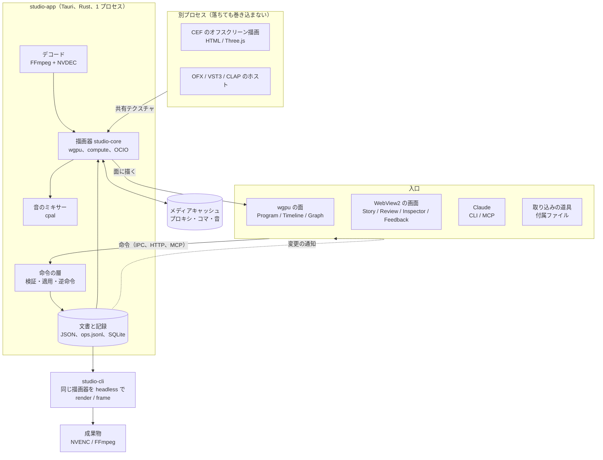
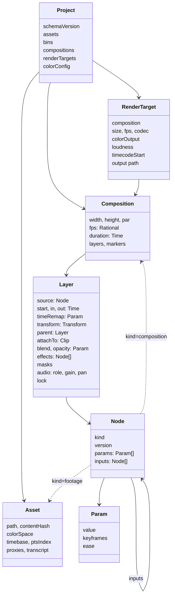
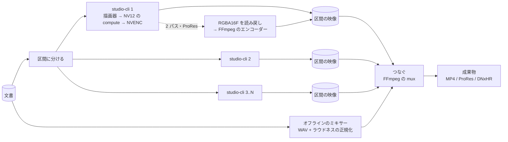
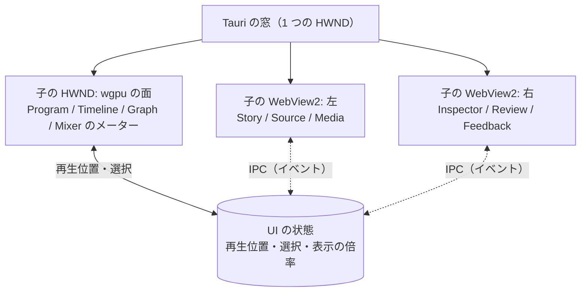

# studio 設計書

汎用の動画編集・合成ソフト。2026-11-05 時点の案。名前（studio）は仮。
6 人のレビュー（`reviews/2026-11-05.md`）と規格の調査（`reviews/2026-11-05-standards.md`）を反映し、ネイティブの描画器を軸にした構成で書いた版。実測の数はレビューのものを使い、〔推〕を付けた数と判断は推測。事実の主張の出典は末尾の「出典」に番号で示す。

## 目的

1. AI と手作業の混成: Claude が編集でき、人も UI でまったく同じ作業ができる。
2. 素早いフィードバック: 操作した結果を、書き出しを待たずにその場で再生できる。
3. 継続的な改善: 要望を出すと自動で直るサイクルを持つ（durun-dashboard と同じ型）。
4. 汎用性: vlog の形に依存しない。vlog は、その上で作るものの 1 つとして扱う。
5. 生成方法の拡張: 映像の作り方（撮影素材、Three.js、シェーダー、Web の UI、生成 AI など）を、同じ口から足せる。
6. 規格への対応: 業界標準の規格がある所はそれに対応し、プロの用途にも耐える（下の「規格への対応」）。

## 決まったこと（2026-11-05、ユーザー）

- 汎用の編集ソフト。コンポジションと入れ子。プロジェクト:成果物 = 1:N。
- 動画オブジェクトの口で全部の生成方法をそろえる。時間変化（キーフレーム）は基盤が持つ。
- 素材の選別と文字起こしのストーリーを持つ。UI の文言は英語。
- 人と Claude が同じ命令で編集する。改善要望は、起票をきっかけに自動で実装する（ON/OFF あり）。
- 拡大のキーフレームがかかったベクターは、プレビューではその範囲でいちばん大きい倍率で 1 回描いて縮め、書き出しでは毎コマ実寸で描き直す。
- 業界標準の規格に対応し、プロの用途に耐える。レビューの指摘は全部反映する。
- 既存の基盤（DTM_Vlog の `build_ep.py`、レビュー UI）にはこだわらず、ゼロから組む。開発は `claude-marketplace` の worktree の `studio/`。durun-dashboard とは API でつなぐ。
- ブラウザで動く前提を外す。出先の作業は、機能を絞った「モバイル版」として後回しにする（通信量がかさむ形は使わない）。
- 言語は安全性を重視して Rust に寄せる（描画器の核、規格のホスト、サーバー）。
- UI は混成にする。Tauri（WebView2 + Rust）で Rust の核を持ち、ビューアーとタイムラインは wgpu で描いた面を窓に直接置く。文字の多い画面（Story、Review、Inspector、Feedback）は WebView で作る。全部ネイティブ（egui か Slint）は対案として残す。
- HTML の文字や Three.js など「Web の UI で映像を作る」種類は、OBS のブラウザソースと同じ型で残す。Chromium を埋め込み（CEF のオフスクリーン描画）、GPU の共有テクスチャで受け取る。

## 中心の考え方

1. プロジェクトとコンポジション: 1 つのプロジェクトに複数のコンポジションを持つ。書き出しの対象（レンダーターゲット）は複数選べるので、プロジェクトと成果物は 1 対 N になる。コンポジションはほかのコンポジションに入れられる（入れ子）。
2. 動画オブジェクト: 「入力パラメータを受け取り、時刻ごとに映像（と音）を返す箱」。撮影素材も、文字も、シェーダーも、CEF で描く Web の場面も、生成 AI の出力も、OpenFX のプラグインも、コンポジションそのものも、この口で扱う。
3. 時間変化は基盤が持つ: どのパラメータもキーフレームとイージングで動かせる。動画オブジェクトは「時刻 t でのパラメータの値」を受け取るだけ。
4. 操作は命令にする: 文書を変えるのは命令だけ。UI も Claude の CLI・MCP も同じ命令を呼ぶ。
5. 同じ描画器で見て、同じ描画器で書き出す: プレビューも書き出しも、同じ Rust の描画器（`studio-core`）を同じ GPU で動かす。プレビューは窓の面に、書き出しは headless の CLI で。差として認めるのは、素材のデコードの品質（プロキシか原本か）と、ベクターを描く倍率だけ。
6. 内部のモデルは規格に合わせて作る: 時刻は有理数（OTIO の `RationalTime`）、色は線形の浮動小数と OCIO の変換、タイムラインは OTIO の `Track`・`Clip`・`Gap`・`Transition` に写せる形。
7. 落ちうるものは別のプロセスに置く: 他人のコード（OFX、VST3、CLAP のプラグイン、Chromium）はプロセスを分け、GPU の共有テクスチャか共有メモリで結果だけを受け取る。描画器の核は 1 プロセスで、その中は Rust の安全な領域に保つ。

## 構成の判断

| 軸 | A. ブラウザで描画 + ネイティブの補助プロセス | B. ネイティブの描画器 + 混成の UI（Tauri）+ 埋め込みの Chromium | C. ネイティブの描画器 + 全部ネイティブの UI（egui か Slint） |
|---|---|---|---|
| プレビューの即時性と品質 | ブラウザの中で描く。WebGL2 の制約（SDR、文脈 16 個、`VideoFrame` の往復） | wgpu の面を窓に直接置く。デコードから表示まで GPU の中で完結。RGBA16F/32F、HDR の出力も可 | B と同じ |
| プレビューと書き出しの一致 | 同じ描画器を headless Chrome で。GPU の選択が Chrome 任せ | 同じ Rust の描画器、同じ GPU、同じシェーダー。一致する | B と同じ |
| 規格への対応 | OFX、VST3、OCIO、ProRes は補助プロセスで。毎コマの往復が重いので `offline`（キャッシュ経由）に限る | 全部直接組み込める。OFX と VST3 もリアルタイムで当てられる | B と同じ |
| Web 由来の種類（HTML の文字、Three.js） | そのまま動く | CEF を埋め込み、共有テクスチャで受ける（OBS のブラウザソースの型） | B と同じ |
| 文字の多い画面（Story、Review、Inspector）の作りやすさ | HTML と CSS。Claude が直しやすい | WebView で HTML と CSS。同じ | egui/Slint で書く。表や長文の画面は手間が大きく、Claude が直す回数も増える〔推〕 |
| 直して確かめる速さ | ブラウザのリロードだけ | WebView 側はリロード、Rust 側はコンパイル（部分的な差し替えで縮める。下の「自動の改善」） | 全部 Rust のコンパイル |
| 出先の作業 | そのまま使える（通信量が多い） | モバイル版を別に作る（Tauri は iOS と Android に出せる） | 同じ |
| 安全性 | TypeScript | Rust が核。UI の WebView は境界の外 | Rust が全部 |
| 実装の手間 | いちばん小さい | 描画器を Rust で書く。Tauri の窓に wgpu の面と WebView2 を並べる所と CEF の取り込みが難所（段階 0） | 描画器に加えて UI の部品を全部 Rust で書く |
| 先行事例 | MasterSelects（WebGPU + Rust の補助）[13] | Gyroflow（Rust の核 + wgpu + Qt/QML の UI）[9]、OBS のブラウザソース（CEF の共有テクスチャ）[6][7] | Rerun（egui + wgpu）[10]、Zed（gpui）、OpenCut の desktop（gpui、まだ空）[14] |

判断: B を採る。理由は 3 つ。

1. 品質の要（ビューアー、タイムライン、デコード、色、書き出し）を GPU の中で完結させられる。ブラウザでは `VideoFrame` の往復、WebGL2 の SDR、GPU の選択が Chrome 任せ、といった制約を抱えたままになる。
2. プロの用途の規格（OFX、VST3、OCIO、ProRes）を、キャッシュ経由の `offline` に限らず、描画器から直接リアルタイムに当てられる。
3. 文字の多い画面は WebView で作り、直す速さと Claude の直しやすさを保つ。全部ネイティブ（C）は、ビューアーとタイムラインの品質では同じだが、表や長文の画面を Rust で書く手間が上乗せになる。Rust の UI 部品が十分に育ったら、C に寄せる道は残す（Slint は wgpu のテクスチャを画像として取り込める [11]）。

「出先で作業したい」は、通信量を抑えた機能限定のモバイル版で満たす（下の「モバイル版」）。

## 全体像



ランタイムの分担:

| 部分 | studio-app（Tauri） | studio-cli | WebView2 の画面 | 別プロセスのホスト |
|---|---|---|---|---|
| 受け持つもの | 命令の層、文書の保存、索引、描画器、デコード、ミキサー、wgpu の面、Claude の入口（HTTP、MCP）、自動の改善の起動、ホストの管理 | 同じ描画器で書き出し（`render`）と 1 コマ（`frame`）。GUI なし | Story、Source、Media、Inspector、Review、Deliver、Feedback | CEF（HTML、Three.js の種類）、OFX、VST3、CLAP |
| 言語 | Rust | Rust（同じクレート） | TypeScript（Preact、esbuild） | Rust（CEF と OFX の C API を呼ぶ） |
| つなぎ | | 文書のファイル | Tauri の IPC（命令とイベント） | 共有テクスチャ（D3D12 の NT ハンドル）、共有メモリ、制御はパイプ |
| 描画器 | プレビュー | 書き出しと Claude の目 | 描かない | 描いた結果を渡す |

クレートの分け方: `studio-model`（文書、時刻、パラメータ、命令）、`studio-core`（描画器、ミキサー、キャッシュ）、`studio-media`（FFmpeg、NVDEC、NVENC、OCIO）、`studio-host-cef`、`studio-host-ofx`、`studio-app`（Tauri）、`studio-cli`。`studio-model` は GPU に依存せず、テストが速い。

## 先行事例から採るもの

| 型 | 先行事例 | この設計での形 |
|---|---|---|
| コンポジション、レイヤー、入れ子、親子づけ、キーフレームとグラフエディター | After Effects | データの骨組み |
| 書き出しの対象を並べて一度に書き出す | AE のレンダーキュー、Resolve の Deliver | レンダーターゲット |
| 素材の選別（I/O で範囲を付け、刻んで並べる） | Resolve の Cut ページ、Premiere のソースモニター、FCP のキーワードコレクション | Media と Source |
| 端の語彙（リップル、ロール、スリップ、スライド）、3 点編集、J/K/L | Avid のトリムモード | 命令とキー操作の語彙 |
| 隙間のできない並びと、カットに接続したクリップ | FCP の磁気タイムラインと接続クリップ | `sequence` と `attach` |
| 言葉で切る | Premiere の文字ベースの編集、Descript | Story |
| 見た目を固定し、中身だけを差し替えるテンプレート | Premiere の MOGRT、Remotion の Zod スキーマ | 動画オブジェクトのパラメータの型から編集欄を作る |
| パラメータの型を宣言した描画の部品。時刻で引ける入力、描く領域、恒等の宣言 | OpenFX のプラグイン API、Nuke のノード | 動画オブジェクトの口 |
| 有理数の時刻と版つきの交換形式 | OpenTimelineIO、FCPXML | 時刻の型と文書のスキーマの版 |
| 作業色空間を線形の浮動小数にし、入出力で変換する | OpenColorIO、ACES | 色の管理 |
| 変形を 1 つの行列にまとめ、1 回だけ再標本化する | AE の「トランスフォームを折りたたむ」、Nuke の concat | 変形の折りたたみ |
| Rust の核 + wgpu で、UI は別の道具 | Gyroflow（核は純 Rust、UI は QML、GPU は wgpu と OpenCL）[9] | `studio-core` と Tauri の分け方 |
| egui + wgpu で全部ネイティブ | Rerun（`re_renderer`）[10] | 対案 C |
| Web の UI を映像の素材にする。Chromium のオフスクリーン描画を共有テクスチャで受ける | OBS のブラウザソース、CEF の `OnAcceleratedPaint`（`shared_texture_enabled`）[6][7] | `web.cef` の種類と `studio-host-cef` |
| Rust のバインディングで CEF の共有テクスチャを wgpu に取り込む | `cef` クレートの `osr_texture_import`（D3D12 は `OpenSharedHandle` → `texture_from_raw` → `create_texture_from_hal`、Vulkan は外部メモリ）[2] | 同上 |
| 先回りの描画、プロキシ、中身で引くキャッシュ | Resolve の Smart Cache、FCP のバックグラウンドレンダリング、Premiere の Media Cache | コマのキャッシュとメディアキャッシュ |
| 文書を分けて保存し、変わった所だけ書く | FCP の `.fcpbundle`、Unity の `.meta` | プロジェクトのディレクトリ |
| スナップショットと操作の記録からの復旧 | Redis の RDB と AOF、SQLite の WAL | `ops.jsonl` の再生 |
| 人の UI と AI のスクリプトが同じデータを書く | Resolve の Python API、Descript の API | 命令の層 |
| 時刻・範囲・描き込みつきのコメント、版の比較 | Frame.io | Review |
| 要望の保存をきっかけに AI が直す。別の作業場で直して検査が通ったら取り込む | durun-dashboard の `server/improve.ts`、Dependabot | 自動の改善 |
| 役割ごとのバス、ラウドネスのメーター | FCP のロール、EBU R128 | 音のミキサー |
| Rust の関数の差し替えで、再起動なしに直す | Dioxus の subsecond（ジャンプテーブルで関数を差し替え。構造体の形を変えると落ちる）[8] | 自動の改善の反映 |

## 新しく設計するもの

- 動画オブジェクトの 1 つの口に、撮影素材・文字・シェーダー・CEF の Web の場面・生成 AI・OFX・入れ子のコンポジションをそろえること。
- ベクターの倍率の扱い（プレビューは範囲の最大の倍率で 1 回、書き出しは毎コマ実寸）。
- Tauri の 1 つの窓に、wgpu の面と WebView2 の画面を並べ、再生位置と選択を Rust の状態で 1 つにすること。
- プラグインのホストを別プロセスに置きつつ、GPU の共有テクスチャでリアルタイムに合成すること（`offline` はキャッシュが要るときの選択肢に下げる）。
- 命令の `touches` による同時書き込みの判定と、AI の対応 1 回をまとまりとして承認・却下すること。
- 自動の改善を worktree で囲い、本番のプロジェクトのハッシュで守ること。

## データの形



### 時刻

- 時刻は有理数 `Time { num: i128, den: u32 }`（OTIO の `RationalTime`、FCPXML の `1001/30000s`）。fps も有理数。浮動小数の秒は文書に書かない。
- 素材のコマを選ぶ規則は 1 つ。コンポジションの時刻 t を素材の時間軸に写した後、`floor((t - offset) * fps + 1/2^20)` でコマの番号にする。量子化は葉で 1 回だけ。
- 可変フレームレート（VFR）の素材は、取り込みで PTS の索引を作り、プロキシも PTS を保つ。
- OBS の mkv は音と映像の頭がずれることがある。取り込みで最初の PTS の差を `timebase.offset` に記録する。
- タイムコードは SMPTE ST 12-1。ドロップフレームを含む。表示と書き出しのメタデータに使い、内部の時刻には使わない。

### 色

- 作業色空間は線形の Rec.709（primaries）、中間のテクスチャは `Rgba16Float`。精度が要る所（LUT の適用、ぼかしの蓄積）は `Rgba32Float`。アルファは中ではすべて premultiplied の線形。
- 素材ごとに入力の色空間を持つ（`Asset.colorSpace`。OCIO の名前）。取り込みで素材のタグを読み、無ければ既定（映像は `bt709`・tv レンジ、画像は sRGB）。HDR の素材（PQ、HLG）はトーンマップを明示して受ける。
- 変換は OCIO 2.5 を描画器のプロセスの中で直接呼ぶ。`GpuShaderDesc` に GLSL か HLSL を出させ、naga で WGSL に変換して描画器のシェーダーに組み込む（OCIO は GLSL、HLSL SM 5.0、MSL を出せる [16]。naga の入力は WGSL、SPIR-V、GLSL 440+ で、HLSL は入力にならない [4]）。GLSL の経路を主にし、動かなければ 3D LUT に落とす。Rust のバインディングは置き場所だけの空のクレート（`opencolorio` 0.1.0）しかないので、自前で `bindgen` を書く [15]。
- YUV→RGB は自前の compute シェーダーで行う（レンジ、行列、クロマの位置を明示）。NVDEC の NV12 を直接受ける。
- プロキシと書き出しには `bt709`・tv レンジのタグを明示する。8 bit に落とす前にディザーをかける。
- 合成のガンマはコンポジションの設定で選べる。既定は線形。
- ASC CDL は WGSL で持ち、`.cube` は 3D テクスチャで当てる。CLF は OCIO 経由。
- HDR の出力は、wgpu の面を `Rgba16Float` にして、Windows の HDR の表示に乗せる〔推。段階 0 では確かめない〕。

### プロジェクト

- `assets`: 撮影素材、音、画像、文字起こし。原本のパス、中身のハッシュ、色空間、時間軸、取り込みで作ったものへの参照。
- `bins`: 素材の整理。`selection`（素材の中の範囲）、評価、キーワード、話題。
- `compositions`、`renderTargets`（形式、ラウドネスの目標、タイムコードの始まり、出力先）、`colorConfig`（OCIO の設定、作業色空間、表示の変換）。
- プロジェクトをまたぐ素材とテンプレートは、ライブラリとして参照で使う。

### コンポジションとレイヤー

- コンポジションは、大きさ、画素の縦横比、fps、長さ、背景、レイヤーの重なり、マーカーを持つ。
- レイヤーは動画オブジェクト（`source`）を 1 つ持ち、次を足す。時間（`start`、`in`・`out`、速さ、タイムリマップ）、接続（`attachTo`。カットがリップルで動くと一緒に動く）、形（変形と親）、重ね方（合成モード、マスク、トラックマット）、効果の列、音（役割、音量、パン）、ロック（人が直した所を AI が上書きしない印）。
- 変形は当面 2D。`FrameContext` にカメラの欄を空け、3D は後で足す。
- マーカーはコンポジションに持ち、YouTube のチャプターの書き出しに使う。

### パラメータ（時間変化）

- どのパラメータも、固定の値か、キーフレームの列を持てる。キーフレームは時刻、値、補間（ホールド、直線、ベジェ）、イージング。
- 型: 数、2・3 次元の数、色、真偽、文字、選択肢、素材の参照、JSON。数の型は補間でき、それ以外はホールドだけ。
- エクスプレッションは後で足す。「時刻 t で値を返す」形を保つ。

### 入れ子と本編とショートの関係

- コンポジションも動画オブジェクト（`kind: composition`）。循環は命令の検証で断る。外の時間を中の時間に写す。
- ショートは本編の `sequence` の一部を参照する（本編を直すとショートも変わる。カットの in/out だけショートで上書きでき、印が付く）か、複製して分岐する（元との対応を残し、元が変わったら知らせる）。どのカットがどのショートで使われているかを本編に印で出す。再フレーミングと字幕の置き場所は、コンポジションごとに別の値を持つ。

## 動画オブジェクトの口

OpenFX のプラグイン API に寄せる（非同期の描画、時刻で引ける入力、描く領域、恒等の宣言、画素の形の宣言）。Rust のトレイトで持つ。

```rust
pub trait NodeKind: Send + Sync {
    fn id(&self) -> &'static str;             // "footage", "text", "web.cef", "shader.wgsl", "ofx" ...
    fn version(&self) -> u32;
    fn params(&self) -> ParamSchema;          // UI の編集欄と MCP の引数はここから作る
    fn inputs(&self) -> InputSchema;          // 効果やトランジションが受ける映像
    fn traits(&self) -> Traits;               // realtime, deterministic, offline, time_varying, audio, vector, pixel, cost, isolation
    fn duration(&self, p: &Params) -> Option<Time>;
    fn migrate(&self, old: serde_json::Value, from: u32) -> Result<Params>;
    fn prepare(&self, p: &Params, cx: &PrepareCx) -> Result<()>;      // 素材の読み込み、生成 AI、ホストの起動
    fn frames_needed(&self, cx: &FrameCx) -> Vec<TimeRange>;        // 入力のどの時刻が要るか
    fn region_of_definition(&self, cx: &FrameCx) -> Rect;
    fn is_identity(&self, cx: &FrameCx) -> bool;
    fn render(&self, cx: &FrameCx, enc: &mut wgpu::CommandEncoder) -> Result<FrameRef>;   // 時刻 t のコマ（テクスチャ）
    fn render_audio(&self, cx: &AudioCx) -> Result<AudioBlock>;
}
```

- `FrameCx` は、時刻 t、評価済みのパラメータ、描く大きさ、要る領域、入力の映像（時刻で引ける）、カメラ、描画先とヘルパー（テクスチャの確保、パイプラインのキャッシュ、CPU の絵を写す）。`wgpu::Device` そのものは渡さず、ヘルパーで囲う。
- 返すコマは `Rgba16Float`、premultiplied の線形のテクスチャ。CPU で描く種類（Lottie、SVG）はヘルパーでアップロードする。
- 隔離（`traits.isolation`）: `in_process`（Rust の種類。`render` の `Err` と panic は `catch_unwind` で受け、そのレイヤーだけ透明にしてエラーの印）、`out_of_process`（CEF、OFX、VST3、CLAP。別プロセスで動かし、落ちたら印を出して起動し直す。時間切れつき）。
- `deterministic` の自己申告は、契約テストで 2 回描いて同じかを確かめる。
- 種類は `studio-core/src/nodes/` に 1 つずつ置き、登録簿に足すだけで使える。

最初に作る種類と、後で足す種類:

| 種類 | 中身 | 時期 |
|---|---|---|
| `footage`、`audio`、`image`、`solid` | 撮影素材（プレビューはプロキシ、書き出しは原本）、音、静止画、単色 | 最初 |
| `shape`、`svg` | 図形と SVG。ベクターのまま持ち、vello か resvg で描く | 最初 |
| `composition`、`sequence` | 入れ子と磁気の並び | 最初 |
| `text` | 字幕と短い文字。ネイティブの文字の描画（下の「文字の描き方」）。多くの字幕はこれで足りる | 最初 |
| `shader.wgsl` | WGSL のフラグメントか compute。uniform がパラメータになる。効果とトランジションもこれで書ける | 最初 |
| `color.cdl`、`color.lut`、`color.ocio` | ASC CDL、`.cube`、OCIO の変換 | 最初 |
| `web.cef` | HTML と CSS のテンプレート、Three.js の場面を、埋め込みの Chromium で描いて共有テクスチャで受ける。`out_of_process`、`cost: heavy` | 次 |
| `shader.glsl` | naga で WGSL に変換（GLSL 440+、Vulkan の流儀 [4]）。DTM_Vlog のトランジション（WebGL2 の GLSL ES 3.0）は書き換えが要る | 次 |
| `ofx` | OpenFX のプラグイン。別プロセスのホストが描き、共有テクスチャで受ける | 次 |
| `shader.hlsl` | DXC で SPIR-V にしてから naga で WGSL に。naga は HLSL を直接読めない [4] | 後 |
| `lottie` | Lottie（rlottie か pure Rust の実装）で CPU に描いてアップロード | 後 |
| `gen.ai` | 生成 AI。`offline`。費用のかかる API は命令の側で見積もりを強制し、自動の改善の回からは呼べない | 後 |

### ベクターの解像度

- `vector` の種類は、ラスタにする時期を最後まで遅らせる。描画器は、入れ子とレイヤーの変形を出力の画面まで掛け合わせた変形を `FrameCx` に渡す。種類はその大きさで描き、描いたコマを後から拡大しない。
- 入れ子の中のベクターも、外の変形を中へ折りたたんで、出力の解像度で 1 回だけラスタにする。途中で一度ラスタにするのは、ラスタを入力に取る効果がかかるときだけ。
- プレビューではモニターの実際の画素（表示の倍率と DPI を含む）で描く。書き出しでは出力の解像度で描く。
- 拡大のキーフレームで大きさが変わる区間: プレビューでは、その区間でいちばん大きい倍率で 1 回描いてテクスチャにし、合成で縮める。書き出しでは毎コマ実寸で描き直す。
- 大きさは画面上の倍率で描き、平行移動は合成の側でサブピクセルにかける（ヒンティングで跳ねない）。
- キャッシュのキーには画面上の大きさを入れ、段階（1、1.5、2、3、4 倍…）に丸める。

### 文字の描き方

2 つの経路を使い分ける。

| 経路 | 中身 | 使う所 |
|---|---|---|
| ネイティブ（`text`） | cosmic-text で整形と行組み、glyphon（cosmic-text + etagere のアトラス + wgpu）[12] で GPU に描く。見出し程度の装飾（縁、影、帯）は WGSL で付ける。vello が成熟したらベクターの経路に寄せる | 字幕、短い札、タイムラインの文字。パラメータが文字と色と位置だけのもの |
| CEF（`web.cef`） | HTML と CSS のテンプレート。Chromium がオフスクリーンで描き、共有テクスチャで受ける | テンプレートの見た目が要る所（7_mix のステッカー、図解、Three.js の場面） |

- `web.cef` は毎コマ往復させず、パラメータの組ごとに 1 回描いてキャッシュする。動かすのは合成の側。アニメーションする HTML（CSS のトランジション、Three.js）は、`SendExternalBeginFrame` でコマを進め、時刻 t を JS に渡して決定的に描かせる [6]。
- フォントは OpenType。プロジェクトが使うフォントはライブラリに置き、CEF にも同じフォントを読ませる。

### 変形と合成

- 変形は 4x4 の行列で掛け合わせ、素材を 1 回だけ再標本化する。縮めるときは面積の平均か Lanczos、広げるときは bicubic。線形の光で。
- マスクは被覆率のアンチエイリアス。合成モードの式は W3C Compositing and Blending Level 1。
- モーションブラーの口を `FrameCx` と `frames_needed` で持つ。最初は実装しない。
- 中間の絵は `Rgba16Float`。8 bit に落とすのは表示と書き出しの最後だけ。

### 磁気の並び（`sequence`）

- 撮影素材を切って並べる編集を、コンポジションの中の 1 つの動画オブジェクトとして持つ。OTIO の `Track` に写せる形。
- カットの時刻は前のカットの尻から自動で決まる。カットの間にトランジション（効果音つき）を置ける。
- 端の命令（リップル、ロール、スリップ、スライド）はこの中で働く。`attachTo` したレイヤーも一緒に動く。
- 喋りの継ぎ目は自動で処理できる（短いクロスフェード、無音の詰め。マクロで）。外したカットは消さずに残す。

## 命令の層

- 文書を変えるのは命令だけ。命令は `studio-model/src/ops/` に 1 つずつ置き、引数の型（serde + JSON Schema）、検証、適用、逆命令、`touches` を持つ。
- 汎用の命令: `addLayer`、`removeLayer`、`moveLayer`、`setParam`、`setKeyframe`、`removeKeyframe`、`setEase`、`parentLayer`、`attachLayer`、`lockLayer`、`precompose`、`addComposition`、`forkSequence`、`addRenderTarget`、`addMarker`。
- 編集の命令: `insert`、`overwrite`、`lift`、`extract`、`split`、`ripple`、`roll`、`slip`、`slide`、`disable`。選別: `markIn`・`markOut`、`addSelection`、`rate`、`tag`、`addTopic`。文字起こし: `deleteWords`、`fixTranscript`。
- 入口は 4 つで、どれも同じ命令を呼ぶ。wgpu の面（Rust から直接）、WebView の画面（Tauri の IPC）、Claude の CLI（`studio op <project> ripple --clip c12 --edge out --by -0.4`。アプリが動いていれば HTTP で、動いていなければ文書を直接開く）、Claude の MCP（命令ごとのツール。引数の型はスキーマから作る）。
- トランザクション: 複数の命令を 1 つのまとまりとして当てる。ドラッグの連続、マクロ、AI の対応 1 回。取り消しもまとまりの単位。
- 逆命令を記録に残し、取り消しは逆命令、やり直しは元の命令を当て直す。
- 同時書き込み: 1 本の列で順に当て、文書の版番号を進め、変わった所を開いているすべての画面に送る。古い版を元にした命令は、`touches` が重ならなければ当て、重なれば断る。CRDT は使わない。
- ロック: `lock` の付いた所に触る命令は、Claude の入口からは断る。
- 記録: `ops.jsonl`（誰が、いつ、何を、どのコメントへの対応として、逆命令）。
- マクロ: 命令の列を作る手順。vlog の編集の好みは、マクロとテンプレートの組（パック）として持つ。

## 描画器

- 文書と時刻 t から、レイヤーを評価して合成する。Rust の `studio-core`、GPU は wgpu（Windows の裏は D3D12 を既定にし、Vulkan も選べる）。合成、変形、色、YUV の変換は compute シェーダー（WGSL）。中間は `Rgba16Float`、精度の要る所は `Rgba32Float`（wgpu の `TextureFormat` にある [5]）。
- 描画は UI のスレッドと分けた描画のスレッドで行い、面への表示と書き出しは同じ経路（最後に面か読み戻しかが違うだけ）。
- 文書の一部が変わったら、影響する時刻の範囲だけを評価し直す。`is_identity` が真の効果は飛ばし、`region_of_definition` が画面の外のレイヤーは描かない。
- GPU の選択: wgpu の `request_adapter` に `HighPerformance` を指定し、選ばれたアダプターの名前を Program に出す。
- デコード: FFmpeg のライブラリ（`ffmpeg-the-third`。FFmpeg 5.1〜8.1 に対応 [17]）を `studio-media` で囲う。H.264、HEVC、AV1 は NVDEC（`hwaccel`）で復号し、ProRes、DNxHR、MXF、DPX、OpenEXR はそのまま読める。デコーダは素材ごとに 1 つを使い回すプール（同時 4〜6 本。NVDEC は 2 基で約 1,450 fps が上限）。
- NVDEC からの受け渡しは 3 段で試す（段階 0）。(1) FFmpeg の `d3d12va` で復号し（FFmpeg 7.0 から [18]）、D3D12 のテクスチャを `wgpu_hal::dx12::Device::texture_from_raw` → `create_texture_from_hal` で wgpu に包む [2][3]（コピーなし）。(2) CUDA の `cuvid` で復号し、wgpu の D3D12 のテクスチャを共有ヒープで作って CUDA の外部メモリに取り込み、`cuMemcpy2D` で 1 回コピーする（`cudarc` の `import_external_memory` は Win32 のハンドルを受けるが D3D12 の種類は生の `sys` で指定する [19]）。(3) `nv12` を CPU に下ろしてアップロードする（最後の手段）。
- エンコード: NVENC（FFmpeg の `h264_nvenc`、`hevc_nvenc`、`av1_nvenc`）。描画器が compute で NV12 にしたテクスチャを、(1) と同じ外部メモリの経路で渡す。ダメなら読み戻して渡す。

### キャッシュ

- コマのキャッシュのキー: 種類、種類の版、描画器の版、評価済みのパラメータ、入力のキー、素材の中身のハッシュ、素材のコマの番号（か PTS）、品質、作業色空間と OCIO の設定、画面上の大きさ。`time_varying` が偽の種類は t を外す。
- コマのキャッシュは RAM や VRAM には入らない（1080p の RGBA で 1 分 30 GB）。描いた区間を短い GOP の H.264（NVENC、ロスレスに近い cq）で符号化して NVMe に置き、NVDEC で読み戻す。GPU の上に持つのは直近の数十コマだけ。
- メディアキャッシュ（プロキシ、中間、音、文字の絵）はプロジェクトの外の決まった置き場所に置き、素材の中身のハッシュで引く。
- 原本の置き場所（T500）とキャッシュの置き場所（T705）を分けると、読みと書きがぶつからない（レビューの見込み 60%）。

### プレビュー

- 撮影素材は、取り込みのときに NVENC で作った 960x540・GOP 3・B フレームなし・cq 28 の H.264 のプロキシを使う（実測: 実時間の約 11 倍で作れ、1 時間あたり約 2.6 GB）。
- 拡大するカットは 540p ではぼやける。止まっているときは原本に切り替え、拡大の大きいカットだけ 1080p のプロキシを足す。
- スクラブは、ドラッグ中は縮小したコマを先に出し、止まったら正確なコマに差し替える。
- `realtime` でない種類は、キャッシュがあれば使い、なければ印を出して先回りで描く。手を止めて数秒たったら、変わった区間を先に描いてキャッシュにためる。
- 撮影中の取り込みは、OBS の NVENC と取り合わないよう抑える。
- 再生位置の同期: 再生位置、選択、表示の倍率は Rust の 1 つの状態が持つ。wgpu の面はそれを直接読んで描き、WebView の画面にはイベントで送る（WebView から戻るのは命令とクリックだけ）。音の時計を主にして映像を合わせる。

### 音

- ミキサーは自前の DSP で、Float32・48 kHz・サンプル単位。プレビューは cpal の出力のスレッドで同じ DSP を動かし、書き出しは同じ DSP をオフラインで回す。
- 取り込みでトラックごとに区切った PCM をメディアキャッシュに作り、カットの範囲だけ読む。
- 役割ごとのバス、バスごとの音量とメーター（ITU-R BS.1770。`ebur128` クレートは libebur128 の Rust 移植で、EBU TECH 3341・3342 のテストを通る [20]）、ダッキング。
- カットの端に数 ms のマイクロフェード。リサンプルの変換器は 1 つに固定する。
- 速さを変えた音は、既定ではピッチも変わる。ピッチを保つ時間伸縮は後で足す。
- 音の効果も動画オブジェクト（`render_audio`）。VST3 と CLAP は別プロセスのホストで動かし、共有メモリのリングバッファで音を往復させる（リアルタイム）。遅れが大きいプラグインは `offline` に切り替える。

### 書き出し



- `studio-cli render <project> <target>` が、同じ描画器を headless（面なし）で動かし、1 コマずつ描く。NVENC へは GPU の中で渡す。
- 長い書き出しは区間に分け、プロセスを並行に起動して描き、つなぐ。区間ごとに再開できる。並行の数は VRAM と NVENC の数で決める。
- 細かい画質の指定（2 パス、10 bit、ProRes、DNxHR）は、`Rgba16Float` を読み戻して FFmpeg のエンコーダーに渡す。
- 音はオフラインのミキサーで WAV に書き、レンダーターゲットのラウドネスの目標に正規化してから詰める。
- 書き出し中は、自動の改善によるアプリの差し替えを待たせる。

### Claude の目

- `studio-cli frame <project> <comp> <time> --out x.png`（1 コマ）、`studio-cli render --range` （区間）。アプリが動いていれば同じ描画器を HTTP で頼み、動いていなければ CLI が自分で描く。
- 音は書き出した区間を測る道具（DTM_Vlog の `listen.py`、`seams.py` の型）を移す。数値の点検（無音、つなぎ目、ラウドネス）は対応のまとまりに注釈として付く。

## 規格への対応

| 規格 | 対応 | 段階 | 部品 | 優先度 |
|---|---|---|---|---|
| SMPTE ST 12-1 | 内部は有理数。表示と書き出しでドロップフレームを含めて変換 | 1 | `studio-model` | 必須 |
| OpenTimelineIO | `sequence` を OTIO の形に写す。`.otio` の読み書きは JSON なので Rust で自前（Rust のバインディング `opentimelineio-bind` は Linux だけ [21]）。EDL、FCPXML、AAF への変換は公式の Python のアダプターを外の道具として呼ぶ | モデルは 1、変換は 5 | `studio-model`、外の道具 | あると良い |
| OpenColorIO 2.5、ACES 2.0 | プロセスの中で直接呼ぶ。シェーダーは GLSL を出させて naga で WGSL に。自前の `bindgen` | 2 | `studio-media` | 必須 |
| ASC CDL、`.cube` | WGSL で自前 | 2 | `studio-core` | 必須 |
| CLF | OCIO 経由 | 5 | `studio-media` | あると良い |
| OpenFX 1.5 | `studio-host-ofx` を Rust で書く（`openfx-sys` は C API の生のバインディングと C++ の HostSupport を含むが、Rust のホストの先行事例は見つからない [1]）。別プロセス。GPU Rendering Suite の CUDA [22] で描かせ、結果を共有テクスチャで受ける。CPU だけのプラグインは共有メモリ。パラメータは OFX の記述子から `ParamSchema` に写す | 7 | `studio-host-ofx` | あると良い |
| VST3、CLAP | 別プロセスのホスト。CLAP は `clack-host`（安全な Rust のホストのライブラリ [23]）、VST3 は `vst3` クレート（coupler-rs。C++ のヘッダーから生成した生のバインディング。SDK は別に要る [24]）の上に書く | 7 | `studio-host-audio` | あると良い |
| H.264、HEVC、AV1 | NVDEC で復号、NVENC で符号化 | 0〜2 | `studio-media` | 必須 |
| ProRes、DNxHR、MXF、DPX、OpenEXR | FFmpeg のライブラリでそのまま読む。書き出しも FFmpeg | 読みは 2、書き出しは 4 | `studio-media` | 読み込みは必須 |
| PQ、HLG、Rec.2020 | 作業空間は線形の浮動小数。入力はトーンマップを明示。出力は面を `Rgba16Float` に | 後 | `studio-core` | あると良い |
| BWF、iXML | WAV のチャンクを取り込みで読む | 3 | 取り込み | 読み込みは必須 |
| ITU-R BS.1770、EBU R128 | `ebur128` クレートのメーターと、書き出しの正規化 | 2 | ミキサー | 必須 |
| SRT、WebVTT | 字幕のトラックから書き出す | 4 | 書き出し | 必須 |
| TTML、IMSC 1.2 | 同じトラックから XML で | 7 | 書き出し | あると良い |
| CEA-608、708 | 対応しない | | | 当面は不要 |
| OpenType、SVG | cosmic-text、resvg | 2 | `studio-core` | 必須 |
| Lottie 1.0 | `lottie` の種類 | 7 | `studio-core` | あると良い |
| glTF | `web.cef` の Three.js で | 7 | `studio-host-cef` | あると良い |
| USD、MaterialX | 対応しない | | | 当面は不要 |
| AAF | OTIO のアダプター経由 | 5 | 外の道具 | あると良い |

OFX と VST3 を `offline` に限らなくてよい理由: 前の構成では、プラグインの結果をブラウザへ毎コマ渡すと 8 MB/コマの転送が要った。ネイティブの描画器なら、別プロセスで描いた結果を GPU の共有テクスチャのまま受けられるので、転送は要らない。`offline` は、遅いプラグインと生成 AI のための選択肢として残す。

## UI

パネルの組み合わせで、どの作業も 1 つの画面で進める。どのパネルも同じ文書を見る。再生位置と選択は全体で 1 つ。文言は英語。



| パネル | 作る場所 | 中身 |
|---|---|---|
| `Program` | wgpu | プログラムモニター。選ばれた GPU の名前、未描画の印、HDR |
| `Timeline` | wgpu | `sequence` のカットと接続したレイヤー。端のつまみ、刃、スナップ、マーカー、AI が変えた所の色、ショートで使っているカットの印。数千のカットと波形を 60 fps で |
| `Graph` | wgpu | キーフレームとイージングの曲線 |
| `Mixer` | wgpu（メーター）+ WebView（フェーダー） | 役割ごとのバス、LUFS、ダッキング |
| `Source` | wgpu（映像）+ WebView（一覧） | 素材を見て I/O で範囲を付ける |
| `Inspector` | WebView | 選んだもののパラメータの編集欄。スキーマから作る |
| `Story` | WebView | 文字起こしを読み、範囲を選んで `selection` に。使っている・使っていないの色分け、採用・却下・保留を 1 キーで、話題の概観、検索、収録の中の編集者への指示の印 |
| `Review` | WebView | 時刻・範囲・描き込みのコメント、返信、承認。AI の対応 1 回を前後 2 秒ずつ続けて再生。数値の点検の注釈 |
| `Media`、`Deliver` | WebView（別画面） | 素材の一覧と取り込みの進み具合。レンダーターゲットと書き出しの進み具合 |
| `Feedback` | WebView（右下） | 改善要望の入口。画面の部品を指して添付できる |

- 窓の組み立て: Tauri の `unstable` の機能で 1 つの窓に複数の子 WebView を置き [25]、wgpu の面は Tauri の窓の HWND の下に自前の子 HWND を作って、そこに `wgpu::Surface` を張る。WebView2 の透過は Windows で当てにならないので（黒くなる報告がある [26]）、重ねずに並べる。領域の境目はドラッグで動かし、Rust が両方の矩形を更新する。
- 描き込み（Review の点と矩形）は Program の上に wgpu で描く。WebView から Program の上に何かを重ねることはしない。
- AI の変更は「対応 1 回」のまとまりで見え、まとまりごとに承認・却下・取り消しできる。
- キー操作は J/K/L、I/O、刃（`B`）、矢印、`[` `]` を先に。wgpu の面と WebView のどちらにフォーカスがあっても同じ命令になるよう、キーの表は Rust が 1 つ持つ。
- スナップ、名前つきのスナップショットと差分、自動保存とクラッシュからの復元。

## 取り込み

- 取り込みも命令で文書に素材を足す。素材ごとに中身のハッシュ、プロキシ、波形、サムネイル、文字起こし、PTS の索引、色空間のタグを作る。波形と文字起こしが先にでき、プロキシは後から足される。
- 取り込みの処理は、決まった形の付属ファイル（版と JSON Schema を持つ JSON）を書く外の道具として作り、言語を問わない。文字起こし（faster-whisper）は Python のままでよい。
- 文字起こしの単語の ID は「素材の中身のハッシュ + 開始の時刻」の決定的な値にする。
- 同じ時間に撮った複数の素材（VR の別撮りと画面収録）は、取り込みで組にして頭をそろえる。

## 保存の形

```
<project>/
  project.json        索引と設定（スキーマの版、素材とコンポジションの一覧、レンダーターゲット、colorConfig）
  comps/<id>.json     コンポジションごと
  assets/<id>.json    素材ごと
  transcripts/<assetId>.json
  review.jsonl        コメント
  ops.jsonl           命令の記録（逆命令つき）。スナップショットごとにローテーション
  snapshots/<n>/      文書のスナップショット
  .index/             SQLite（rusqlite、FTS5）。派生物なので消してよい
<media cache>/<contentHash>/   プロキシ、中間、音の PCM、コマ、文字の絵（プロジェクトの外）
```

- 正は文書。`ops.jsonl` は記録で、取り消し・履歴・復旧に使う。変わったファイルだけ書き、書き込みはアトミック（一時ファイル → fsync → rename）。
- 復旧は「最後のスナップショット + その後の `ops.jsonl` の再生」。
- git には文書と `review.jsonl` を入れ、`ops.jsonl`、`snapshots/`、`.index/`、メディアキャッシュは外す。
- スキーマの移行は 1 版ずつの純関数。動画オブジェクトの種類も `migrate` を持つ。文書の JSON の形は言語に依存しないので、モバイル版や durun-dashboard からも読める。

## レビューと Claude の対応

- コメントは `review.jsonl`。時刻か範囲、描き込み、返信、状態（`open` → `fresh` → `done`、`wontfix`）。
- Claude はコメントを読んで命令で対応し、対応 1 回を 1 つのトランザクションにして、そのコメントに結びつける。返事は UI に出る。
- durun-dashboard とは HTTP の API でつなぐ（要望の起票、対応の状態、Claude の対応の起動）。画面は埋め込まず、dashboard からは studio の URL を開く。

## 自動の改善

durun-dashboard の `server/improve.ts` の型を移す。dashboard とつなぐまでは、studio が自分で持つ。

- 入口: `Feedback`。アプリの panic と例外、画面の例外、遅い処理も自動で起票する（同じエラーは 1 件にまとめ、1 時間あたりの上限）。
- 起動: 要望を保存したとき、設定を変えたとき、アプリを起動したときに、動いている回がなく、ON で、未対応の要望があれば `claude -p` を起動して、たまった要望をまとめて実装する。
- 区切り: Stop フックで回を終え、済んだ要望を決める。使用制限で止まったら、明けたときに続きから再開する。
- 囲い: 回は別の worktree で動かし、`cargo check`、`cargo test`、WebView の型の検査が通ったら本線へ取り込む。回の中では見本のプロジェクトに向け、実際のプロジェクトは権限の外に置き、前後でハッシュを比べる。回の予算と、すぐ止める手段。回ごとに 1 コミット。描画器、命令の層、スキーマの移行は人の承認が要る領域にして PR までで止める。費用のかかる命令は回から呼べない。
- 反映の速さ: Rust のコンパイルが待ち時間になる。3 段で縮める。(1) WebView 側（Story、Review、Inspector）は esbuild の束ね直しと画面のリロードだけで、Rust を触らない。(2) Rust の関数の中身だけの変更は、Dioxus の subsecond（`dx serve --hotpatch`。ジャンプテーブルで関数を差し替え、構造体の形を変えると落ちる [8]）で、動いているアプリに当てる。どこまで縮むかは段階 0 で測る。(3) 構造体やトレイトを変えたら、ビルドして差し替える。入力中と書き出し中は差し替えず、更新の印を出す。
- 反映の隔離: 自動の回は `studio-model` と WebView の画面を触れる。`studio-core` と `studio-media` は人の承認。

## テスト

| 対象 | 方法 |
|---|---|
| 命令 | 性質テスト（proptest）。apply → undo で元に戻る。apply → undo → redo が apply と同じ。同じ文書と命令なら同じ結果。断った命令は文書を変えない。`touches` が実際に触った所と一致する |
| キーフレーム | 補間の性質テスト |
| 時刻 | 有理数の演算、コマの選択の規則、ドロップフレームの往復 |
| 描画器 | 小さい固定の解像度で決まった時刻のコマを描き、見本の絵と許容差つきで比べる。GPU は wgpu の裏を固定（CI は `Vulkan` + SwiftShader か `D3D12` の WARP、実機は RTX）。裏が違うと浮動小数の丸めが違うので、見本は裏ごとに持ち、許容差は PSNR と最大の差で決める。プレビューの経路と `studio-cli` の経路で同じコマを描いて比べる |
| 動画オブジェクト | 全種類に共通の契約テスト。既定値で描ける、端で例外なし、`vector` なら 2 倍で描けて縁が崩れない、キーが安定、`deterministic` なら 2 回描いて同じ、`migrate` が古い見本を通す。`out_of_process` の種類は、ホストを落として復帰するか |
| 音 | 数値で比べる。ミキサーの決定性 |
| 保存 | 版ごとの見本の文書からの移行。スナップショット + ops の再生。途中で落ちた書き込みからの復旧 |
| 取り込み | 付属ファイルの JSON Schema。VFR と頭のずれの見本 |
| UI | wgpu の面の計算（端のつまみ、範囲、スナップ）は純関数にして `cargo test`。WebView の計算は `node --test`。画面は Tauri の WebDriver で主な流れを通す |
| 実データ | 終わった回（ep03）を再現して、前の書き出しと比べる |

## モバイル版

出先の作業は、通信量を抑えた機能限定の版で受ける。Tauri は iOS と Android に出せる（窓は全画面の WebView [27]）ので、WebView の画面（Story、Review）をそのまま流用し、Rust の核は文書と命令だけ（`studio-model`）を載せる。

| できること | 中身 | 通信量の見積もり〔推〕 |
|---|---|---|
| 文字起こしのストーリー | 文字起こしと `selection` を読み、採用・却下・保留と範囲を付ける | 文字起こし 1 時間で 1 MB 以下。命令は数 KB |
| コメント | 時刻つきのコメントと返信 | 数 KB |
| 命令の発行 | 端の詰めや外しなど、文書だけで済む命令を送る。母艦が受けて当てる | 数 KB |
| 低い画質の確認 | 母艦が書き出した 360p・低ビットレートの確認用（1 時間で 200 MB 程度）か、場面ごとの静止画 | 見る分だけ |

母艦とは Tailscale でつなぎ、文書の同期は命令の列（`ops.jsonl` の差分）で行う。映像の素材は送らない。範囲は、モバイル版を作るときに改めて決める。

## vlog をこの上で作る

DTM_Vlog の作り方は、studio の上の「パック」として持つ。基盤は vlog を知らない。

| DTM_Vlog の今 | studio での形 |
|---|---|
| `pool.yaml` の候補 | `bins` の `selection` |
| `edit.yaml` の並び | 本編のコンポジションの `sequence` |
| 字幕、札、図解（`overlay.mjs` と 7_mix） | 字幕は `text`。ステッカーと図解は `web.cef` のテンプレート。カットに `attachTo` |
| トランジション（`tools/transitions/fx/*.js`、WebGL2） | `shader.wgsl` に書き換える（GLSL ES 3.0 は naga が読めないので、GLSL 440 に直すか WGSL に書き直す） |
| ショート | 本編の `sequence` を参照した縦のコンポジションと、そのレンダーターゲット |
| 編集の好み | パックのマクロと、ミキサーのダッキング |
| ディレクション UI の書き込み | `Review` のコメント |
| `seams.py`、`listen.py` | 対応のまとまりに付く数値の点検 |

ep04 から、この形で作れるかを試す。

## 技術の選び方

| 部分 | 選ぶもの |
|---|---|
| 言語 | Rust（核、ホスト、CLI、アプリ）。WebView の画面は TypeScript |
| アプリの枠 | Tauri 2（`unstable` の複数 WebView）。wgpu の面は子の HWND に自前で |
| 画面（WebView） | Preact。束ねは esbuild |
| GPU | wgpu（D3D12 を既定、Vulkan も）。シェーダーは WGSL。GLSL は naga、HLSL は DXC → SPIR-V → naga |
| デコードとエンコード | FFmpeg のライブラリ（`ffmpeg-the-third`）。NVDEC は `d3d12va` か `cuvid`、NVENC は `*_nvenc` |
| 色 | OCIO 2.5 を自前の `bindgen` で。シェーダーは GLSL → naga |
| 文字とベクター | cosmic-text、glyphon、resvg。後で vello |
| Web の種類 | CEF（`cef` クレート、tauri-apps/cef-rs [1]）。オフスクリーン描画の共有テクスチャを wgpu に取り込む |
| プラグインのホスト | `openfx-sys` の上に自前、`clack-host`、`vst3`（coupler-rs） |
| 音 | cpal、自前の DSP、`ebur128` |
| 保存 | serde の JSON、`ops.jsonl`、rusqlite の索引、プロジェクトの外のメディアキャッシュ |
| テスト | `cargo test`、proptest、`node --test` |
| Claude の入口 | `studio-cli`、HTTP（axum）、MCP |

## 進め方

| 段階 | 中身 | 終わりの条件 |
|---|---|---|
| 0 | 難所の試作（下）と、縦の 1 本: 素材 1 本を切って文字を載せ、音を付けて書き出す | 難所の数字と可否がこの設計書に戻っている。書き出した MP4 が再生できる |
| 1 | 文書のスキーマ、パラメータとキーフレーム、命令（逆命令、`touches`、トランザクション）、保存と復旧、CLI | 命令の性質テストと移行テストが通る。落とした後に復旧できる |
| 2 | 描画器（`footage`、`solid`、`image`、`composition`、`sequence`、`text`、`shader.wgsl`、`color.*`）、OCIO、ミキサー、プレビュー、コマのキャッシュ | 入れ子のコンポジションを窓で通して再生できる。見本の絵のテストが通る |
| 3 | `Media`、`Story`、`Source`、`Timeline` と取り込み | 長い素材から話題を切り出して並べ、そのまま再生できる |
| 4 | `Inspector`、`Graph`、`Mixer`、`Deliver`、書き出し（並行、音、ラウドネス、字幕、チャプター、ProRes）、本編とショートの参照 | 1 つのプロジェクトから本編とショートを書き出せ、プレビューと一致する |
| 5 | `Review`、MCP と対応のまとまり、OTIO、ep03 の再現、durun-dashboard の API | Claude が MCP で同じ編集をでき、承認・却下できる。ep03 の再現が前の書き出しと一致する |
| 6 | `web.cef` と vlog のパック、ep04 | ep04 を studio で作れる |
| 7 | 自動の改善（worktree の囲い、Feedback、subsecond） | 要望を起票すると、自動で直って返事が付く |
| 8 | `ofx`、VST3、CLAP、`lottie`、`gen.ai`、HLSL、HDR | 種類を足すだけで使える |
| 9 | モバイル版 | 出先で Story とコメントと命令の発行ができる |

### 段階 0 で最初に確かめる難所

| 難所 | 確かめること | ダメだったときの逃げ道 |
|---|---|---|
| Tauri の窓に wgpu の面と WebView2 | 子 HWND に `wgpu::Surface` を張り、`unstable` の子 WebView と並べる。大きさの変更、DPI、フォーカス、キーの振り分け。再生中に WebView の画面を更新しても面が落ちないか。再生位置の同期の遅れ（Rust の状態 → IPC → 画面）を測る | wry の `wgpu.rs` の例 [28] から始める。並べられなければ、wgpu の面を別の窓にする。それもダメなら対案 C |
| CEF の共有テクスチャを wgpu へ | `cef` クレートの `osr_texture_import` で、`OnAcceleratedPaint` の D3D11 の共有ハンドルを D3D12 の `OpenSharedHandle` → `texture_from_raw` → `create_texture_from_hal` で包み、コピーして描く [2][3]。CEF はハンドルをコールバックの外で使えないので、その中でコピーする [7]。1080p で何 ms か、`SendExternalBeginFrame` で時刻を決められるか | CEF の `OnPaint`（CPU の BGRA）でアップロードする。遅ければ `web.cef` はパラメータごとに 1 回描くキャッシュに限る |
| NVDEC → wgpu をコピーなしで | FFmpeg の `d3d12va` で復号した `ID3D12Resource`（NV12）を wgpu に包めるか（面の配列、フォーマット、同期） | `cuvid` + CUDA の外部メモリで 1 コピー。最後は CPU 経由（実測 4K で 700〜800 fps の NVDEC に対して、CPU のコピーがどこまで落とすかを測る） |
| Rust の関数の差し替え | subsecond で `studio-model` の命令と WebView の裏の関数を差し替え、リロードが何秒で済むか。Tauri のアプリで動くか（対応の表は Android、iOS、Linux で、Windows は未確認 [8]） | 差し替えは WebView 側だけにし、Rust は `cargo build` の増分と再起動（文書は自動保存から復元） |
| OCIO のシェーダー | OCIO 2.5 を `bindgen` で呼び、GLSL を naga で WGSL にできるか | 3D LUT に焼いて WGSL で当てる |

## 決めてほしいこと

1. wgpu の面と WebView2 を並べられなかったとき
   - 案 1（60%）: wgpu の面を別の窓（ビューアーとタイムラインの窓）にして、WebView の窓と 2 枚で使う。Tauri の構成は保てる
   - 案 2（40%）: 対案 C（egui か Slint で全部ネイティブ）に移る。Slint は wgpu のテクスチャを取り込めるが GPLv3、無償の Royalty-free、商用の 3 つのライセンスがある〔推。公式で確かめる〕 [29]、egui は MIT で Rerun の実績がある
2. NVDEC の経路: `d3d12va`（55%。コピーなし。wgpu と同じ D3D12 で同期が素直）か `cuvid`（45%。OFX の CUDA と同じ経路で、後で OFX を足すときに合う）。段階 0 の結果で決める
3. プロキシとキャッシュの置き場所: プロジェクトの外の決まった置き場所（`D:` か `E:`。推奨）
4. 名前: 仮の名前は studio。ほかの名前にするなら、ディレクトリを作る前に決めたい

## 出典

Web で確かめたもの。〔推〕は確かめられなかった推測。

1. tauri-apps/cef-rs（Rust の CEF バインディング。`cef`、`cef-dll-sys`。Windows x86_64 と ARM64、Apache-2.0）: https://github.com/tauri-apps/cef-rs 。OpenFX の Rust は `openfx-sys` 0.1.0（C API と HostSupport のバインディング）: https://docs.rs/crate/openfx-sys/latest 。Rust で書いた OpenFX のホストの先行事例は見つからなかった
2. `cef` クレートの `osr_texture_import/d3d11.rs`（D3D12 と Vulkan で CEF の共有テクスチャを wgpu に取り込む）: https://docs.rs/crate/cef/latest/source/src/osr_texture_import/d3d11.rs
3. `wgpu_hal::dx12::Device::texture_from_raw` と `create_texture_from_hal` で D3D12 の共有リソースを包む例（`grafting`、`mediaway`）: https://docs.rs/crate/grafting/latest/source/src/dx12_shared_texture.rs 、https://docs.rs/crate/mediaway/latest/source/src/wgpu/dx12_decode.rs
4. naga の入力（SPIR-V、WGSL、GLSL 440+ の Vulkan の流儀）と出力（SPIR-V、WGSL、MSL、HLSL SM 5.0+、GLSL 330+）: https://github.com/gfx-rs/wgpu/blob/trunk/naga/README.md
5. wgpu の `TextureFormat`（`Rgba16Float`、`Rgba32Float`）: https://wgpu.rs/doc/wgpu/enum.TextureFormat.html 。`Rgba32Float` のブレンドは `FLOAT32_FILTERABLE` 等の機能に依る〔推〕
6. CEF の `OnAcceleratedPaint`（`shared_texture_enabled`、`SendExternalBeginFrame`）の見本 cef-mixer: https://github.com/twobrainsgmbh/cef-mixer 。設計の経緯: https://bitbucket.org/chromiumembedded/cef/pull-requests/158
7. 共有ハンドルはコールバックの外で使えず、毎回開き直す（CefSharp の文書）: https://cefsharp.github.io/api/130.1.x/html/M_CefSharp_Wpf_ChromiumWebBrowser_OnAcceleratedPaint.htm 。OBS のブラウザソースがこの経路を使うことは obs-browser の実装では確かめていない〔推〕
8. Dioxus subsecond（ジャンプテーブルで関数を差し替え。構造体の形の変更は落ちる。`dx serve --hotpatch`。対応の表は Android、iOS、Linux）: https://docs.rs/subsecond/
9. Gyroflow（核は純 Rust、UI は Qt/QML、GPU は wgpu と OpenCL）: https://docs.gyroflow.xyz/app/technical-details/used-technologies
10. Rerun（egui + wgpu、`re_renderer`）: https://github.com/rerun-io/rerun/blob/main/ARCHITECTURE.md
11. Slint の wgpu の取り込み（`unstable-wgpu-NN`、`slint::Image::try_from(wgpu::Texture)`）: https://docs.slint.dev/latest/docs/rust/slint/wgpu_29/
12. glyphon（cosmic-text + etagere + wgpu）: https://lib.rs/crates/glyphon
13. MasterSelects（WebGPU の編集ソフト + Rust の Native Helper）: https://github.com/Sportinger/MasterSelects
14. OpenCut（Rust + wgpu の核を WASM で。desktop は gpui でまだ空）: https://github.com/opencut-app/opencut
15. OCIO の Rust は置き場所だけの空のクレート（`opencolorio` 0.1.0、2020）: https://lib.rs/crates/opencolorio
16. OCIO の GPU の言語（GLSL、HLSL SM 5.0、MSL、OSL）: https://deepwiki.com/AcademySoftwareFoundation/OpenColorIO/2.5-gpu-processing-system （二次情報。公式の `GpuShaderDesc` で確かめ直す）
17. `ffmpeg-the-third`（FFmpeg 5.1〜8.1）: https://docs.rs/crate/ffmpeg-the-third/latest 。`ffmpeg-next` は保守モード。`hwaccel` の扱いは各クレートの文書で確かめ直す〔推〕
18. FFmpeg 7.0 の D3D12VA の復号（H.264、HEVC、VP9、AV1、MPEG-2、VC1）: https://ffmpeg.org/doxygen/7.0/d3d12va__decode_8h_source.html
19. `cudarc` の `import_external_memory`（Win32 の不透明なハンドル。D3D12 の種類は生の `sys`）: https://docs.rs/crate/cudarc/0.19.3/source/src/driver/safe/external_memory.rs
20. `ebur128` クレート（libebur128 の移植。EBU TECH 3341・3342 のテストを通る）: https://docs.rs/crate/ebur128/latest
21. `opentimelineio-bind`（vfx-rs。Linux だけ）: https://github.com/vfx-rs/opentimelineio-bind
22. OpenFX 1.5 の GPU Rendering Suite（Metal、CUDA、OpenCL）: https://openfx.readthedocs.io/en/main/ReleaseNotes/relnotes-1.5.html
23. `clack-host`（安全な Rust の CLAP のホスト）: https://docs.rs/clack-host
24. `vst3` クレート（coupler-rs。SDK は別に要る）: https://docs.rs/crate/vst3/0.2.0/source/README.md
25. Tauri 2 の複数 WebView（`unstable`。Windows で新しい WebView が前に出ない報告 #9798）: https://github.com/tauri-apps/tauri/issues/9798
26. wry の WebView2 の透過が Windows 11 で黒くなる報告: https://github.com/tauri-apps/wry/issues/692
27. Tauri のモバイルの複数の窓（各窓が全画面の WebView。2026-03）: https://github.com/tauri-apps/tauri/pull/14484
28. wry の wgpu の例（`build_as_child` と透過の WebView）: https://docs.rs/crate/wry/latest/source/examples/wgpu.rs 。Tauri v2 への移植 FabianLars/tauri-v2-wgpu（2024-12 にアーカイブ）: https://github.com/FabianLars/tauri-v2-wgpu
29. Slint のライセンス（GPLv3、Royalty-free、商用）: https://users.rust-lang.org/t/which-gui-framwork-should-i-choose/137581 （二次情報）
